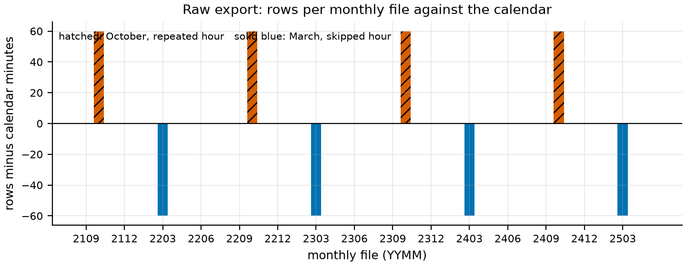

# Figure sheet: Stage 0: Raw data intake

Generated by `python -m solarpv.figures` from `outputs/figures/figures_manifest.json`; do not edit by hand. One sheet per task (`docs/figures_plan.md`, rule 7): what the task did, what it found and what that led to, for writing the report. Every takeaway is formatted from the facts its builder computed.

Figures: 1 (1 process, 0 correction).

## Process figures

### S00-01. Raw export: minutes per monthly file against the calendar

- **Question:** Is the raw SCADA export complete, and where does it deviate from one row per minute?
- **Shows:** Bars: rows in each of the monthly files minus the minutes of that calendar month. October files have extra rows and March files have missing rows; every other month is exact.
- **Takeaway:** 45 monthly files with 1,971,360 rows. Only the daylight-saving months deviate: 4 October files with +60 rows and 4 March files with -60 rows; no other file has a missing or duplicate minute.
- **Led to:** The export is written in local wall-clock time, so stage 2 converts it to UTC with the daylight-saving rule instead of dropping or averaging the repeated hour.
- **File:** `outputs/figures/stage_00/S00-01_raw_inventory.png`
- **Inputs:** `00_data_audit/raw_data_inventory.csv`
- **Built at commit:** `c263a41`
