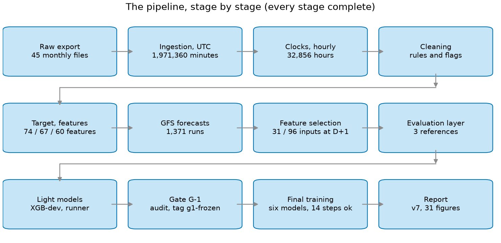
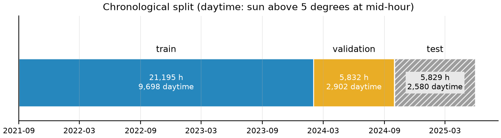
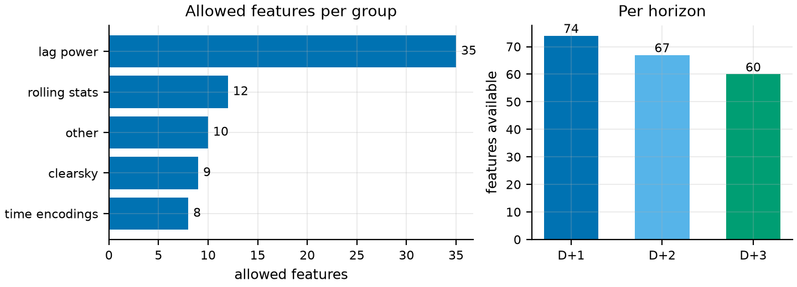

# Figure sheet: Stage 1: Infrastructure, splits and leakage contract

Generated by `python -m solarpv.figures` from `outputs/figures/figures_manifest.json`; do not edit by hand. One sheet per task (`docs/figures_plan.md`, rule 7): what the task did, what it found and what that led to, for writing the report. Every takeaway is formatted from the facts its builder computed.

Figures: 3 (3 process, 0 correction).

## Process figures

### S01-01. The pipeline, stage by stage

- **Question:** What are the stages from the raw export to the report, and what does each one produce?
- **Shows:** Twelve boxes in reading order, each with the stage's main output. Every stage is complete; the final training ran once, on the code frozen at gate G-1.
- **Takeaway:** From 45 raw files to 1,971,360 UTC minutes, 32,856 hourly rows, 74 / 67 / 60 candidate features per horizon plus 1,371 weather-forecast runs, and 31 (indirect) and 96 (direct) model inputs at D+1. The final run completed 14 steps on the frozen code, and the report holds 31 figures.
- **Led to:** Each stage is built and checked before the next one starts; the final training runs once on frozen code after gate G-1 (D-08).
- **File:** `outputs/figures/stage_01/S01-01_pipeline.png`
- **Inputs:** `00_data_audit/raw_data_inventory.csv`, `data/processed/01_ingest/ingest_manifest.json`, `data/processed/06_features/features_manifest.json`, `outputs/06b_gfs/gfs_manifest.json`, `outputs/07_feature_selection/model_inputs.json`, `outputs/runs/20261114T083930Z_final/run.json`, `docs/report_v7_figures.csv`
- **Built at commit:** `a407f85+dirty`

### S01-02. Train, validation and test periods

- **Question:** Which periods train, tune and finally test the models, and how many hours does each hold?
- **Shows:** Three consecutive bars on a calendar axis with the hours and the daytime hours of each period. The test period is hatched: it is read only in the final run.
- **Takeaway:** Chronological split without shuffling: train 21,195 hours (9,698 daytime), validation 5,832 (2,902 daytime), test 5,829 (2,580 daytime). Every selection and tuning step uses train and validation only.
- **Led to:** The split fixed the evaluation rule of every later stage: decisions on validation, the test period opened once in the final run after the code is frozen (D-08).
- **File:** `outputs/figures/stage_01/S01-02_splits.png`
- **Inputs:** `outputs/03_eda/tables/table_splits.csv`
- **Built at commit:** `a407f85+dirty`

### S01-03. The feature contract and the leakage list

- **Question:** Which candidate features may a model see, and how many remain at each horizon?
- **Shows:** Left: allowed features per group. Right: features available at each horizon, after the power lags that are not known at issuance are removed.
- **Takeaway:** 74 allowed features in 5 groups; 74 / 67 / 60 remain at D+1 / D+2 / D+3. The leakage list blocks 47 exact names and 13 name patterns (same-hour power, flags, quality columns, set-points).
- **Led to:** An allow-list, not a block-list, decides what reaches a model; the leakage tests run on every table and model input from stage 6 on.
- **File:** `outputs/figures/stage_01/S01-03_feature_contract.png`
- **Inputs:** `data/processed/06_features/features_manifest.json`
- **Built at commit:** `a407f85+dirty`
