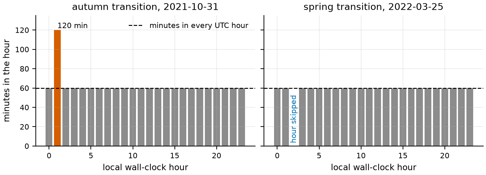
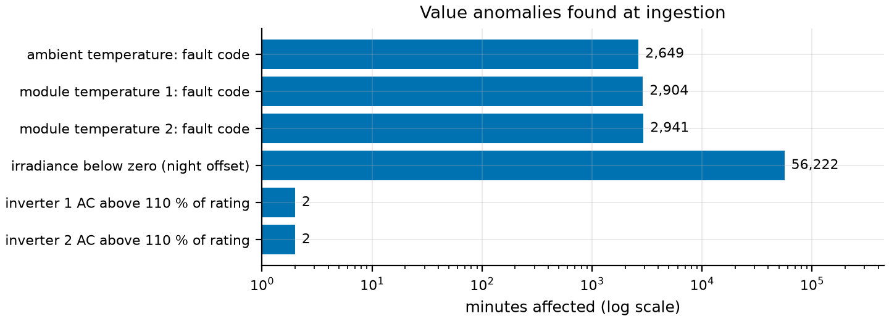
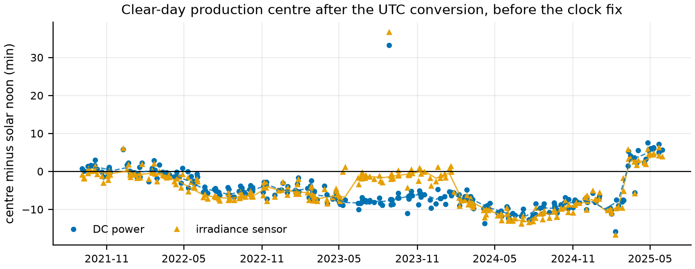

# Figure sheet: Stage 2: Ingestion and the UTC time base

Generated by `python -m solarpv.figures` from `outputs/figures/figures_manifest.json`; do not edit by hand. One sheet per task (`docs/figures_plan.md`, rule 7): what the task did, what it found and what that led to, for writing the report. Every takeaway is formatted from the facts its builder computed.

Figures: 3 (3 process, 0 correction).

## Process figures

### S02-01. Daylight-saving days on a continuous UTC grid

- **Question:** How are the repeated autumn hour and the skipped spring hour handled?
- **Shows:** Minutes per local wall-clock hour on the first autumn and the first spring transition day (bars), against the 60 minutes that every UTC hour holds (dashed line).
- **Takeaway:** 1,971,360 UTC minutes from 2021-08-31 21:00 to 2025-05-31 20:59, every UTC hour with exactly 60 minutes. On the 4 autumn days the local hour 01:00 holds 120 minutes (two distinct UTC hours); on the 4 spring days 02:00 local does not exist.
- **Led to:** All later stages work on this one UTC grid, so daily and hourly features never mix two clocks.
- **File:** `outputs/figures/stage_02/S02-01_dst_utc_grid.png`
- **Inputs:** `data/processed/01_ingest/ingest_manifest.json`
- **Built at commit:** `c263a41`

### S02-02. Value anomalies found at ingestion

- **Question:** What kinds of impossible or suspicious values does the raw export contain?
- **Shows:** Minutes affected per anomaly type, on a logarithmic axis because the counts range from a few minutes to tens of thousands.
- **Takeaway:** No missing or non-numeric cell. Temperature sensors carry a fault code (minimum -270) in 2,649-2,941 minutes each; irradiance is slightly negative at night in 56,222 minutes; 4 inverter minutes exceed 110 % of the inverter rating (up to 40,825 kW).
- **Led to:** Each anomaly type became an explicit cleaning rule with evidence for its threshold (stage 3b) and a logged effect (stage 5).
- **File:** `outputs/figures/stage_02/S02-02_raw_anomalies.png`
- **Inputs:** `data/processed/01_ingest/ingest_qa.csv`, `data/processed/01_ingest/ingest_manifest.json`
- **Built at commit:** `c263a41`

### S02-03. Production centre against solar noon after the UTC conversion

- **Question:** Once the time base is UTC, does production line up with the sun on clear days?
- **Shows:** Each point is one clear day: the centre of the DC power curve (circles) and of the irradiance curve (triangles) minus solar noon, in minutes.
- **Takeaway:** On 270 clear days the monthly medians stay within 13.2 min of solar noon (the stage-2 check allows 30), so the UTC conversion is right; but the medians drift from month to month (irradiance sensor -13.2 to 4.4 min) and the DC and irradiance medians differ by up to 6.7 min in the same month.
- **Led to:** The residual drift pointed to the logger clocks themselves: the per-day clock study (F-15) and the per-source correction of stage 4 (D-19).
- **File:** `outputs/figures/stage_02/S02-03_centroid_after_utc.png`
- **Inputs:** `data/processed/01_ingest/centroid_offsets.csv`
- **Built at commit:** `c263a41`
