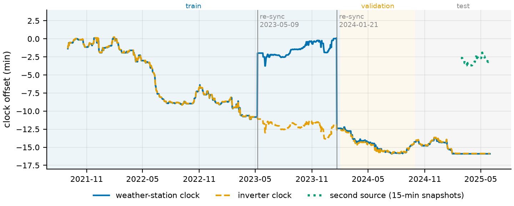
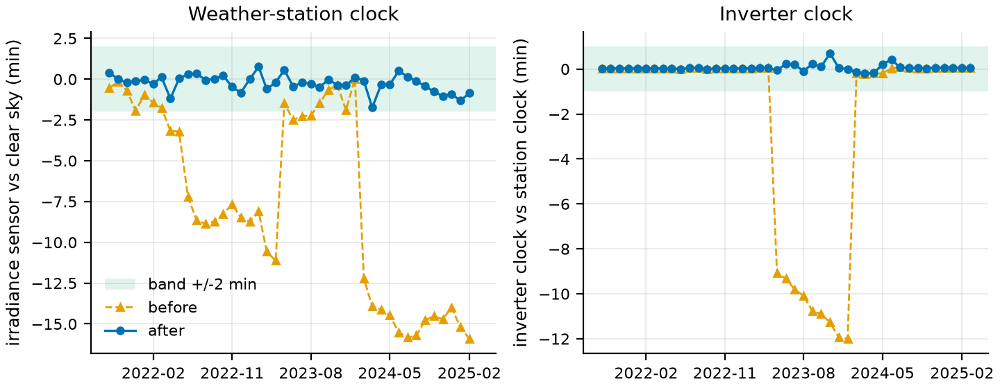
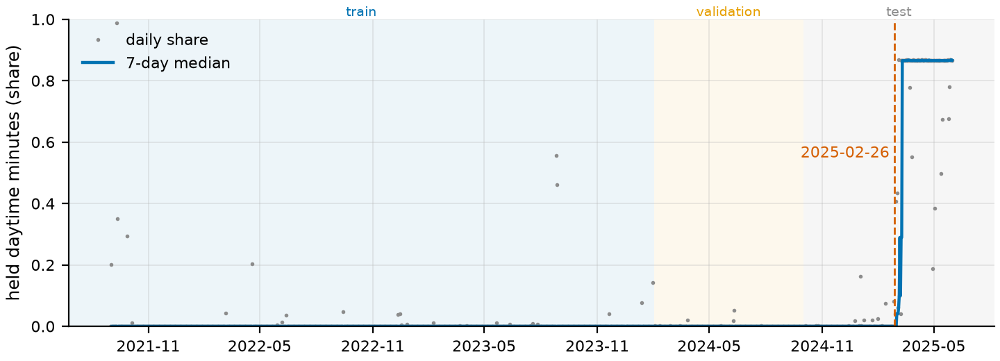

# Figure sheet: Stage 4: Logger clocks and hourly data

Generated by `python -m solarpv.figures` from `outputs/figures/figures_manifest.json`; do not edit by hand. One sheet per task (`docs/figures_plan.md`, rule 7): what the task did, what it found and what that led to, for writing the report. Every takeaway is formatted from the facts its builder computed.

Figures: 3 (3 process, 0 correction).

## Process figures

### S04-01. Logger clock offsets applied per day

- **Question:** How far were the logger clocks from true time, and how does the correction follow them?
- **Shows:** Daily offset (time stamp minus true time) of the weather-station clock (solid), the inverter clock (dashed) and the clock of the second data source (dotted), with the two re-synchronisations marked.
- **Takeaway:** Over 1,369 days the weather-station clock drifts down to -15.9 min and the inverter clock to -15.9 min; the clocks were re-synchronised on 2023-05-09 (weather station only) and 2024-01-21. The second source, from 2025-02-26, keeps its own clock (-3.7 to -1.9 min).
- **Led to:** Every minute is shifted by its own clock's offset of that day before the hourly means, so power, irradiance and the sun share one time base (D-19).
- **File:** `outputs/figures/stage_04/S04-01_clock_offsets.png`
- **Inputs:** `configs/clock_offsets.csv`
- **Built at commit:** `a407f85+dirty`

### S04-02. Clock check after the correction

- **Question:** Does the corrected data meet the acceptance bounds of the clock correction?
- **Shows:** Monthly median of the clear-day offset of the irradiance sensor against the clear-sky model (left) and of the inverter clock against the weather-station clock (right), before (triangles, dashed) and after (circles) the correction, with the acceptance bands.
- **Takeaway:** After the correction every one of the 43 months is inside the bands: the irradiance offset is at most 1.74 min (before: up to 15.9) and the inverter-to-station gap at most 0.70 min (before: up to 12.0).
- **Led to:** With the clocks aligned, the panel orientation was re-measured on the corrected data (21 degrees tilt, 185 degrees azimuth) and the hourly tables were built.
- **File:** `outputs/figures/stage_04/S04-02_clock_check.png`
- **Inputs:** `00_data_audit/clock_drift_2026-10-14/monthly_minute_before_after.csv`
- **Built at commit:** `a407f85+dirty`

### S04-03. The second data source: values held for 15 minutes

- **Question:** Did the way the data was recorded change during the period?
- **Shows:** Share of daytime minutes per day in which inverter-1 AC power repeats the previous minute exactly, over the whole period with the splits shaded.
- **Takeaway:** Before 2025-02-26, the first day of the second source, the daily median of repeated minutes is 0.0%; from that day on it is 86.6% (95 days, the two sources mixed hour by hour at first). The file still has a row per minute, but the value is a snapshot refreshed every 15 minutes.
- **Led to:** The second source was detected per tag and hour, rebuilt at its sampling instants with its own clock (D-20), and evaluated separately (D-21).
- **File:** `outputs/figures/stage_04/S04-03_second_source.png`
- **Inputs:** `data/processed/01_ingest/scada_1min_utc.parquet`, `configs/clock_offsets.csv`
- **Built at commit:** `a407f85+dirty`
