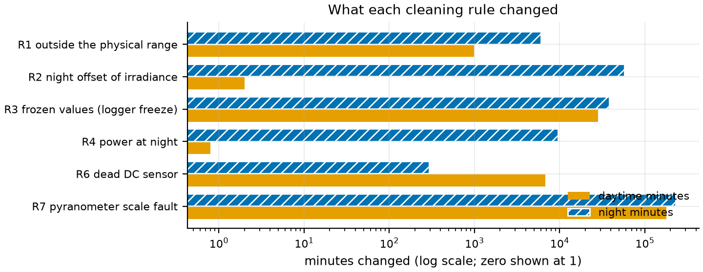
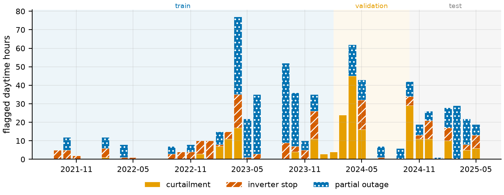

# Figure sheet: Stage 5: Cleaning

Generated by `python -m solarpv.figures` from `outputs/figures/figures_manifest.json`; do not edit by hand. One sheet per task (`docs/figures_plan.md`, rule 7): what the task did, what it found and what that led to, for writing the report. Every takeaway is formatted from the facts its builder computed.

Figures: 2 (2 process, 0 correction).

## Process figures

### S05-01. What each cleaning rule changed

- **Question:** How much data does each cleaning rule touch, by day and by night?
- **Shows:** Minutes set to missing or corrected by each rule (all columns), split into daytime and night minutes, on a logarithmic axis.
- **Takeaway:** 6 value rules touched 557,092 minutes; the largest is the pyranometer scale fault (409,160 minutes, a QA sensor that no model uses). On the power columns the rules changed 123,154 kWh, most of it in logger freezes that had repeated a value for hours.
- **Led to:** The cleaned minutes were re-aggregated to hours, and hours with downtime, curtailment or a partial inverter outage were flagged rather than deleted (D-22).
- **File:** `outputs/figures/stage_05/S05-01_cleaning_rules.png`
- **Inputs:** `outputs/05_cleaning/cleaning_log.csv`
- **Built at commit:** `123b2fb`

### S05-02. Operationally limited daytime hours per month

- **Question:** When was production limited by people or equipment rather than by the weather?
- **Shows:** Daytime hours per month carrying the operational flag, by cause: grid curtailment, inverter stop, partial inverter outage; the splits are shaded.
- **Takeaway:** 379 flagged daytime hours in train, 146 in validation and 186 in test: 218 curtailment, 157 stops and 336 partial outages in total.
- **Led to:** Flagged hours stay in the data and in the main evaluation, but are left out of the training loss and set to missing in the past-day features (D-22).
- **File:** `outputs/figures/stage_05/S05-02_operational_flags.png`
- **Inputs:** `data/processed/05_clean/scada_1H_clean.parquet`
- **Built at commit:** `123b2fb`
