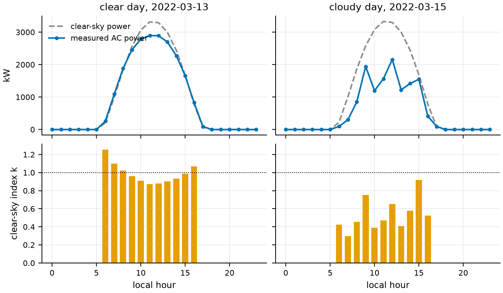
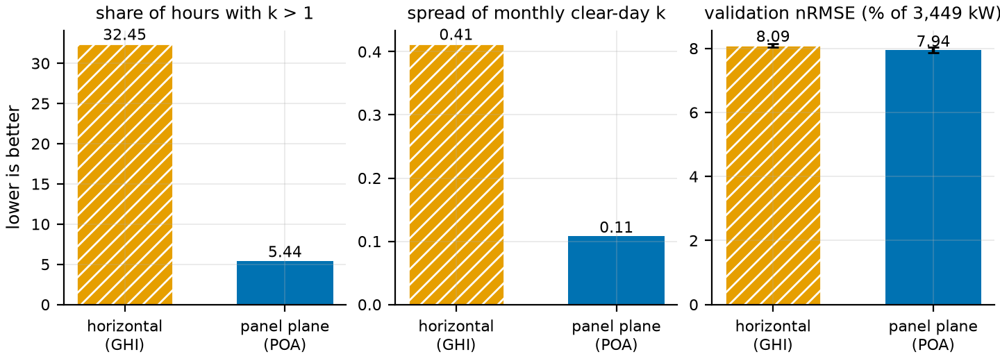
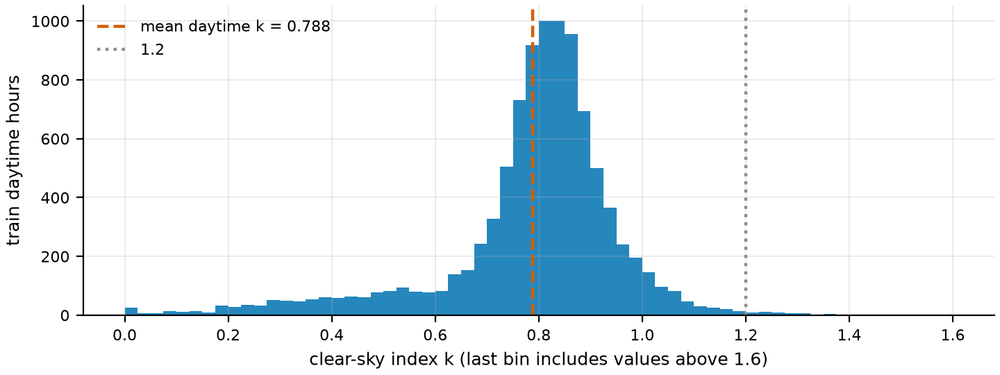
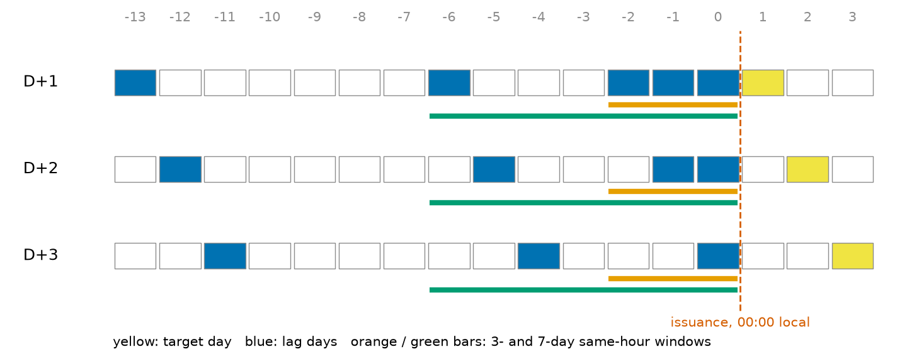
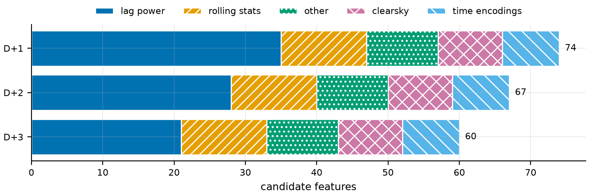

# Figure sheet: Stage 6: Target and features

Generated by `python -m solarpv.figures` from `outputs/figures/figures_manifest.json`; do not edit by hand. One sheet per task (`docs/figures_plan.md`, rule 7): what the task did, what it found and what that led to, for writing the report. Every takeaway is formatted from the facts its builder computed.

Figures: 5 (5 process, 0 correction).

## Process figures

### S06-01. From power to the clear-sky index on two days

- **Question:** How is the indirect target built from the measured power?
- **Shows:** Top: measured AC power and the clear-sky power of the panel plane on a clear and a cloudy day of {month} (train). Bottom: their hourly ratio, the clear-sky index k, on daytime hours.
- **Takeaway:** On the clear day (2022-03-13) the measured power follows the clear-sky curve: the daily k is 0.94, with hourly values from 0.87 to 1.25 (the highest at low sun). On the cloudy day (2022-03-15) the daily k is 0.54 and the hourly k drops to 0.30. Dividing by the clear-sky power removes the daily and seasonal shape and leaves the weather.
- **Led to:** k is the indirect target; it is converted back to kW by multiplying with the same clear-sky power, exactly, so both routes are scored in kW (F-06 fix, T-11).
- **File:** `outputs/figures/stage_06/S06-01_target_construction.png`
- **Inputs:** `data/processed/06_features/features_1H_D1.parquet`
- **Built at commit:** `c263a41`

### S06-02. Choosing the clear-sky reference of the target

- **Question:** Should k be measured against horizontal clear-sky irradiance or against clear-sky irradiance on the panel plane?
- **Shows:** The three criteria fixed before the comparison, for the horizontal (GHI) and the panel-plane (POA) reference: share of train daytime hours with k above 1, spread of the monthly clear-day k, and validation error in kW of a fixed XGBoost (mean and SD of 3 seeds).
- **Takeaway:** The panel-plane reference wins all three: k above 1 in 5.4% of hours against 32.4%, a monthly clear-day spread of 0.108 against 0.413, and 7.94 % against 8.09 % of capacity on validation.
- **Led to:** k is defined against the panel-plane clear-sky power (D-11), with no clipping; the mean daytime k on train becomes the normalising constant of the indirect route.
- **File:** `outputs/figures/stage_06/S06-02_clear_sky_reference.png`
- **Inputs:** `outputs/06_features/d11_criteria.csv`
- **Built at commit:** `c263a41`

### S06-03. The clear-sky index on train

- **Question:** What values does the target take, and is any clipping needed?
- **Shows:** Histogram of hourly k on valid daytime train hours in bins of 0.025, with the mean daytime k used to normalise the indirect error.
- **Takeaway:** 9,656 valid daytime train hours, one peak near 0.84, mean daytime k 0.788. Only 0.61% of hours exceed 1.2, 100% of them with the sun below 15 degrees, and no value sits at a cap, so k is kept as measured.
- **Led to:** No clipping: k converts back to the measured kW exactly, and the same rows feed the training masks of stage 9.
- **File:** `outputs/figures/stage_06/S06-03_k_distribution.png`
- **Inputs:** `data/processed/06_features/features_1H_D1.parquet`, `configs/derived_constants.yaml`
- **Built at commit:** `c263a41`

### S06-04. Which past days each horizon may use

- **Question:** Which measured days are known when the forecast is issued at local midnight, for each horizon?
- **Shows:** One row per horizon; columns are local days relative to the issuance midnight (dashed line). Filled squares: the power and weather lags allowed at that horizon; bars below: the 3- and 7-day same-hour windows.
- **Takeaway:** Lags allowed, in days back from the target day: D+1: 1, 2, 3, 7, 14; D+2: 2, 3, 7, 14; D+3: 3, 7, 14. The same-hour windows always end on the last day before issuance (day 0), whatever the horizon.
- **Led to:** Every history feature is built from days known at issuance, and a test plants a future day to check that it is caught (T-09, T-18).
- **File:** `outputs/figures/stage_06/S06-04_history_per_horizon.png`
- **Inputs:** drawn from the code
- **Built at commit:** `c263a41`

### S06-05. The candidate feature table per horizon

- **Question:** How many candidate features of each kind exist at each horizon, and how much had to be filled in?
- **Shows:** Stacked bars: candidate features per group at each horizon (contract only, before the weather forecasts are added).
- **Takeaway:** 74 / 67 / 60 candidates at D+1 / D+2 / D+3; only the power and weather lags shrink with the horizon. At most 3.56% of any feature's values are filled from the same hour of the previous 30 days.
- **Led to:** The table goes to feature selection together with the weather-forecast candidates of stage 6b.
- **File:** `outputs/figures/stage_06/S06-05_feature_table.png`
- **Inputs:** `outputs/06_features/feature_dictionary.csv`
- **Built at commit:** `c263a41`
