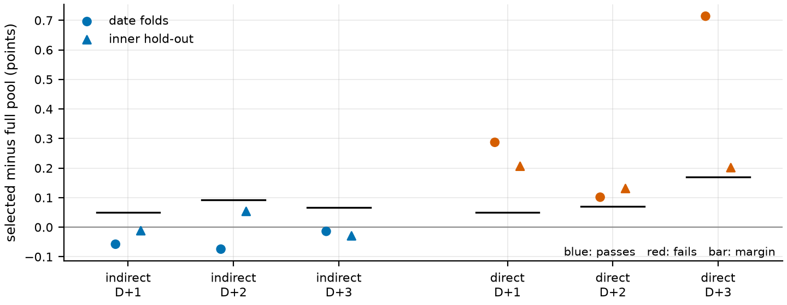
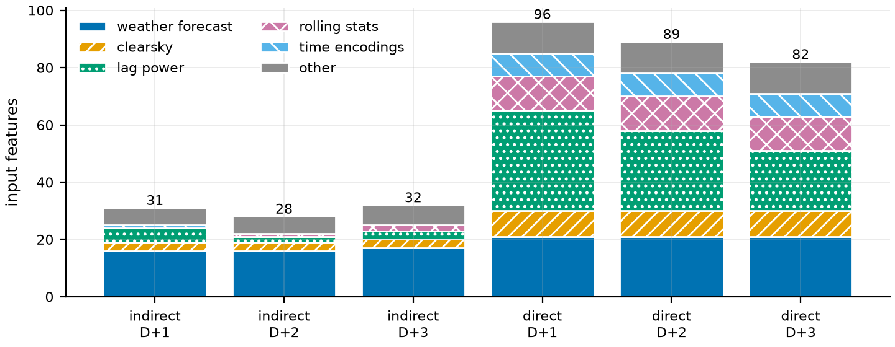

# Figure sheet: Stage 7: Feature selection

Generated by `python -m solarpv.figures` from `outputs/figures/figures_manifest.json`; do not edit by hand. One sheet per task (`docs/figures_plan.md`, rule 7): what the task did, what it found and what that led to, for writing the report. Every takeaway is formatted from the facts its builder computed.

Figures: 2 (2 process, 0 correction).

## Process figures

### S07-01. Selected sets against the full candidate pool, inside train

- **Question:** Does the selected feature set predict as well as the full candidate pool, before validation is opened?
- **Shows:** Error of the selected set minus error of the full pool (points; negative is better) on two train-only samples, with the acceptance margin of each case (short bars).
- **Takeaway:** Indirect route: the selected set passes in 6 of 6 checks (difference -0.07 to +0.05 points). Direct route: it fails in 6 of 6 (the selected set is worse by 0.10 to 0.71 points), because its importance is concentrated in a few features and the stability floor kept too few.
- **Led to:** The indirect route takes its selected sets, the direct route takes the full pool (F-29); the decision was committed before validation was looked at.
- **File:** `outputs/figures/stage_07/S07-01_inner_train_check.png`
- **Inputs:** `outputs/07_feature_selection/inner_train_check.csv`
- **Built at commit:** `a407f85+dirty`

### S07-02. Model inputs per route and horizon

- **Question:** What does each model finally receive, per route and horizon?
- **Shows:** Stacked bars: number of input features of each group for every route and horizon, as written in the model-input file read by stage 9.
- **Takeaway:** Indirect route: 31 / 28 / 32 inputs at D+1 / D+2 / D+3, of which 16 are weather-forecast variables at D+1. Direct route: 96 / 89 / 82 (the full pool, 21 forecast variables at D+1).
- **Led to:** These lists are the input of every model of stage 9 and stage 10; the runner checks them against the tables they were selected on.
- **File:** `outputs/figures/stage_07/S07-02_model_inputs.png`
- **Inputs:** `outputs/07_feature_selection/model_inputs.json`, `outputs/06_features/feature_dictionary.csv`
- **Built at commit:** `a407f85+dirty`
