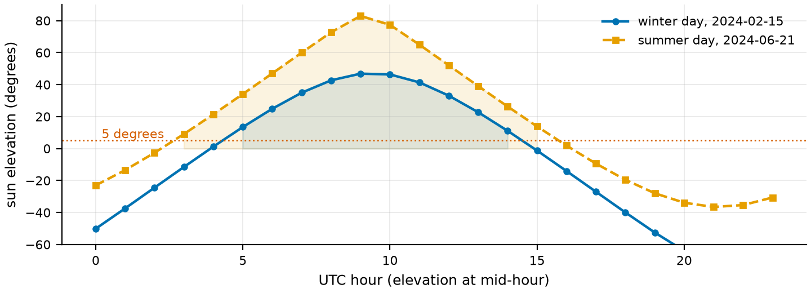
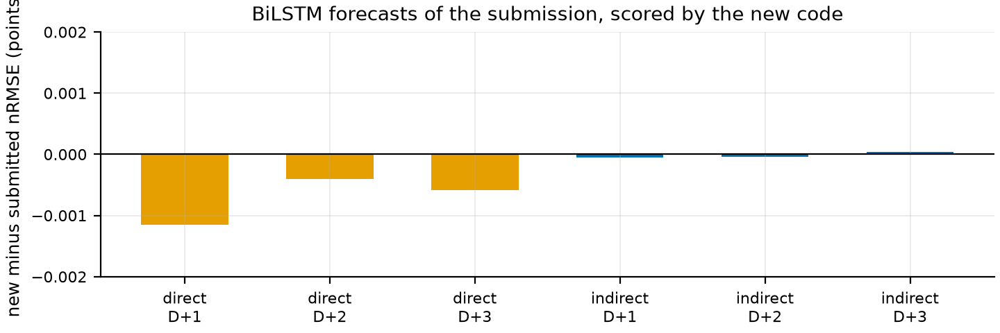
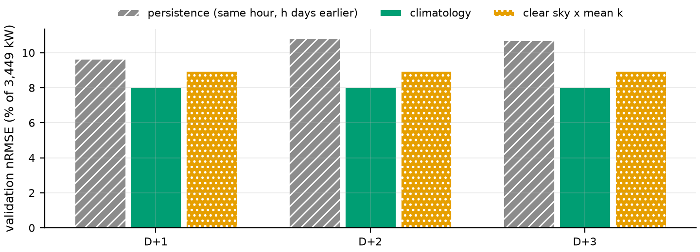
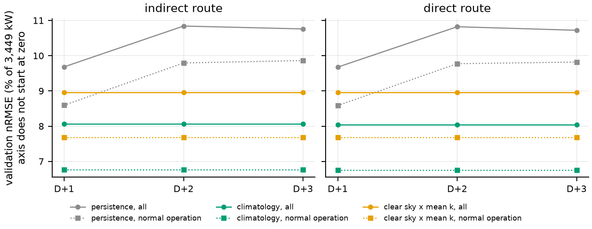

# Figure sheet: Stage 8: Evaluation layer

Generated by `python -m solarpv.figures` from `outputs/figures/figures_manifest.json`; do not edit by hand. One sheet per task (`docs/figures_plan.md`, rule 7): what the task did, what it found and what that led to, for writing the report. Every takeaway is formatted from the facts its builder computed.

Figures: 4 (4 process, 0 correction).

## Process figures

### S08-01. Which hours are scored

- **Question:** Which hours count in the evaluation, and how many are there on validation?
- **Shows:** Sun elevation at the middle of each UTC hour on a winter and a summer validation day; hours above the 5-degree line (shaded) are scored.
- **Takeaway:** An hour is scored when the sun is above 5 degrees at its middle: 10 hours on 2024-02-15 and 13 on 2024-06-21. Validation has 2,901 scored hours with a measured truth; every model and reference is scored on exactly these hours.
- **Led to:** One daytime rule from geometry only, the same for both routes and all models, so the errors are comparable (T-39).
- **File:** `outputs/figures/stage_08/S08-01_evaluation_hours.png`
- **Inputs:** `outputs/07_evaluation/val/benchmark_summary.csv`
- **Built at commit:** `123b2fb`

### S08-02. Evaluation code checked on the surviving forecasts

- **Question:** Does the new evaluation code compute the metrics the same way as the submitted study?
- **Shows:** For the one model whose forecasts survived (BiLSTM), the nRMSE computed by the new code minus the nRMSE in the submitted benchmark table, per route and horizon, with equal hour counts.
- **Takeaway:** On the same forecasts the new code reproduces the submitted nRMSE within 0.0001 points (indirect) and 0.0012 points (direct), on the same 2,510-2,514 hours: the metric definitions did not change, so later differences come from the data and the models.
- **Led to:** The evaluation layer was then run on the rebuild's own tables (validation only) with the references and statistical tests.
- **File:** `outputs/figures/stage_08/S08-02_evaluation_code_check.png`
- **Inputs:** `outputs/07_evaluation_fixture/benchmark_summary.csv`, `submission_evidence/01_benchmark/benchmark_summary.csv`
- **Built at commit:** `123b2fb`

### S08-03. Reference forecasts on validation

- **Question:** How hard is the forecasting problem, judged by simple references?
- **Shows:** Validation nRMSE in kW of the three references at each horizon (direct target).
- **Takeaway:** Climatology (8.04 %) beats persistence at every horizon (9.68 / 10.82 / 10.72 %), since a day says little about the next one; clear sky times the mean k gives 8.96 %. A model must beat climatology to be useful. The indirect-route references, converted to kW, differ from these by at most 0.04 points.
- **Led to:** These references are the yardstick of the skill scores and the significance tests of stage 9.
- **File:** `outputs/figures/stage_08/S08-03_references.png`
- **Inputs:** `outputs/07_evaluation/val/benchmark_summary.csv`
- **Built at commit:** `123b2fb`

### S08-04. The secondary views of the evaluation

- **Question:** How do the secondary views (normal operation, data source) change the references' errors on validation?
- **Shows:** Validation nRMSE in kW per horizon of the three references on all scored hours, without the operationally limited hours (D-22), and on the hours of each data source (D-21), both routes.
- **Takeaway:** Leaving out the operationally limited hours (146 per horizon) lowers the references' error by 0.90 to 1.30 points. The data-source views equal all hours on validation, because no validation hour comes from the second source.
- **Led to:** Every model is reported in the same views (S09-30); the main score stays all scored hours (C-35).
- **File:** `outputs/figures/stage_08/S08-04_evaluation_views.png`
- **Inputs:** `outputs/07_evaluation/val/benchmark_views.csv`
- **Built at commit:** `82b512a`
