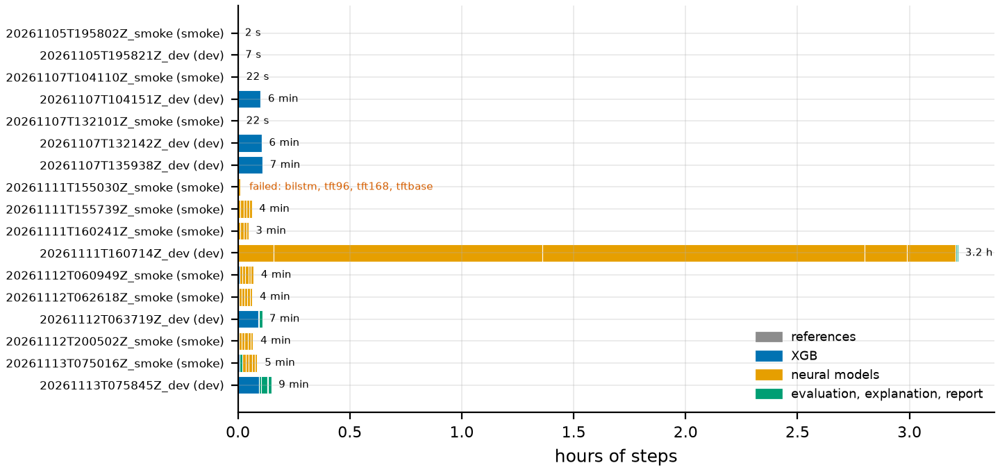

# Figure sheet: Stage 9, W1: The runner, the baselines and the evaluate step

Generated by `python -m solarpv.figures` from `outputs/figures/figures_manifest.json`; do not edit by hand. One sheet per task (`docs/figures_plan.md`, rule 7): what the task did, what it found and what that led to, for writing the report. Every takeaway is formatted from the facts its builder computed.

Plan and self-review of the task: `docs/stage9_plan.md §10`.

Figures: 2 (2 process, 0 correction).

## Process figures

### S09-01. Run modes of the pipeline runner

- **Question:** How is a development run kept away from the test period, and when may the final run start?
- **Shows:** Three run modes, the data each one may read, and the gate in front of the final run.
- **Takeaway:** Smoke: a short slice to test the plumbing. Development: train and validation, 20 tuning trials, seed 42. Final: 60 trials, seeds 42, 123, 777, and the only mode that reads the test period, refused unless the code carries the frozen tag.
- **Led to:** Light models are developed in the dev mode until gate G-1; the final run of the six models happens once (stage 10).
- **File:** `outputs/figures/stage_09/S09-01_run_modes.png`
- **Inputs:** drawn from the code
- **Built at commit:** `c263a41`

### S09-33. The runs of stage 9 so far

- **Question:** Which runs did stage 9 make, in which mode, and where did the time go?
- **Shows:** Every run folder of stage 9 in order: the duration of each step (hours), coloured by kind (references, XGB, neural models, and evaluation with explanation and report); the label gives the mode.
- **Takeaway:** 17 runs: 10 smoke and 7 development, no final run. 4.2 h of steps in all, 84 % of them in the neural models; the longest run is 20261111T160714Z_dev (3.2 h). 4 steps failed, in 20261111T155030Z_smoke, and each passed in the next run that ran it. Each run keeps its configuration hash, and every completed step its commit and fingerprint.
- **Led to:** The final run adds one folder; its time is estimated in S09-18.
- **File:** `outputs/figures/stage_09/S09-33_stage9_runs.png`
- **Inputs:** `outputs/runs/20261105T195802Z_smoke/run.json`, `outputs/runs/20261105T195821Z_dev/run.json`, `outputs/runs/20261107T104110Z_smoke/run.json`, `outputs/runs/20261107T104151Z_dev/run.json`, `outputs/runs/20261107T132101Z_smoke/run.json`, `outputs/runs/20261107T132142Z_dev/run.json`, `outputs/runs/20261107T135938Z_dev/run.json`, `outputs/runs/20261111T155030Z_smoke/run.json`, `outputs/runs/20261111T155739Z_smoke/run.json`, `outputs/runs/20261111T160241Z_smoke/run.json`, `outputs/runs/20261111T160714Z_dev/run.json`, `outputs/runs/20261112T060949Z_smoke/run.json`, `outputs/runs/20261112T062618Z_smoke/run.json`, `outputs/runs/20261112T063719Z_dev/run.json`, `outputs/runs/20261112T200502Z_smoke/run.json`, `outputs/runs/20261113T075016Z_smoke/run.json`, `outputs/runs/20261113T075845Z_dev/run.json`
- **Built at commit:** `c263a41`
