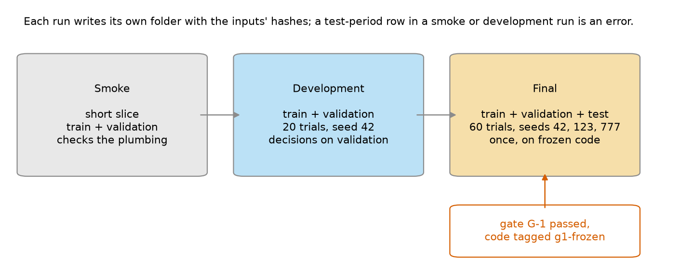

# Figure sheet: Stage 9, W1: The runner, the baselines and the evaluate step

Generated by `python -m solarpv.figures` from `outputs/figures/figures_manifest.json`; do not edit by hand. One sheet per task (`docs/figures_plan.md`, rule 7): what the task did, what it found and what that led to, for writing the report. Every takeaway is formatted from the facts its builder computed.

Plan and self-review of the task: `docs/stage9_plan.md §10`.

Figures: 1 (1 process, 0 correction).

## Process figures

### S09-01. Run modes of the pipeline runner

- **Question:** How is a development run kept away from the test period, and when may the final run start?
- **Shows:** Three run modes, the data each one may read, and the gate in front of the final run.
- **Takeaway:** Smoke: a short slice to test the plumbing. Development: train and validation, 20 tuning trials, seed 42. Final: 60 trials, seeds 42, 123, 777, and the only mode that reads the test period, refused unless the code carries the frozen tag.
- **Led to:** Light models are developed in the dev mode until gate G-1; the final run of the six models happens once (stage 10).
- **File:** `outputs/figures/stage_09/S09-01_run_modes.png`
- **Inputs:** drawn from the code
- **Built at commit:** `a0ad8ec`
