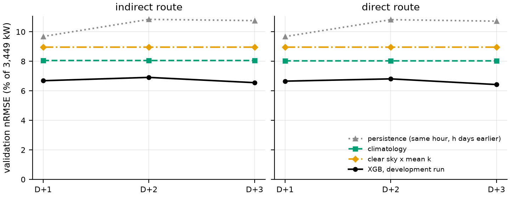
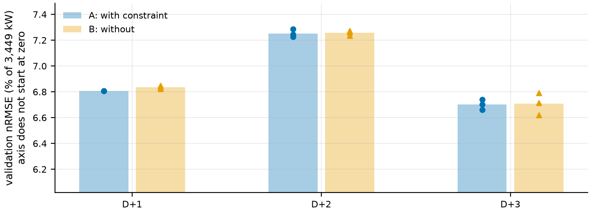
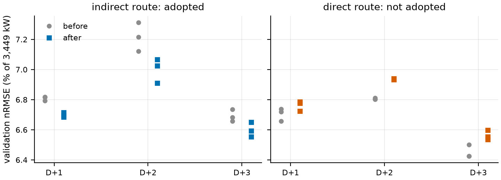
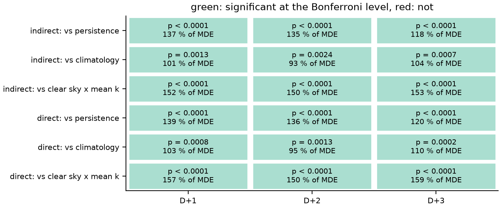
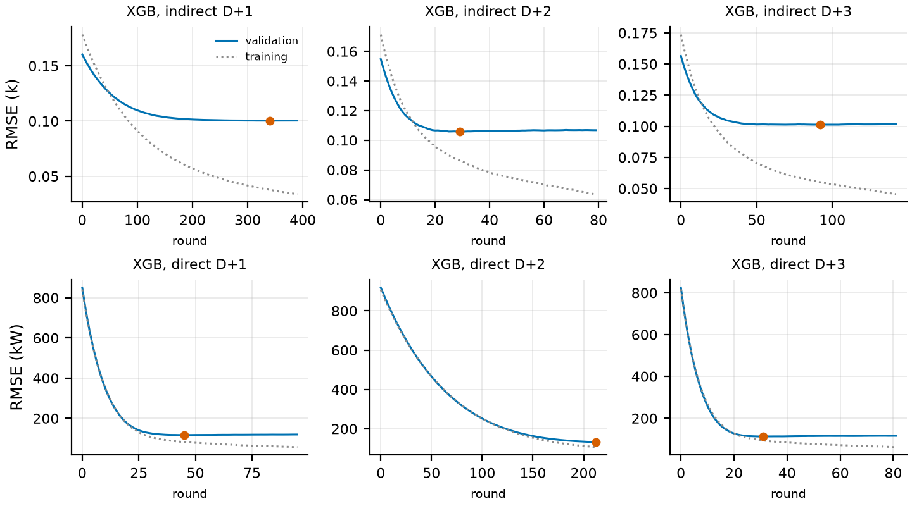
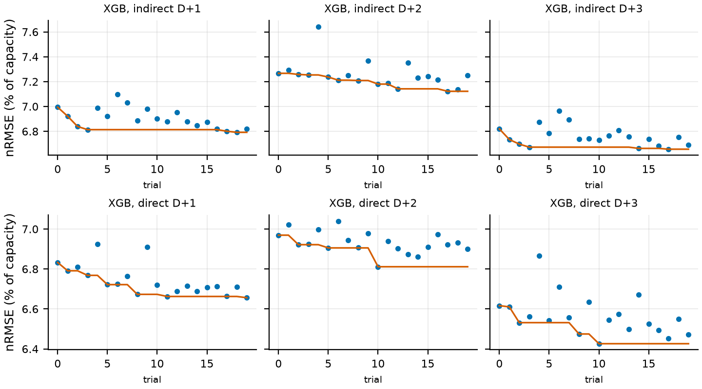

# Figure sheet: Stage 9, W2: The XGB step and its development run

Generated by `python -m solarpv.figures` from `outputs/figures/figures_manifest.json`; do not edit by hand. One sheet per task (`docs/figures_plan.md`, rule 7): what the task did, what it found and what that led to, for writing the report. Every takeaway is formatted from the facts its builder computed.

Plan and self-review of the task: `docs/stage9_plan.md §13–§16`.

Figures: 6 (6 process, 0 correction).

## Process figures

### S09-02. XGB development run against the references

- **Question:** Does a lightly tuned XGBoost beat the references on validation, in both routes?
- **Shows:** Validation nRMSE in kW per horizon for the development XGBoost and the three references, for the indirect route (left, converted to kW) and the direct route (right).
- **Takeaway:** XGB-dev: 6.69 / 6.91 / 6.55 % (indirect) and 6.66 / 6.81 / 6.43 % (direct), below climatology (8.04 %) and persistence at every horizon. These are tuning-split numbers, optimistic by construction; the unbiased test comes once, in the final run.
- **Led to:** The pipeline runs end to end with a light model; the neural models are added next (W4) on the same datasets and scoring.
- **File:** `outputs/figures/stage_09/S09-02_xgb_dev_vs_references.png`
- **Inputs:** `outputs/runs/20261107T135938Z_dev/evaluate/val/benchmark_summary.csv`
- **Built at commit:** `9ad5af7+dirty`

### S09-03. Monotone constraint on clear-sky irradiance

- **Question:** Should the indirect model keep the submitted study's rule that the prediction may only rise with clear-sky irradiance?
- **Shows:** Validation nRMSE in kW of a fixed XGBoost with the constraint (A) and without it (B), three seeds each (points) and their means (bars), per horizon.
- **Takeaway:** Dropping the constraint does not help: the gain is -0.029 / -0.005 / -0.006 points at D+1 / D+2 / D+3, against a pre-registered margin of 0.05 at D+1.
- **Led to:** The constraint stays in both routes as in the submitted study (D-15); its exact feature list is now checked against the trained model.
- **File:** `outputs/figures/stage_09/S09-03_monotone_check.png`
- **Inputs:** `outputs/09_xgb_checks/d15_check.csv`, `configs/monotone_decision.yaml`
- **Built at commit:** `a0ad8ec`

### S09-04. Linear correction of the forecast in kW

- **Question:** Does a straight-line correction of the forecast, fitted inside train, reduce the error?
- **Shows:** Validation nRMSE in kW before (circles) and after (squares) the correction a + b x forecast, fitted on out-of-fold train forecasts; three seeds per horizon and route.
- **Takeaway:** Indirect route: the error drops by 0.11 / 0.22 / 0.09 points, above every margin, so the correction is adopted. Direct route: it rises by 0.06 / 0.13 / 0.11 points, so it is not used.
- **Led to:** The correction runs inside the XGB step for the indirect route, refitted on each run (L-09); the uncorrected forecast is kept beside it.
- **File:** `outputs/figures/stage_09/S09-04_linear_correction.png`
- **Inputs:** `outputs/09_xgb_checks/l09_check.csv`, `configs/mos_decision.yaml`
- **Built at commit:** `a0ad8ec`

### S09-05. Are the differences significant? Diebold-Mariano in kW

- **Question:** Is XGB-dev better than each reference beyond what chance in the validation hours allows?
- **Shows:** Grid of the Bonferroni-corrected Diebold-Mariano tests (squared error in kW, HLN correction): each cell is XGB-dev against one reference at one horizon; the text is the p-value and the observed effect as a share of the minimum detectable effect.
- **Takeaway:** XGB-dev is significantly better in 18 of 18 comparisons. Against climatology the effect is 93% to 110% of the minimum detectable effect: real, but modest.
- **Led to:** The kW table is the primary acceptance test of the final run (Q-19); the k-unit table is kept as secondary.
- **File:** `outputs/figures/stage_09/S09-05_significance_kw.png`
- **Inputs:** `outputs/runs/20261107T135938Z_dev/evaluate/val/dm_tests_kw.csv`
- **Built at commit:** `a0ad8ec`

### S09-31. Learning curves of the XGB final fits

- **Question:** Did the final XGB fits of the development run converge, and where did early stopping act?
- **Shows:** Validation RMSE (solid) and training RMSE (dotted) per boosting round of each final fit (indirect route in k, top; direct route in kW, bottom; one fit per horizon); the dot marks the best round, after which early stopping waited 50 more rounds. Same layout as the neural curves (S09-08).
- **Takeaway:** The best rounds lie between 29 and 340. Early stopping ended 5 of 6 fits after 50 rounds without a better validation error; in 1 the best round was the last one allowed. Where the fit went on, the training error kept falling after the best round.
- **Led to:** The final run keeps early stopping with 50 rounds; its curves are compared with these in the review of stage 10.
- **File:** `outputs/figures/stage_09/S09-31_xgb_learning_curves.png`
- **Inputs:** `outputs/runs/20261112T063719Z_dev/xgb/learning_curves.csv`, `outputs/runs/20261112T063719Z_dev/xgb/best_params.json`
- **Built at commit:** `9ad5af7+dirty`

### S09-32. Optuna searches of XGB

- **Question:** How did the XGB searches progress within their development budget?
- **Shows:** Validation nRMSE in kW of every trial (points) and the best so far (line), per route and horizon; one study per route and horizon with seed 42. Same layout as the neural searches (S09-10).
- **Takeaway:** 120 trials in all; the best trial improved on the first by 0.14 to 0.20 points, and 4 of 6 studies found their best value in the last quarter of their trials.
- **Led to:** The final run searches 60 trials per study in the same space (the v6 budget).
- **File:** `outputs/figures/stage_09/S09-32_xgb_optimization.png`
- **Inputs:** `outputs/runs/20261112T063719Z_dev/xgb/trials.csv`
- **Built at commit:** `9ad5af7+dirty`
