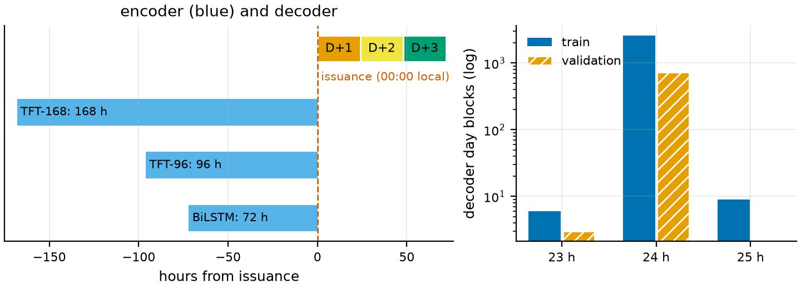

# Figure sheet: Stage 9, W3: The datasets of the sequence models

Generated by `python -m solarpv.figures` from `outputs/figures/figures_manifest.json`; do not edit by hand. One sheet per task (`docs/figures_plan.md`, rule 7): what the task did, what it found and what that led to, for writing the report. Every takeaway is formatted from the facts its builder computed.

Plan and self-review of the task: `docs/stage9_plan.md §17`.

Figures: 1 (1 process, 0 correction).

## Process figures

### S09-06. Sequence datasets: one forecast origin per local day

- **Question:** How are the sequence models fed so that they forecast the same hours as XGB?
- **Shows:** Left: one forecast origin at local midnight, with the encoder history of each model and the decoder covering the next three local days. Right: decoder block lengths of the train and validation origins (23 and 25 hours on daylight-saving days).
- **Takeaway:** 872 train and 246 validation origins, one per local day. Blocks are 3,324 days of 24 hours, 9 of 23 and 9 of 25; every check passed (each hour forecast once per horizon, the encoder ends at issuance, no step reaches the test period). The encoders of the 5 models hold 72 to 168 hours.
- **Led to:** BiLSTM, the three TFTs and PatchTST read these datasets in W4, with the loss on exactly the rows XGB is trained on.
- **File:** `outputs/figures/stage_09/S09-06_sequence_datasets.png`
- **Inputs:** `outputs/09_sequence_data/checks_dev.csv`, `outputs/09_sequence_data/dataset_report_dev.json`
- **Built at commit:** `c263a41`
