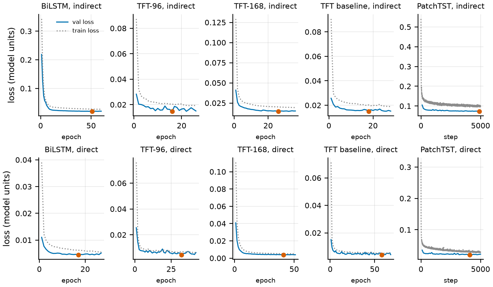
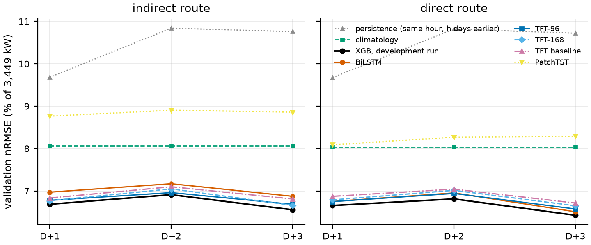
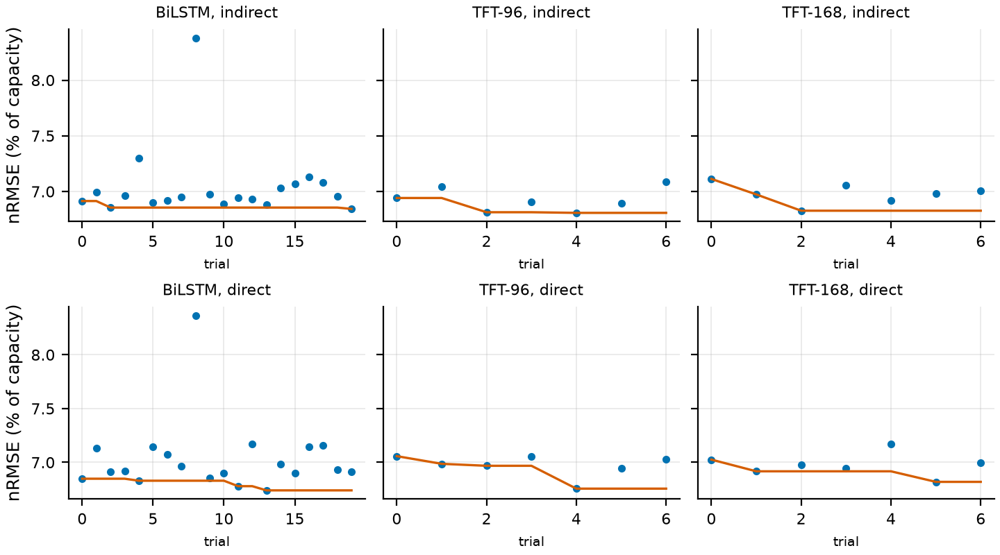
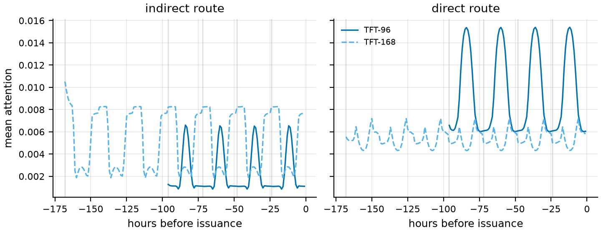
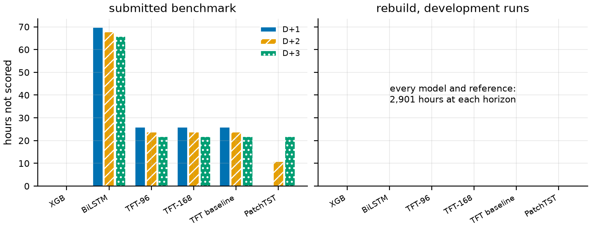
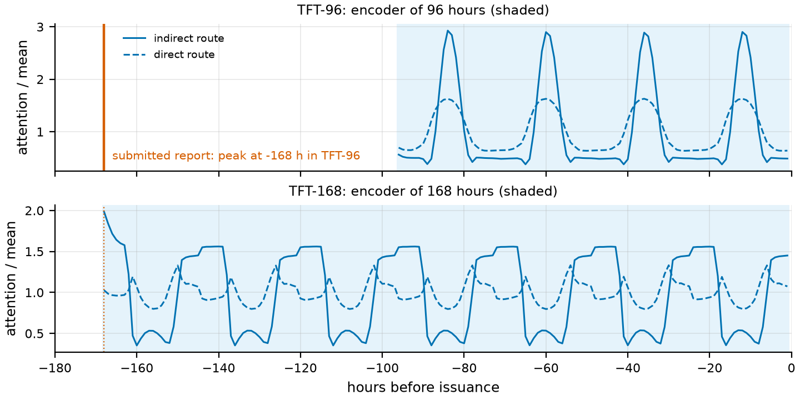

# Figure sheet: Stage 9, W4: The five neural models

Generated by `python -m solarpv.figures` from `outputs/figures/figures_manifest.json`; do not edit by hand. One sheet per task (`docs/figures_plan.md`, rule 7): what the task did, what it found and what that led to, for writing the report. Every takeaway is formatted from the facts its builder computed.

Plan and self-review of the task: `docs/stage9_plan.md §18`.

Figures: 9 (6 process, 3 correction).

## Process figures

### S09-07. Smoke runs of the five neural models

- **Question:** Do the five neural steps run end to end on the GPU, and do they reproduce?
- **Shows:** Median seconds per training epoch of each final fit (PatchTST: per validation check) in the smoke run (a few weeks of training windows) and in the development run (the whole training split), log scale.
- **Takeaway:** All five steps and the evaluation passed the smoke run; a second smoke run with the same seed gave identical losses for 4 models. In development an epoch takes 0.3 s (BiLSTM) to 7.5 s (TFT-168); the run took 3.2 h.
- **Led to:** The development run used the budgets approved by the user (§18.6); the final run can rely on reproducible training.
- **File:** `outputs/figures/stage_09/S09-07_neural_smoke.png`
- **Inputs:** `outputs/runs/20261111T155739Z_smoke/bilstm/learning_curves.csv`, `outputs/runs/20261111T155739Z_smoke/tft96/learning_curves.csv`, `outputs/runs/20261111T155739Z_smoke/tft168/learning_curves.csv`, `outputs/runs/20261111T155739Z_smoke/tftbase/learning_curves.csv`, `outputs/runs/20261111T155739Z_smoke/patchtst/learning_curves.csv`, `outputs/runs/20261111T160241Z_smoke/bilstm/learning_curves.csv`, `outputs/runs/20261111T160241Z_smoke/tft96/learning_curves.csv`, `outputs/runs/20261111T160241Z_smoke/tftbase/learning_curves.csv`, `outputs/runs/20261111T160241Z_smoke/patchtst/learning_curves.csv`, `outputs/runs/20261111T160714Z_dev/bilstm/learning_curves.csv`, `outputs/runs/20261111T160714Z_dev/tft96/learning_curves.csv`, `outputs/runs/20261111T160714Z_dev/tft168/learning_curves.csv`, `outputs/runs/20261111T160714Z_dev/tftbase/learning_curves.csv`, `outputs/runs/20261111T160714Z_dev/patchtst/learning_curves.csv`, `outputs/runs/20261111T160714Z_dev/run.json`
- **Built at commit:** `46881ae+dirty`

### S09-08. Learning curves of the neural models

- **Question:** Did the final fits of the development run converge, and where did early stopping act?
- **Shows:** Validation loss (solid) and training loss (dotted) of each final fit, per epoch (PatchTST: per validation check), indirect route (top) and direct route (bottom); the dot marks the restored best epoch.
- **Takeaway:** Early stopping ended 7 of 8 epoch-based fits before their budget; the best epochs lie between 16 and 58. 0 fits had their best epoch at the last epoch.
- **Led to:** The warnings of the run are read in the review (R9-17); the curves are the reference for the final run's longer budgets.
- **File:** `outputs/figures/stage_09/S09-08_neural_learning_curves.png`
- **Inputs:** `outputs/runs/20261111T160714Z_dev/bilstm/best_params.json`, `outputs/runs/20261111T160714Z_dev/tft96/best_params.json`, `outputs/runs/20261111T160714Z_dev/tft168/best_params.json`, `outputs/runs/20261111T160714Z_dev/tftbase/best_params.json`, `outputs/runs/20261111T160714Z_dev/patchtst/best_params.json`, `outputs/runs/20261111T160714Z_dev/bilstm/learning_curves.csv`, `outputs/runs/20261111T160714Z_dev/tft96/learning_curves.csv`, `outputs/runs/20261111T160714Z_dev/tft168/learning_curves.csv`, `outputs/runs/20261111T160714Z_dev/tftbase/learning_curves.csv`, `outputs/runs/20261111T160714Z_dev/patchtst/learning_curves.csv`
- **Built at commit:** `a0ad8ec`

### S09-09. Neural models in the development run

- **Question:** How do the five neural models score on validation, next to XGB and the references?
- **Shows:** Validation nRMSE in kW per horizon of the five neural models (development budgets, one seed), the development XGBoost and two references; indirect route converted to kW (left), direct route (right). Every model and reference is scored on the same validation hours.
- **Takeaway:** All 6 models and the 3 references are scored on the same 2,901 validation daytime hours per horizon. Best neural model at D+1: TFT-168 (6.77 %) in the indirect route and TFT-96 (6.75 %) in the direct route, against XGB-dev 6.69 / 6.66 %. 30 of 30 neural cases are below persistence. Tuning-split numbers with reduced budgets: they rank nothing.
- **Led to:** The final run (stage 10) trains every model with the v6 budgets on the frozen code; the comparison of families is made there, on the test split.
- **File:** `outputs/figures/stage_09/S09-09_neural_dev_results.png`
- **Inputs:** `outputs/runs/20261111T160714Z_dev/evaluate/val/benchmark_summary.csv`, `outputs/runs/20261107T135938Z_dev/evaluate/val/benchmark_summary.csv`
- **Built at commit:** `d21a43b`

### S09-10. Optuna searches of the neural models

- **Question:** How did the searches of BiLSTM, TFT-96 and TFT-168 progress within their development budgets?
- **Shows:** Validation nRMSE in kW of every trial (points) and the best so far (line), per model and target; one study per target with seed 42.
- **Takeaway:** 68 trials in all; the best trial improved on the first by 0.07 to 0.30 points. Best values on the edge of the search space: 4 of 6 studies (the warning of §3.5, M23).
- **Led to:** The final run searches 60 (BiLSTM) and 20 (TFT) trials in the same spaces; an edge result goes to the list of G-1.
- **File:** `outputs/figures/stage_09/S09-10_neural_optimization.png`
- **Inputs:** `outputs/runs/20261111T160714Z_dev/bilstm/trials.csv`, `outputs/runs/20261111T160714Z_dev/tft96/trials.csv`, `outputs/runs/20261111T160714Z_dev/tft168/trials.csv`, `outputs/runs/20261111T160714Z_dev/bilstm/best_params.json`, `outputs/runs/20261111T160714Z_dev/tft96/best_params.json`, `outputs/runs/20261111T160714Z_dev/tft168/best_params.json`
- **Built at commit:** `a0ad8ec`

### S09-11. Where the TFT models look in their encoder

- **Question:** Over which past hours does the attention of TFT-96 and TFT-168 fall?
- **Shows:** Mean encoder attention of the validation forecasts (all decoder steps, all heads) by lag before issuance, for TFT-96 and TFT-168, indirect route (left) and direct route (right).
- **Takeaway:** Each model attends only inside its own encoder (96 and 168 hours), with a daily rhythm (correlation of the profile with itself shifted by 24 h: at least 1.00). Within the last day the weights peak 12 h (TFT-96) and 20 h (TFT-168) before issuance in the indirect route, 12 h and 6 h in the direct route. TFT-168's indirect weights also rise at the first position of its encoder (0.0105 against a mean of 0.0053): an edge of the window, not a lag.
- **Led to:** Stage 11 reads the attention of the final models (S-33); a peak can only be claimed at a lag that the encoder contains (M22).
- **File:** `outputs/figures/stage_09/S09-11_tft_attention.png`
- **Inputs:** `outputs/runs/20261111T160714Z_dev/tft96/attention_indirect_seed42.csv`, `outputs/runs/20261111T160714Z_dev/tft96/attention_direct_seed42.csv`, `outputs/runs/20261111T160714Z_dev/tft168/attention_indirect_seed42.csv`, `outputs/runs/20261111T160714Z_dev/tft168/attention_direct_seed42.csv`
- **Built at commit:** `a0ad8ec`

### S09-12. Mean bias of the neural models

- **Question:** Do the neural forecasts carry a systematic bias on validation, and does it differ from training?
- **Shows:** Mean bias (forecast minus actual AC, % of capacity) on the scored daytime hours of the training windows (light) and the validation windows (dark), per model and route; the lines mark XGB-dev on validation (R-14; the indirect route before its linear correction).
- **Takeaway:** On validation the neural biases range from +0.37 to +2.73 % of capacity (XGB-dev: +0.74 % direct, +1.31 % indirect). The largest change from training to validation is 0.63 points (PatchTST, direct).
- **Led to:** The bias diagnostics of stage 11 (L-15) read the final run; no correction is applied to the neural models in W4 (§18.1).
- **File:** `outputs/figures/stage_09/S09-12_neural_bias.png`
- **Inputs:** `outputs/runs/20261111T160714Z_dev/bilstm/mbe.csv`, `outputs/runs/20261111T160714Z_dev/tft96/mbe.csv`, `outputs/runs/20261111T160714Z_dev/tft168/mbe.csv`, `outputs/runs/20261111T160714Z_dev/tftbase/mbe.csv`, `outputs/runs/20261111T160714Z_dev/patchtst/mbe.csv`, `outputs/09_xgb_checks/r14_bias.csv`
- **Built at commit:** `a0ad8ec`

## Correction figures (for docs/defense_notes.md only)

### C-07. Seed table of the submitted BiLSTM

- **Question:** Which numbers does the seed spread of the submitted BiLSTM rest on?
- **Shows:** Submitted nRMSE of the BiLSTM per route and horizon: the three rows of the seed table (seeds 42, 123 and 777; markers) and the one forecast that the evaluation script scored (seed 42; bars), both as the submitted files report them.
- **Takeaway:** All three seed-table rows, seed 42 included, are the training script's own metrics (the seed-42 row equals the training output file): at D+1 they average 19.7 % (indirect) and 8.5 % (direct), while the scored seed-42 forecast has 30.2 % and 12.6 %. The reported relative spread of 2.2% is therefore not a spread of day-ahead errors; only one seed was scored.
- **Led to:** Every seed of every neural step writes its own forecast file, scored by the run's evaluate step; no number from a training loop enters a result table (C-10, M19, T-73).
- **File:** `outputs/figures/correction/C-07_bilstm_seed_table.png`
- **Inputs:** `submission_evidence/05_seed_variability/seed_variability.csv`, `submission_evidence/08_lstm_alignment/metrics_lstm_sota.csv`, `submission_evidence/01_benchmark/benchmark_summary.csv`
- **Built at commit:** `d21a43b`

### C-08. Scored hours per model, submitted and rebuilt

- **Question:** Were the models of the submitted study scored on the same hours?
- **Shows:** Hours that each model was not scored on, counted against the model with the most scored hours at the same horizon and route: in the submitted benchmark (left, as reported) and in the rebuild's development runs (right, validation).
- **Takeaway:** In the submission the six models were scored on 2,510 to 2,580 hours at D+1 (BiLSTM 2,510, the three TFTs 2,554, XGB and PatchTST 2,580): each model's input window decided which hours it forecast, so a difference between two models also mixes different hours. In the rebuild all 6 models and the 3 references are scored on the same 2,901 validation hours at every horizon.
- **Led to:** One coverage rule for every model (C-35, T-39) and one forecast per hour and horizon from the sequence datasets (D-25, T-67).
- **File:** `outputs/figures/correction/C-08_scored_hours.png`
- **Inputs:** `submission_evidence/01_benchmark/benchmark_summary.csv`, `outputs/runs/20261111T160714Z_dev/evaluate/val/benchmark_summary.csv`, `outputs/runs/20261107T135938Z_dev/evaluate/val/benchmark_summary.csv`
- **Built at commit:** `d21a43b`

### C-09. Which lags a TFT encoder can hold

- **Question:** Can TFT-96 show an attention peak 168 hours before issuance, as the submitted report says?
- **Shows:** The encoder of TFT-96 (top) and TFT-168 (bottom) on the axis of hours before issuance, with the rebuild's mean validation attention in each (development run, relative to the mean of its own profile; indirect route solid, direct dashed). The red line is the lag that the submitted report names for TFT-96.
- **Takeaway:** TFT-96 reads only the last 96 hours, so it has no position 168 hours before issuance. In all 4 model-route pairs of the rebuild the first position of the encoder lies 8% to 28% above the same hour of the later days, which agree to within 0.40%: a rise at the edge of the window, whatever its length. A 168-hour encoder puts that edge exactly at -168 h.
- **Led to:** The TFT steps store the attention over each model's own encoder, with its length asserted, and a peak is claimed only at a lag inside the encoder (C-55, M22, T-75).
- **File:** `outputs/figures/correction/C-09_attention_window.png`
- **Inputs:** `outputs/runs/20261111T160714Z_dev/tft96/attention_indirect_seed42.csv`, `outputs/runs/20261111T160714Z_dev/tft96/attention_direct_seed42.csv`, `outputs/runs/20261111T160714Z_dev/tft168/attention_indirect_seed42.csv`, `outputs/runs/20261111T160714Z_dev/tft168/attention_direct_seed42.csv`
- **Built at commit:** `d21a43b`
