# Figure sheet: Stage 9, W5: Select, explain, report, the final gate and the runbook

Generated by `python -m solarpv.figures` from `outputs/figures/figures_manifest.json`; do not edit by hand. One sheet per task (`docs/figures_plan.md`, rule 7): what the task did, what it found and what that led to, for writing the report. Every takeaway is formatted from the facts its builder computed.

Plan and self-review of the task: `docs/stage9_plan.md §19`.

Figures: 13 (12 process, 1 correction).

## Process figures

### S09-13. The two phases of the final run

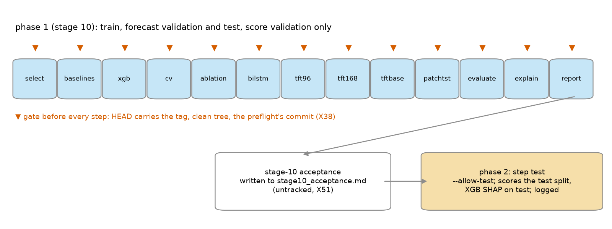

- **Question:** How does the final run keep the test split away from every decision?
- **Shows:** The steps of a final run in order, the gate checked before every step, the stage-10 acceptance written between the phases, and the step that alone scores the test split.
- **Takeaway:** Phase 1 runs 13 steps; each model forecasts validation and test, but only validation is scored. The gate (tag g1-frozen, clean tree, the preflight's commit) is checked before every step. Phase 2 is the step `test`, refused without --allow-test and without the acceptance file `stage10_acceptance.md`; every read of a test row is logged.
- **Led to:** W6 runs this protocol once, after G-1, by docs/runbook_final.md.
- **File:** `outputs/figures/stage_09/S09-13_final_protocol.png`
- **Inputs:** drawn from the code
- **Built at commit:** `a407f85+dirty`

### S09-14. What the development XGBoost relies on

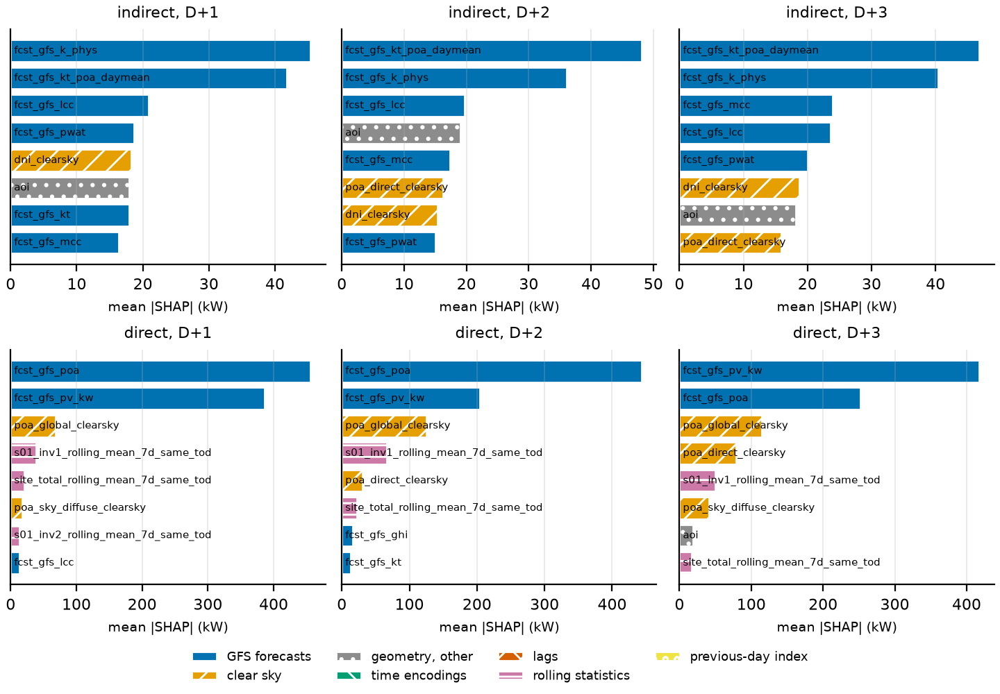

- **Question:** Which inputs carry the largest attributions of the XGB-dev forecasts, in kW?
- **Shows:** Mean |SHAP| in kW of the eight largest features per target and horizon (seed 42), on the scored validation daytime hours; colour and hatch by feature group. The indirect route's attributions are the booster's k values times theo (and the L-09 slope).
- **Takeaway:** The largest attribution comes from a GFS forecast at every target and horizon: fcst_gfs_k_phys (indirect) and fcst_gfs_poa (direct) at D+1. SHAP adds up to the booster forecast within 1.4e-06 of the output scale on 2,901 hours per horizon, and XGBoost's own contributions agree. A description of the fitted model, not a causal effect.
- **Led to:** The final run's SHAP (validation, and test in phase 2) uses the same code; the report flags a dominant feature (the stage-7 rule).
- **File:** `outputs/figures/stage_09/S09-14_xgb_shap_top.png`
- **Inputs:** `outputs/runs/20261112T063719Z_dev/explain/xgb/xgb_shap_features.csv`, `outputs/runs/20261112T063719Z_dev/explain/xgb/xgb_shap_checks.csv`
- **Built at commit:** `a407f85+dirty`

### S09-15. Attribution of the feature groups

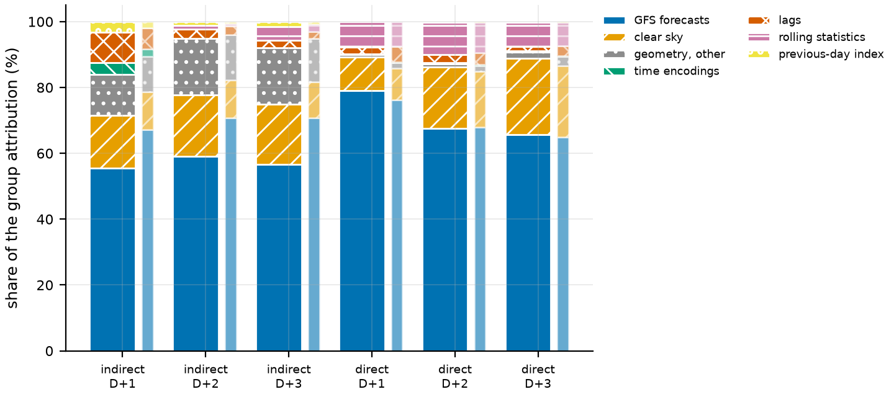

- **Question:** How is the XGB-dev attribution shared between the feature groups, and does the measure matter?
- **Shows:** Share of each feature group in the group attribution, the mean over hours of |sum of SHAP over the group| (wide bars), per target and horizon (seed 42); the narrow bars show the shares that the sum of the members' mean |SHAP| would give on the same values.
- **Takeaway:** The GFS forecasts hold 56 to 79 % of the group attribution. The two measures differ by up to 14.1 points (GFS forecasts, indirect D+3): members of one group often push in opposite directions, so summing their separate magnitudes overstates the group.
- **Led to:** The report and stage 11 use the group attribution (M27).
- **File:** `outputs/figures/stage_09/S09-15_xgb_shap_groups.png`
- **Inputs:** `outputs/runs/20261112T063719Z_dev/explain/xgb/xgb_shap_groups.csv`
- **Built at commit:** `a407f85+dirty`

### S09-16. TFT attention: same hour or fixed clock hours?

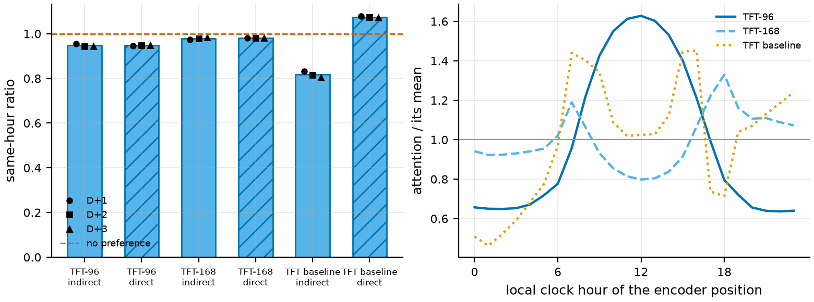

- **Question:** Do the TFT models attend to the same solar hour of earlier days as the hour they forecast, or to fixed hours of the encoder?
- **Shows:** Left: ratio of the encoder attention on positions a whole number of days before each step's valid hour to the share of such positions (1 = no preference), per model, target and horizon block. Right: the mean attention by the local clock hour of the encoder position, direct route. Validation forecasts of the development run.
- **Takeaway:** No model prefers the hour it forecasts: the same-hour ratio is 0.82 to 1.07 (5 of 6 model-target pairs below 1). The daily rhythm of the attention (S09-11) is a preference for fixed clock hours of earlier days: in the direct route the profile peaks at 12:00 (TFT-96), 18:00 (TFT-168) and 16:00 (TFT baseline) local time, whatever hour is forecast.
- **Led to:** Stage 11 reads the final models' attention the same way; agreement with SHAP is not claimed as validation (M29, C-62).
- **File:** `outputs/figures/stage_09/S09-16_tft_same_hour.png`
- **Inputs:** `outputs/runs/20261111T160714Z_dev/explain/tft/tft_attention_summary.csv`, `outputs/runs/20261111T160714Z_dev/explain/tft/tft_attention_lag.csv`
- **Built at commit:** `a407f85+dirty`

### S09-17. Hyper-parameter importance of the development studies

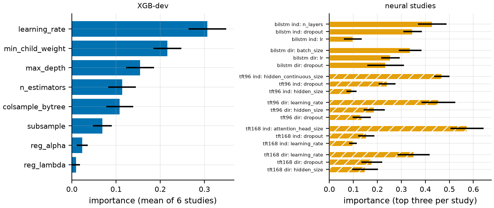

- **Question:** Which hyper-parameters mattered in the development searches, and how stable is that reading?
- **Shows:** fANOVA importance (mean and std over ten evaluator seeds) per searched parameter: XGB averaged over its six studies (left); BiLSTM and the two TFTs per study (right), hatched where every trial lies inside TPE's random start-up.
- **Takeaway:** For XGB the most important parameter is learning_rate (0.31 on average). 4 of 6 neural studies lie entirely inside the random start-up, so their importances describe a handful of random trials only (M30).
- **Led to:** The final run (60 and 20 trials) gives the importances of the report; the development values decide nothing.
- **File:** `outputs/figures/stage_09/S09-17_hparam_importance.png`
- **Inputs:** `outputs/runs/20261112T063719Z_dev/explain/hparam_importance.csv`, `outputs/runs/20261111T160714Z_dev/explain/hparam_importance.csv`
- **Built at commit:** `a407f85+dirty`

### S09-18. Expected duration of the final run

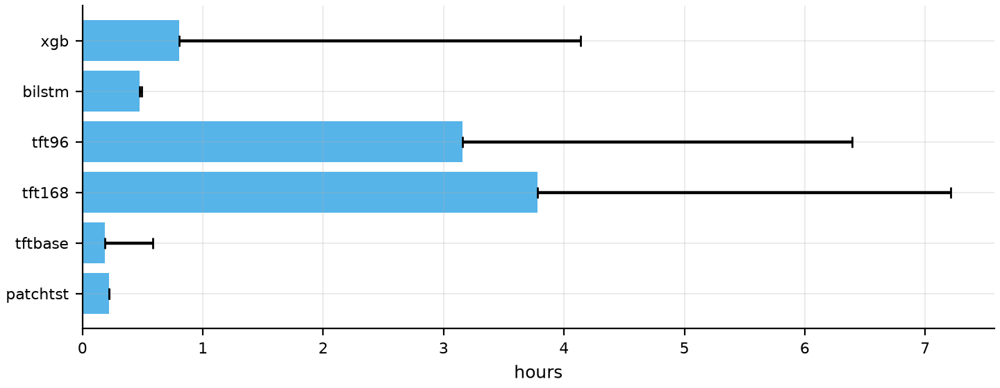

- **Question:** How long will the final run take, step by step, and what is its worst case?
- **Shows:** Duration of each step of a final run, scaled from its development run by the number of fits of the two budgets (bars), and the upper bound if every neural fit ran to its epoch cap and every XGB trial took as long as the longest development trial (whiskers).
- **Takeaway:** About 8.6 h expected and up to about 19.0 h; the longest step is tft168 (about 3.8 h, up to 7.2 h), which cannot be split.
- **Led to:** docs/runbook_final.md runs the final in one sequence or in segments, by the answer of the college IT (Q-15).
- **File:** `outputs/figures/stage_09/S09-18_final_time.png`
- **Inputs:** `outputs/runs/20261112T063719Z_dev/xgb/step.json`, `outputs/runs/20261111T160714Z_dev/bilstm/step.json`, `outputs/runs/20261111T160714Z_dev/tft96/step.json`, `outputs/runs/20261111T160714Z_dev/tft168/step.json`, `outputs/runs/20261111T160714Z_dev/tftbase/step.json`, `outputs/runs/20261111T160714Z_dev/patchtst/step.json`
- **Built at commit:** `a407f85+dirty`

### S09-19. Automatic warnings of the development runs

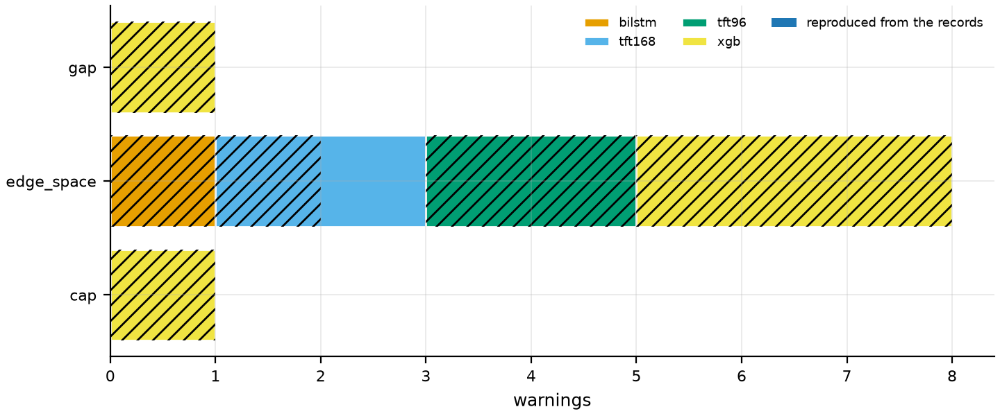

- **Question:** What did the automatic checks of §3.5 find in the two development runs, and do the report's recomputed warnings match what the steps logged?
- **Shows:** Warnings of the XGB and neural development runs by kind (rows) and step (bars), from the run reports; the hatched part is a warning that the steps logged and the report reproduced from the stored records.
- **Takeaway:** 10 warnings in all, 9 reproduced exactly from the records; step log only (kinds the report does not recompute): 0; in the recomputation only: 1 (the effective hidden_continuous_size, X45).
- **Led to:** The final run's report applies the same checks; every warning goes to the run journal before the stage-10 acceptance.
- **File:** `outputs/figures/stage_09/S09-19_report_warnings.png`
- **Inputs:** `outputs/runs/20261112T063719Z_dev/report/report_warnings.csv`, `outputs/runs/20261111T160714Z_dev/report/report_warnings.csv`
- **Built at commit:** `a407f85+dirty`

### S09-20. What the select step verifies

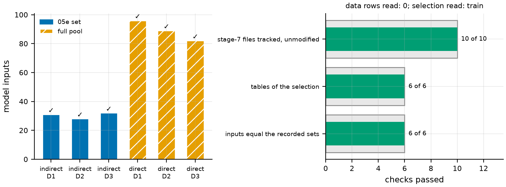

- **Question:** Does the runner use the inputs that stage 7 selected, without selecting again?
- **Shows:** Left: the number of model inputs per route and horizon that the select step recorded, hatched where the route uses the full pool rather than a selected set. Right: the checks of the step, as the number passed out of the number made, in the XGB development run.
- **Takeaway:** The step read 0 data rows and reran nothing. 10 of 10 stage-7 files are tracked and unmodified, 6 of 6 tables are the ones the selection ran on, and the selection read the train split only. The indirect route uses the 05e sets (28 to 32 inputs), the direct route the full pool (82 to 96); both development runs recorded the same inputs. Selection source files changed after the selection ran: 1, listed in the record.
- **Led to:** The model steps compare the inputs file with the hash in the select record before they train; a final run refuses to train without that record (D-30).
- **File:** `outputs/figures/stage_09/S09-20_select_checks.png`
- **Inputs:** `outputs/runs/20261112T063719Z_dev/select/select.json`, `outputs/runs/20261111T160714Z_dev/select/select.json`
- **Built at commit:** `a407f85+dirty`

### S09-21. SHAP explains the booster of the forecast

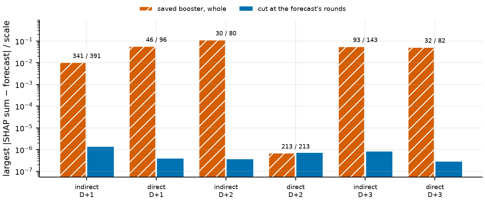

- **Question:** Does SHAP add up to the forecast only when the explainer gets the model that made it?
- **Shows:** Largest additivity error of TreeSHAP per target and horizon (seed 42, validation) as a fraction of the output scale (1 for k, the capacity for kW), log axis: the saved booster explained whole (hatched) and cut at the rounds the forecast uses (solid). The labels give the rounds used and the rounds saved.
- **Takeaway:** In 5 of 6 models the saved booster holds 50 rounds more than the forecast uses (the rounds after the best one, kept by early stopping). Explained whole, it misses the forecast by up to 199 kW in the direct route and 0.11 in k in the indirect route. Cut at the forecast's rounds, SHAP adds up within 1.4e-06 of the scale, XGBoost's own contributions agree exactly, and the booster reproduces the written forecast.
- **Led to:** explain cuts the booster before TreeSHAP and checks additivity against the uncorrected forecast (X46, T-87).
- **File:** `outputs/figures/stage_09/S09-21_shap_booster_rounds.png`
- **Inputs:** `outputs/runs/20261112T063719Z_dev/explain/xgb/xgb_shap_checks.csv`
- **Built at commit:** `a407f85+dirty`

### S09-22. Checks of the XGB explanation

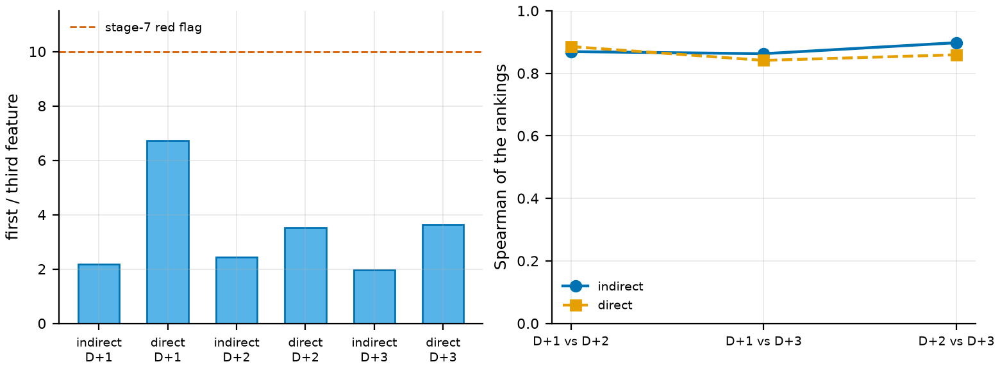

- **Question:** Does one feature dominate the development XGBoost, and do the horizons rank their common inputs alike?
- **Shows:** Left: the first feature's mean |SHAP| over the third's, per target and horizon (seed 42), against the stage-7 red flag (dashed). Right: Spearman correlation of the mean |SHAP| ranking over the features that two horizons share, per target.
- **Takeaway:** No feature dominates: the first is at most 6.7 times the third (direct D+1), below the red flag of 10. The horizons rank their common inputs alike (Spearman 0.84 to 0.90). The development run has one seed; the final run adds the comparison across its three seeds.
- **Led to:** The report flags a dominant feature in the final run (the stage-7 rule, M28).
- **File:** `outputs/figures/stage_09/S09-22_shap_robustness.png`
- **Inputs:** `outputs/runs/20261112T063719Z_dev/explain/xgb/xgb_shap_checks.csv`, `outputs/runs/20261112T063719Z_dev/explain/xgb/xgb_shap_rank_stability.csv`
- **Built at commit:** `a407f85+dirty`

### S09-23. What the TFT models select

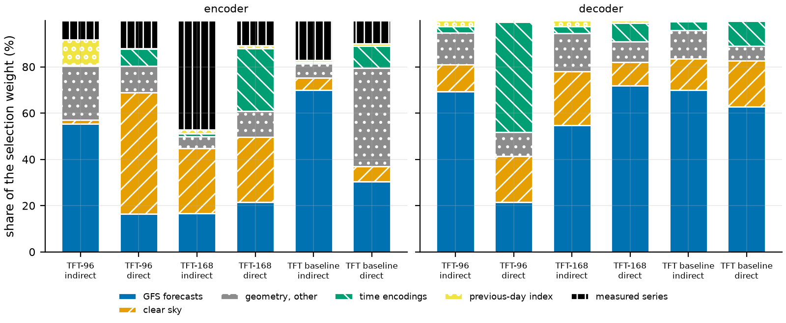

- **Question:** Which input groups do the variable-selection networks of the three TFTs weight, and do the models agree?
- **Shows:** Share of the variable-selection weight per input group (a measured series and its fill flag counted as one variable), per model and target, in the encoder (past days) and the decoder (forecast days), averaged over the validation windows of the development run.
- **Takeaway:** In the decoder the GFS forecasts take 22 to 72 % of the weight; in the encoder the measured series take 8 to 47 %. The three models do not agree on their top input: in the direct decoder they pick is_weekend (TFT-96), fcst_gfs_ghi (TFT-168), fcst_gfs_rh2m (TFT baseline). The largest single weight, 0.55, goes to fcst_gfs_ghi (TFT-168, direct decoder). A selection weight gates an input inside the network; it is not the input's effect on the forecast, and the development fits have one seed.
- **Led to:** Stage 11 reads the final models' weights with their seed spread; no input decision is taken from them (M29).
- **File:** `outputs/figures/stage_09/S09-23_tft_variable_selection.png`
- **Inputs:** `outputs/runs/20261111T160714Z_dev/explain/tft/tft_variable_importance.csv`
- **Built at commit:** `a407f85+dirty`

### S09-24. Points the run reports raise for G-1

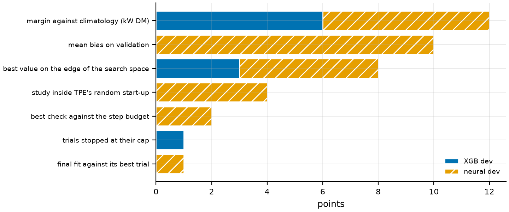

- **Question:** What do the automatic run reports put on the list for the G-1 audit?
- **Shows:** Number of points per kind in the report of each development run (XGB and neural), as the report step lists them; a point is a fact to audit, not a decision.
- **Takeaway:** The two reports list 38 points of 7 kinds (10 XGB, 28 neural); the most frequent kind is margin against climatology (kW DM) (12). The list stays a list until the G-1 audit; no validation decision changes because of it without the user.
- **Led to:** W6 audits every point at G-1 before the tag (PROJECT_MASTER.md §1).
- **File:** `outputs/figures/stage_09/S09-24_g1_points.png`
- **Inputs:** `outputs/runs/20261112T063719Z_dev/report/report_g1_points.csv`, `outputs/runs/20261111T160714Z_dev/report/report_g1_points.csv`
- **Built at commit:** `a407f85+dirty`

## Correction figures (for docs/defense_notes.md only)

### C-10. SHAP groups: the submission against the rebuild

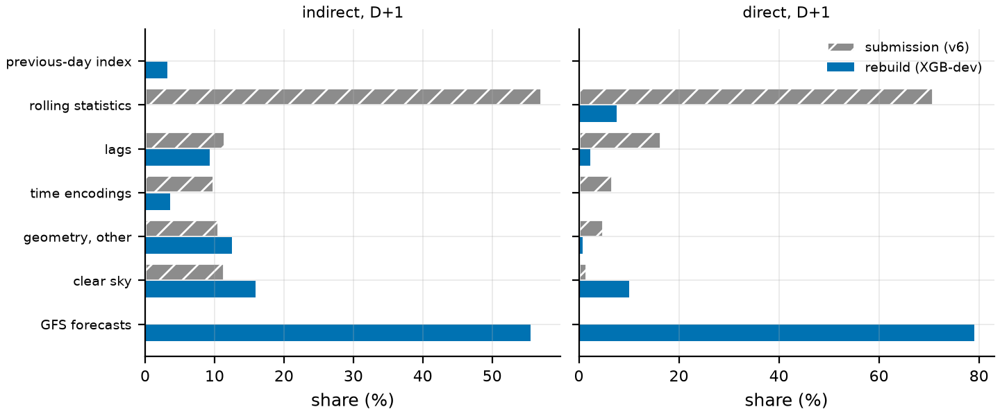

- **Question:** Which feature groups led the submitted SHAP analysis, and which lead the rebuild's?
- **Shows:** Share of each feature group at D+1: the submitted table (sum of the members' mean |SHAP| of the 76-feature model) against the rebuild's group attribution of XGB-dev.
- **Takeaway:** In the submission rolling statistics led with 57 % (indirect) and 71 % (direct); those features leak at D+2 and D+3 (F-07) and the model had 76 inputs (C-31). In the rebuild the GFS forecasts lead with 56 % and 79 %, and rolling statistics hold 8 %.
- **Led to:** docs/defense_notes.md §10; the v7 text of §11.1 is written from the final run (C-59, C-60).
- **File:** `outputs/figures/correction/C-10_shap_groups_v6.png`
- **Inputs:** `submission_evidence/07_shap/shap_group_importance.csv`, `outputs/runs/20261112T063719Z_dev/explain/xgb/xgb_shap_groups.csv`
- **Built at commit:** `a407f85+dirty`
