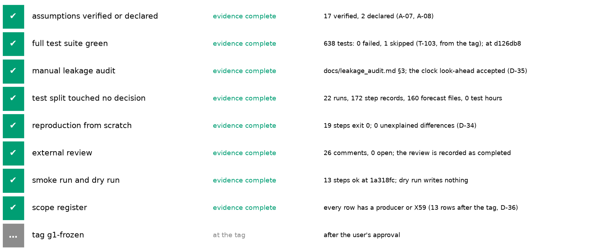
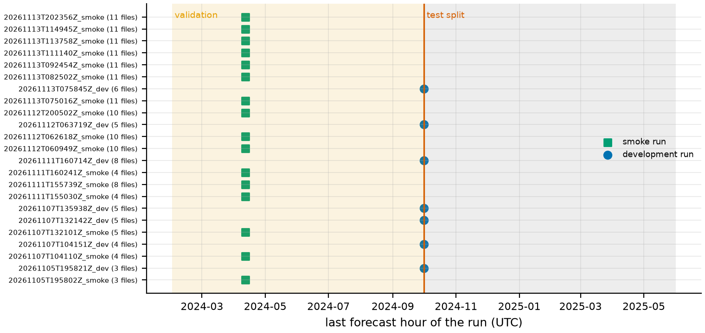
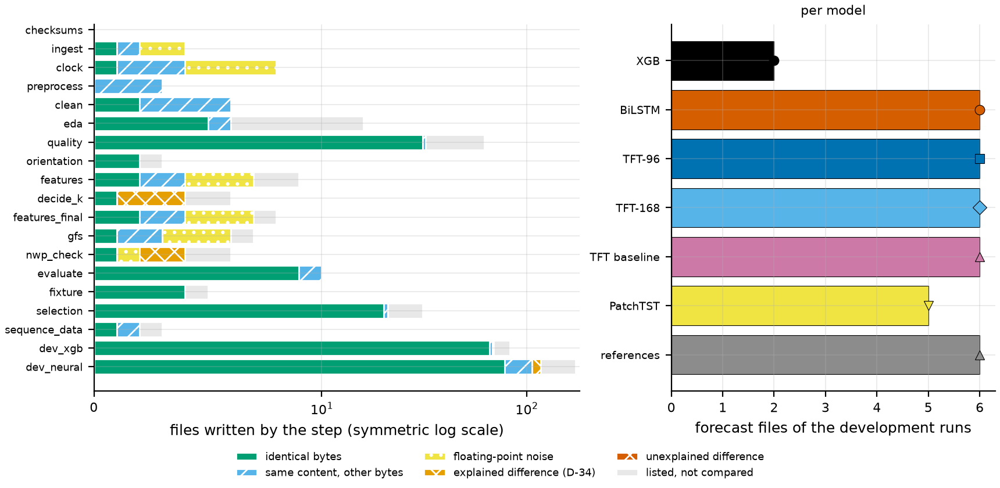
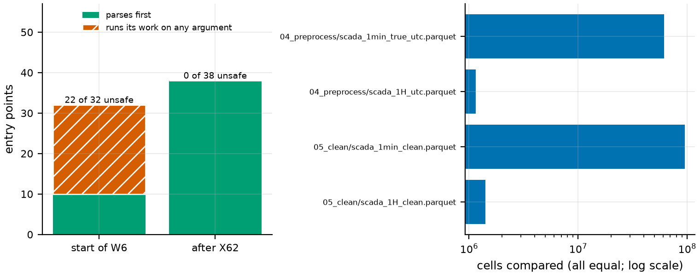
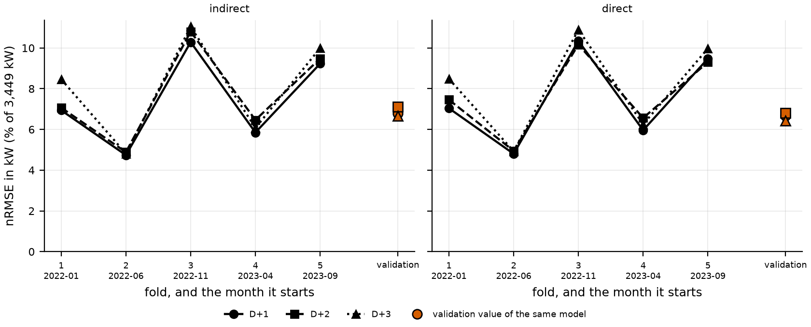
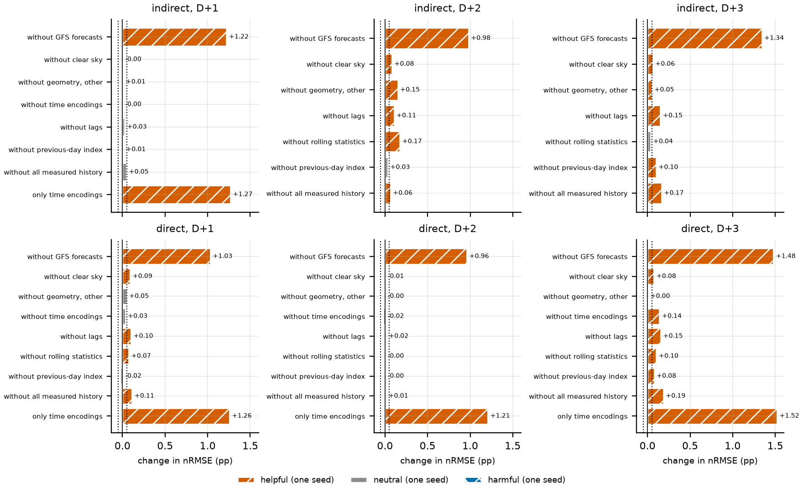
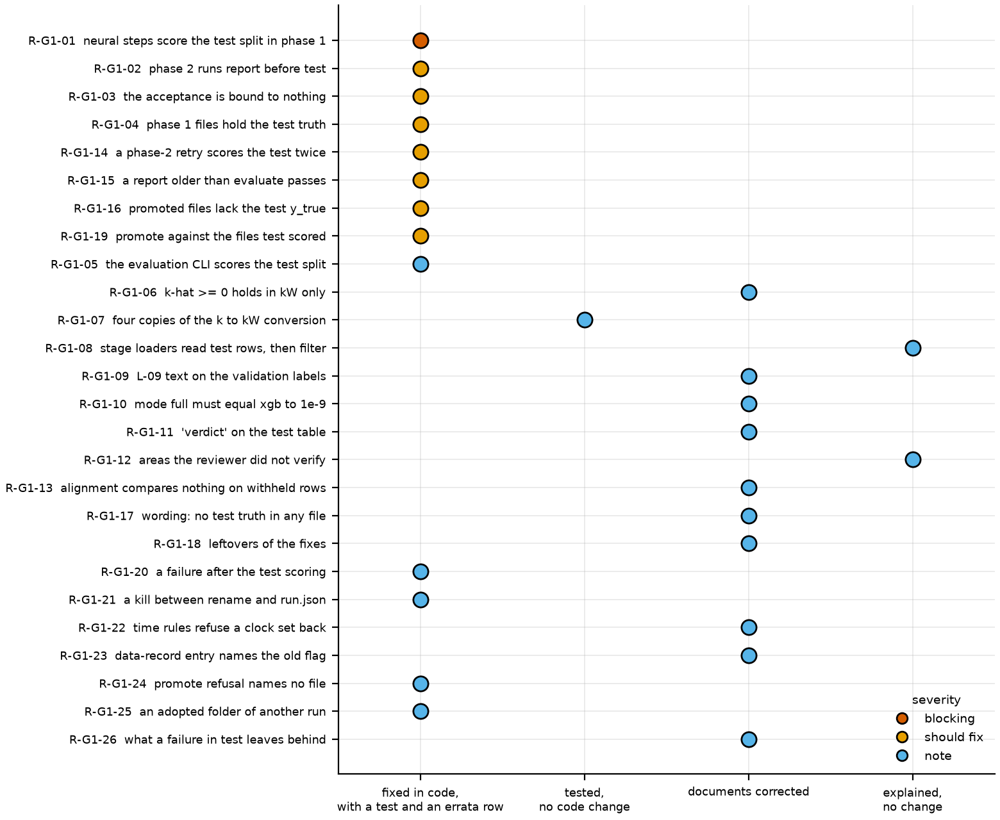

# Figure sheet: Stage 9, W6: Gate G-1: the audit, the reproduction and the guards

Generated by `python -m solarpv.figures` from `outputs/figures/figures_manifest.json`; do not edit by hand. One sheet per task (`docs/figures_plan.md`, rule 7): what the task did, what it found and what that led to, for writing the report. Every takeaway is formatted from the facts its builder computed.

Plan and self-review of the task: `docs/stage9_plan.md §20–§22`.

Figures: 9 (9 process, 0 correction).

## Process figures

### S09-34. Gate G-1: the checklist and its evidence

- **Question:** Which items of gate G-1 have their evidence, and which are still open?
- **Shows:** The nine items of the gate (PROJECT_MASTER.md §7), each with its state read from its evidence file (the assumption register, the JUnit file of the full suite, the test-access audit, the reproduction record, the smoke run, the dry run, the review log, the scope register, the git tags). Evidence gathered at an earlier commit counts for HEAD only when nothing outside the paths of D-36 changed since.
- **Takeaway:** 8 of 9 items have complete evidence, 0 is in progress and 1 wait for the tag (0 wait for a decision). The full suite: 638 tests: 0 failed, 1 skipped (T-103, from the tag); at d126db8.
- **Led to:** The user approves the tag; then the final run by the runbook.
- **File:** `outputs/figures/stage_09/S09-34_g1_checklist.png`
- **Inputs:** `outputs/g1_audit/pytest_final/junit.xml`, `outputs/g1_audit/pytest_final/meta.txt`, `outputs/g1_audit/smoke_final.json`, `outputs/g1_audit/audit/test_access.json`, `outputs/g1_audit/reproduction_20261113T120823Z/record.json`, `docs/g1_review_log.md`, `docs/scope_register.md`, `docs/leakage_audit.md`
- **Built at commit:** `45921f6`

### S09-35. When the information of each input is known

- **Question:** For a forecast issued at T0, which hours does each family of inputs read, at each horizon?
- **Shows:** Hours relative to T0 (00:00 local) read by each input family, from the code's own constants: the kept lags and the rolling windows of the feature table, the encoder windows of the sequence models, the decoder of known inputs, and the GFS run (its initialisation and the latest upload of its files before T0 on the train rows); the shaded band is the forecast day of the horizon.
- **Takeaway:** No measured input reads an hour that ends after T0, at any horizon: the newest lag is 1, 2, 3 days at D+1, D+2 and D+3, and it ends exactly at T0, as do the rolling windows and the encoders. The GFS run starts 9–16 h before T0 and its last file arrives at least 1.1 h before T0 on every train row. Only deterministic inputs (calendar, clear sky, geometry) and that GFS run describe the forecast days.
- **Led to:** The manual audit of G-1 (docs/leakage_audit.md §3) lists every family with its code and test; the steps before the hourly table are measured in S09-36.
- **File:** `outputs/figures/stage_09/S09-35_issuance_windows.png`
- **Inputs:** `data/processed/06b_gfs/gfs_features_D1.parquet`
- **Built at commit:** `45921f6`

### S09-36. Look-ahead in the steps before the hourly table (X57)

- **Question:** Do the clock correction, the polled reconstruction and the cleaning use data after T0, and how much does it change?
- **Shows:** Left: whole-minute clock shift of each day as applied (a centred median of daily estimates) against a trailing median of the earlier days only, as days per absolute difference. Middle: source cells of the 48 hours before T0 that change when the cleaning also sees the next day, per series, over every issuance day. Right: the bound on the last source hour's mean from the polled interpolation (test period only).
- **Takeaway:** The clock correction is the one look-ahead of size: a causal median would move the shift of 40 % of the days, by at most 3 min. The cleaning changes 66 of 458,304 source cells on 4 issuance days, none a scored hour, all a stale value at night; the full-window cleaning equals the stage-5 table on every compared cell. The polled interpolation is bounded by 0.68 °C on a night hour.
- **Led to:** Declared in docs/deviations.md; the user accepted the centred clock and the other two (D-35), so stages 4–9 are not rerun with a causal one.
- **File:** `outputs/figures/stage_09/S09-36_lookahead_prep.png`
- **Inputs:** `outputs/g1_audit/audit/lookahead_clock.csv`, `outputs/g1_audit/audit/lookahead_clock_days.csv`, `outputs/g1_audit/audit/lookahead_clean.csv`, `outputs/g1_audit/audit/lookahead_clean_cells.csv`, `outputs/g1_audit/audit/lookahead_polled.csv`
- **Built at commit:** `45921f6`

### S09-37. No run has read the test split

- **Question:** Has any run of the rebuild read or forecast a test hour before the gate?
- **Shows:** Every run of the runner so far: the last hour that any of its forecast files holds (predictions, uncorrected and ablation forecast files), against the start of the test split, with the number of its step records and forecast files; the evaluation layer's test-access log and its git history.
- **Takeaway:** Across 22 runs, 172 step records hold no test access and 160 forecast files hold 0 test hours; the latest forecast hour of any run is 2024-09-30 23:00 UTC, before the test split starts on 2024-10-01. The access log does not exist and was never committed.
- **Led to:** The test split is read once, by the final run (phase 1 forecasts it, phase 2 scores it, D-32), and every read is logged.
- **File:** `outputs/figures/stage_09/S09-37_test_never_read.png`
- **Inputs:** `outputs/g1_audit/audit/test_access.json`
- **Built at commit:** `45921f6`

### S09-38. The pipeline reproduced from the raw data

- **Question:** Does a fresh checkout, given only the raw data, the GFS point extracts and the site file, produce the same outputs at every stage and the same forecasts for every model?
- **Shows:** Left: every file each stage wrote in a fresh clone, compared with this checkout's: identical bytes, the same content in other bytes (a newer parquet writer), floating-point noise (numeric cells only, relative difference at most 1e-9, nothing missing on one side), a difference explained by a documented fix (D-34), an unexplained difference, or listed only (figures, logs, notebooks). Right: the forecast files of the two development runs per model, against the reference runs; colour and marker per model.
- **Takeaway:** The script's verdict is NOT reproduced, by its rule that any failing file fails: of 317 compared files, 227 have identical bytes, 67 the same content, 16 differ by floating-point noise only (at most 3e-12 relative), 7 differ for a documented reason and 0 for none. The explained files are the 5 of the decision checks run on the laptop (X66: the 2 decisions they record come out the same) and the 2 reports of the neural development run (X45 and the row order of a resumed report). 6 of 6 models give the same forecasts as the reference runs. The parse of the raw text differs by up to 1e-13 relative (X63).
- **Led to:** Evidence of gate G-1 (stage-9 plan §20.5, D-34); the final run starts from the same code and inputs.
- **File:** `outputs/figures/stage_09/S09-38_reproduction.png`
- **Inputs:** `outputs/g1_audit/reproduction_20261113T120823Z/record.json`
- **Built at commit:** `45921f6`

### S09-39. Entry points that run nothing on --help (X62)

- **Question:** Could reading a module's help rewrite data, and did the accidental rerun change anything?
- **Shows:** Left: the entry points of the code (stage modules, scripts, notebook builders) at the start of W6 and now, by whether they parse their arguments before any work. Right: the four stage-4 and stage-5 tables that the accidental run rewrote, cell by cell against the originals restored from the hand-off package.
- **Takeaway:** At the start of W6 22 of 32 entry points ran their work on any argument, --help included; now 0 of 35 do. The accidental rerun rewrote 4 tables with 158,300,208 cells, every one equal to the original; only the parquet writer's bytes differed (pyarrow 25.0.0 against pyarrow 26.0.0), and the originals are back.
- **Led to:** T-98 checks every entry point statically before it calls any; the reproduction compares content, not bytes (M33).
- **File:** `outputs/figures/stage_09/S09-39_entry_points.png`
- **Inputs:** `outputs/g1_audit/incident_2026-11-12/regenerated_vs_original_content.json`
- **Built at commit:** `45921f6`

### S09-40. Cross-validation of the XGB models on the train rows (S-38)

- **Question:** How much does the error of the XGB models vary between five expanding date folds of the train rows, and how does it compare with their validation value?
- **Shows:** nRMSE in kW (% of 3,449 kW) of each of the five folds of the stage-7 expanding-window split (3-day gap) for each target and horizon, seed {seed}; the model of the development run refitted on the fold's earlier days with its rounds fixed, scored on the fold's daytime hours with AC truth. Right of each panel: the validation value of the same model (its early-stopping set, raw forecast). XGB only: S-38 is a v6 analysis of XGB-Opt.
- **Takeaway:** The fold values range from 4.7 to 11.0 % (mean 7.4–8.1 %, std 2.1–2.6 pp over the five folds); the fits grow from 1,374 to 17,005 rows. The validation value is 0.6–1.7 pp below the CV mean in all six cases. Validation tuned the model, the folds did not, and the early folds train on less: the gap is reported and not explained (M43). One seed.
- **Led to:** The step `cv` repeats this for the three seeds of the final run, and the step `test` adds the test value of the uncorrected forecast (phase 2).
- **File:** `outputs/figures/stage_09/S09-40_xgb_cv.png`
- **Inputs:** `outputs/runs/20261113T075845Z_dev/cv/cv_folds.csv`, `outputs/runs/20261113T075845Z_dev/cv/cv_summary.csv`
- **Built at commit:** `45921f6`

### S09-41. Feature-group ablation of the XGB models (S-41)

- **Question:** How much does the validation error of the XGB models change when one feature group is removed and the model is refitted?
- **Shows:** For each target and horizon, the change in nRMSE in kW (pp) of the model refitted without one feature group of the contract (and without all measured history, and with only the time encodings), against the full model of the development run, seed {seed}. Bars right of zero: removing the group raises the error (hatched red); the dotted lines are the registered margin of {margin:.2f} pp (with one seed, the floor). XGB only: S-41 is a v6 analysis of XGB-Opt.
- **Takeaway:** Removing the GFS forecasts raises the error by 0.96–1.48 pp in every case and is the largest change of any single group; with only the time encodings the error is 1.2–1.5 pp higher. Of 49 changes, 30 exceed the margin on one seed, 19 do not and 0 are below minus it. With one seed the margin is only the floor, so these verdicts are provisional (M41); the final run adds two seeds and the pooled seed std.
- **Led to:** The step `ablation` repeats this for the three seeds of the final run, and the step `test` scores the same fits on the test window in phase 2.
- **File:** `outputs/figures/stage_09/S09-41_xgb_ablation.png`
- **Inputs:** `outputs/runs/20261113T075845Z_dev/ablation/ablation_results.csv`, `outputs/runs/20261113T075845Z_dev/ablation/ablation_summary.csv`
- **Built at commit:** `45921f6`

### S09-42. The external review of gate G-1 and its comments

- **Question:** What did the independent review find, how serious was it, and what became of each comment?
- **Shows:** One row per comment of `docs/g1_review_log.md` (the review of the source against §6 and its fix checks), by severity (colour) and by what became of it (column): a fix in code with a test and an errata row, a test without a code change, a correction of the documents, or an explanation with no change.
- **Takeaway:** The review wrote 26 comments: 1 blocking, 7 should fix and 18 notes. All 8 blocking and should-fix comments were fixed in code with a test and an errata row; 10 comments were answered by correcting the documents, 1 by a test and 2 by an explanation. 0 are unanswered.
- **Led to:** The evidence of the gate is repeated at the commit that is tagged (D-36), and the reproduction from the raw data runs once more at it.
- **File:** `outputs/figures/stage_09/S09-42_external_review.png`
- **Inputs:** `docs/g1_review_log.md`
- **Built at commit:** `45921f6`
