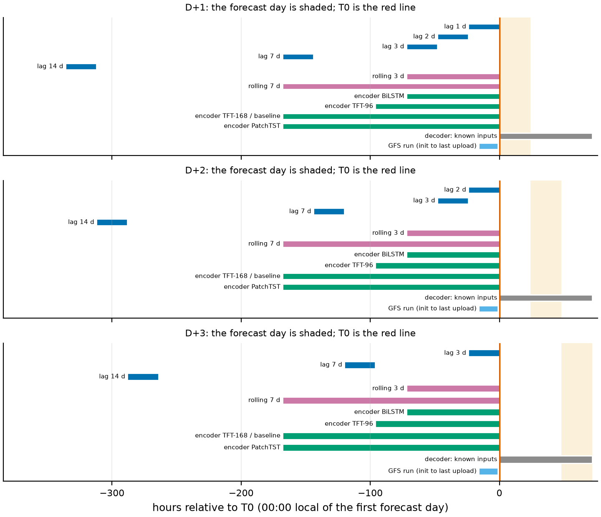
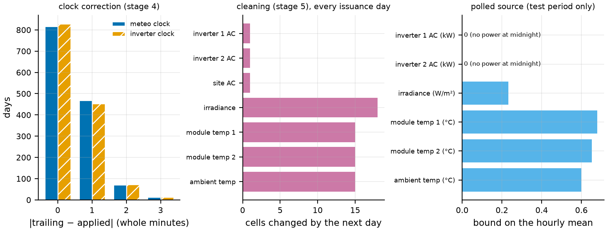

# Figure sheet: Stage 9, W6: Gate G-1: the audit, the reproduction and the guards

Generated by `python -m solarpv.figures` from `outputs/figures/figures_manifest.json`; do not edit by hand. One sheet per task (`docs/figures_plan.md`, rule 7): what the task did, what it found and what that led to, for writing the report. Every takeaway is formatted from the facts its builder computed.

Plan and self-review of the task: `docs/stage9_plan.md §20`.

Figures: 4 (4 process, 0 correction).

## Process figures

### S09-35. When the information of each input is known

- **Question:** For a forecast issued at T0, which hours does each family of inputs read, at each horizon?
- **Shows:** Hours relative to T0 (00:00 local) read by each input family, from the code's own constants: the kept lags and the rolling windows of the feature table, the encoder windows of the sequence models, the decoder of known inputs, and the GFS run (its initialisation and the latest upload of its files before T0 on the train rows); the shaded band is the forecast day of the horizon.
- **Takeaway:** No measured input reads an hour that ends after T0, at any horizon: the newest lag is 1, 2, 3 days at D+1, D+2 and D+3, and it ends exactly at T0, as do the rolling windows and the encoders. The GFS run starts 9–16 h before T0 and its last file arrives at least 1.1 h before T0 on every train row. Only deterministic inputs (calendar, clear sky, geometry) and that GFS run describe the forecast days.
- **Led to:** The manual audit of G-1 (docs/leakage_audit.md §3) lists every family with its code and test; the steps before the hourly table are measured in S09-36.
- **File:** `outputs/figures/stage_09/S09-35_issuance_windows.png`
- **Inputs:** `data/processed/06b_gfs/gfs_features_D1.parquet`
- **Built at commit:** `9ee9ac7+dirty`

### S09-36. Look-ahead in the steps before the hourly table (X57)

- **Question:** Do the clock correction, the polled reconstruction and the cleaning use data after T0, and how much does it change?
- **Shows:** Left: whole-minute clock shift of each day as applied (a centred median of daily estimates) against a trailing median of the earlier days only, as days per absolute difference. Middle: source cells of the 48 hours before T0 that change when the cleaning also sees the next day, per series, over every issuance day. Right: the bound on the last source hour's mean from the polled interpolation (test period only).
- **Takeaway:** The clock correction is the one look-ahead of size: a causal median would move the shift of 40 % of the days, by at most 3 min. The cleaning changes 66 of 458,304 source cells on 4 issuance days, none a scored hour, all a stale value at night; the full-window cleaning equals the stage-5 table on every compared cell. The polled interpolation is bounded by 0.68 °C on a night hour.
- **Led to:** Declared in docs/deviations.md; whether to accept the centred clock or rerun stages 4–9 with a causal one is the user's decision (stage-9 plan §20.7).
- **File:** `outputs/figures/stage_09/S09-36_lookahead_prep.png`
- **Inputs:** `outputs/g1_audit/audit/lookahead_clock.csv`, `outputs/g1_audit/audit/lookahead_clock_days.csv`, `outputs/g1_audit/audit/lookahead_clean.csv`, `outputs/g1_audit/audit/lookahead_clean_cells.csv`, `outputs/g1_audit/audit/lookahead_polled.csv`
- **Built at commit:** `9ee9ac7+dirty`

### S09-37. No run has read the test split

- **Question:** Has any run of the rebuild read or forecast a test hour before the gate?
- **Shows:** Every run of the runner so far: the last hour that any of its prediction files holds, against the start of the test split, with the number of its step records and prediction files; the evaluation layer's test-access log and its git history.
- **Takeaway:** Across 15 runs, 86 step records hold no test access and 81 prediction files hold 0 test hours; the latest forecast hour of any run is 2024-09-30 23:00 UTC, before the test split starts on 2024-10-01. The access log does not exist and was never committed.
- **Led to:** The test split is read once, by the final run (phase 1 forecasts it, phase 2 scores it, D-32), and every read is logged.
- **File:** `outputs/figures/stage_09/S09-37_test_never_read.png`
- **Inputs:** `outputs/g1_audit/audit/test_access.json`
- **Built at commit:** `9ee9ac7+dirty`

### S09-39. Entry points that run nothing on --help (X62)

- **Question:** Could reading a module's help rewrite data, and did the accidental rerun change anything?
- **Shows:** Left: the entry points of the code (stage modules, scripts, notebook builders) at the start of W6 and now, by whether they parse their arguments before any work. Right: the four stage-4 and stage-5 tables that the accidental run rewrote, cell by cell against the originals restored from the hand-off package.
- **Takeaway:** At the start of W6 22 of 32 entry points ran their work on any argument, --help included; now 0 of 34 do. The accidental rerun rewrote 4 tables with 158,300,208 cells, every one equal to the original; only the parquet writer's bytes differed (pyarrow 25.0.0 against pyarrow 26.0.0), and the originals are back.
- **Led to:** T-98 checks every entry point statically before it calls any; the reproduction compares content, not bytes (M33).
- **File:** `outputs/figures/stage_09/S09-39_entry_points.png`
- **Inputs:** `outputs/g1_audit/incident_2026-11-12/regenerated_vs_original_content.json`
- **Built at commit:** `9ee9ac7+dirty`
