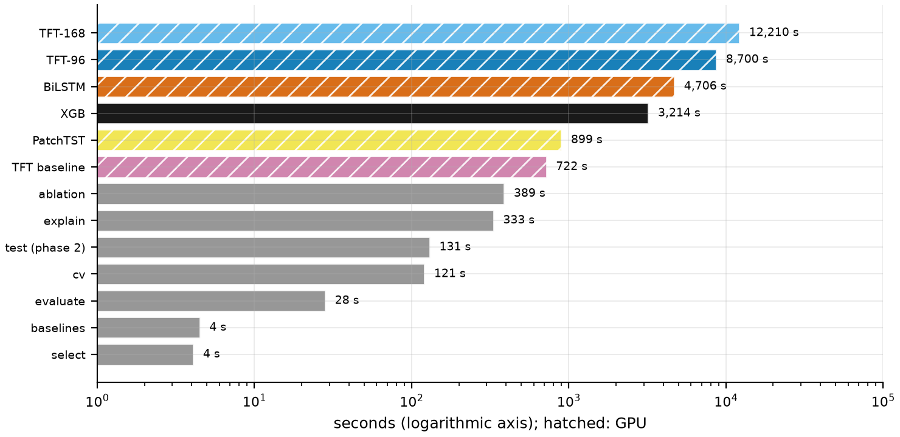
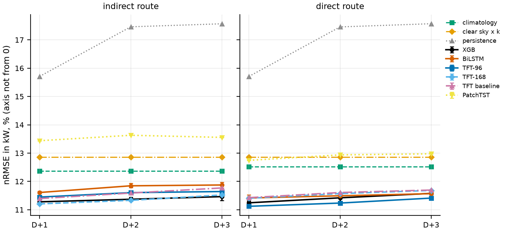
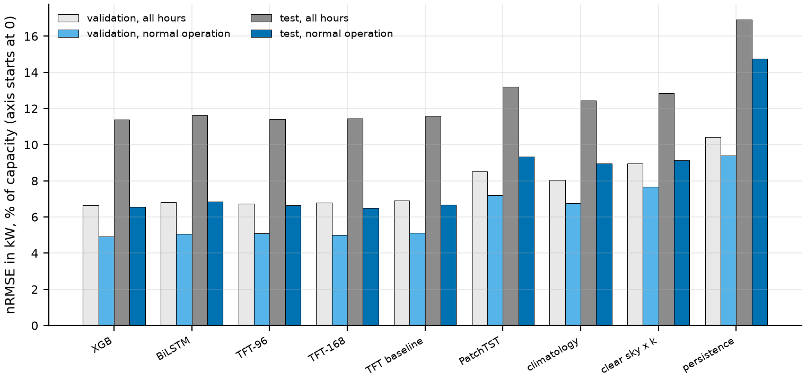
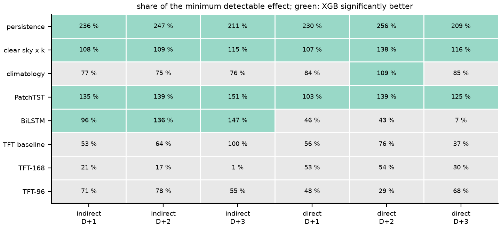
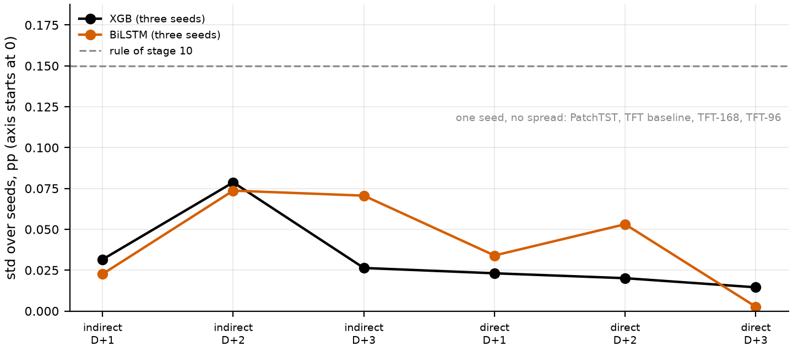
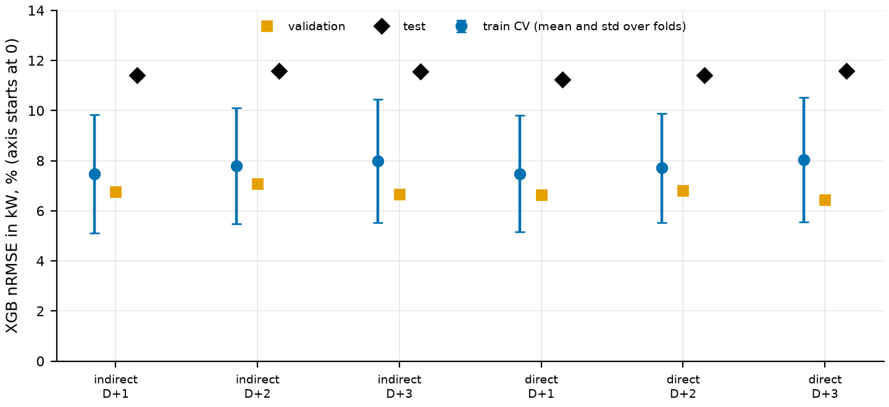

# Figure sheet: Stage 10: The final run (all models)

Generated by `python -m solarpv.figures` from `outputs/figures/figures_manifest.json`; do not edit by hand. One sheet per task (`docs/figures_plan.md`, rule 7): what the task did, what it found and what that led to, for writing the report. Every takeaway is formatted from the facts its builder computed.

Figures: 6 (6 process, 0 correction).

## Process figures

### S10-01. The final run: every step, its time and its device

- **Question:** How long did each step of the final run take, and did any step need a restart?
- **Shows:** One bar per step of the run, in seconds on a logarithmic axis, the model steps in the colour of their model and the others in grey; the text at the end of a bar is the duration recorded in the step's record. The GPU steps are hatched.
- **Takeaway:** All 13 steps finished at one commit with no restart from a checkpoint. The model and analysis steps took 8.6 hours, 7.6 of them on the GPU; the longest step is TFT-168 (3.4 hours). The step test, run in the second phase, took 131 seconds.
- **Led to:** The acceptance of phase 1 (stage10_acceptance.md) and the step test of phase 2.
- **File:** `outputs/figures/stage_10/S10-01_run_steps.png`
- **Inputs:** `outputs/runs/20261114T083930Z_final/report/report_steps.csv`, `outputs/runs/20261114T083930Z_final/stage10_acceptance.md`
- **Built at commit:** `a92756b+dirty`

### S10-02. The six models and the references on the test split

- **Question:** How does each model score on the test split, in kW, against the references, on the same hours?
- **Shows:** Two panels, the indirect and the direct route: nRMSE in kW as a percentage of the plant capacity at D+1, D+2 and D+3, one line per model (mean over its seeds, the bar is the range over seeds) and one per reference. The y axis does not start at zero.
- **Takeaway:** The six models score between 11.12 and 13.63 per cent, the references between 12.37 and 17.57. PatchTST is worse than climatology in 6 of 6 cells and no other model is. The lowest seed-mean among the six models is: TFT-96 in 3 of 6, TFT-168 in 2 of 6, XGB in 1 of 6. Whether such differences are significant is S10-04.
- **Led to:** S10-04 (which of these differences are significant), S10-03 (where the level comes from).
- **File:** `outputs/figures/stage_10/S10-02_test_scores.png`
- **Inputs:** `outputs/runs/20261114T083930Z_final/report/report_benchmark_test.csv`
- **Built at commit:** `a92756b+dirty`

### S10-03. From validation to test: where the extra error is

- **Question:** Why is every model's test error higher than its validation error, and is it the models?
- **Shows:** Grouped bars per model and reference, the mean over seeds and over the six route and horizon cells, in kW as a percentage of the plant capacity: validation and test, each on all daytime hours and on the hours of normal operation (no curtailment, stop or derate; D-22). The bar value is printed.
- **Takeaway:** Every model and reference rises from validation to test: XGB 6.65 to 11.39 on all hours, climatology 8.05 to 12.45. On the hours of normal operation the rise is smaller (XGB 4.93 to 6.55, climatology 6.76 to 8.95): the 186 operation-limited hours of the test split account for 18% to 68% of the rise, and the rest is a shift of the period that every model and reference shares.
- **Led to:** The documents state both views (the all-hours view is the primary one, D-22), and compare a test number only with the validation number of the same view. Whether the operation-limited test hours are an event or a trend is a question for stage 11.
- **File:** `outputs/figures/stage_10/S10-03_val_test_views.png`
- **Inputs:** `outputs/runs/20261114T083930Z_final/report/report_benchmark_val.csv`, `outputs/runs/20261114T083930Z_final/report/report_benchmark_test.csv`, `outputs/runs/20261114T083930Z_final/evaluate/val/benchmark_views.csv`, `outputs/runs/20261114T083930Z_final/test/test/benchmark_views.csv`
- **Built at commit:** `a92756b+dirty`

### S10-04. Every model and reference against XGB: Diebold-Mariano in kW on test

- **Question:** Which differences to XGB survive the Diebold-Mariano test in kW on the test split?
- **Shows:** One row per other model or reference, one column per route and horizon. Green: XGB is significantly better (HLN, Bonferroni level of the family); red: significantly worse; grey: not significant. The text is the effect as a share of the minimum detectable effect.
- **Takeaway:** XGB is significantly better than persistence in 6 of 6 cells, than clear sky x k in 6, than PatchTST in 6 and than climatology in 1; the climatology effect is 75 to 109 per cent of the minimum detectable effect, so the test has too little power to separate them. BiLSTM is significantly worse than XGB in 3 cells; the three TFTs in 0. XGB is significantly worse than no model (0).
- **Led to:** The statement of the result (S10-02) and the limitation of D-37; no model is declared the winner.
- **File:** `outputs/figures/stage_10/S10-04_test_dm_vs_xgb.png`
- **Inputs:** `outputs/runs/20261114T083930Z_final/report/report_dm_kw_test.csv`
- **Built at commit:** `a92756b+dirty`

### S10-05. Seed spread in kW against the rule of stage 10

- **Question:** Do the seeds of a model agree to within the rule of stage 10 (0.15 pp in kW)?
- **Shows:** Standard deviation over seeds of the nRMSE in kW, per route and horizon, for the models that were trained on three seeds, with the rule as a dashed line. The models with one seed are named in the panel: a spread cannot be computed for them.
- **Takeaway:** The largest spread is 0.079 pp for XGB and 0.074 pp for BiLSTM, against the rule of 0.15 pp; 0 of 12 cells are above it. PatchTST, TFT baseline, TFT-168, TFT-96 have one seed each, so their spread is unknown; the differences among models of a similar level (S10-02) are read with that caveat.
- **Led to:** The acceptance of stage 10 (passed) and the limitation on the single-seed neural models.
- **File:** `outputs/figures/stage_10/S10-05_seed_spread.png`
- **Inputs:** `outputs/runs/20261114T083930Z_final/report/report_seed_spread.csv`
- **Built at commit:** `a92756b+dirty`

### S10-06. XGB: the five-fold CV on train, validation and test

- **Question:** How far is the test error of XGB from the error that the train CV and validation predicted?
- **Shows:** For each route and horizon the XGB nRMSE in kW as three points on one line: the mean of the five expanding folds inside train (the bar is the standard deviation over folds), the validation, and the test; the mean over the three seeds.
- **Takeaway:** The test error is 3.5 to 4.0 pp above the train CV in every one of the 18 fits, and validation lies 0.6 to 1.7 pp below it. The mean spread between folds is 2.4 pp, so the folds themselves differ by a large part of the gap; the references rise from validation to test as well (S10-03).
- **Led to:** The statement that the CV, the validation and the test are three different periods, each harder or easier for every model; no decision used the test.
- **File:** `outputs/figures/stage_10/S10-06_cv_val_test.png`
- **Inputs:** `outputs/runs/20261114T083930Z_final/report/report_cv_vs_test.csv`
- **Built at commit:** `a92756b+dirty`
