# Figure sheet: Stage 11, A: Tables and figures from the frozen final run

Generated by `python -m solarpv.figures` from `outputs/figures/figures_manifest.json`; do not edit by hand. One sheet per task (`docs/figures_plan.md`, rule 7): what the task did, what it found and what that led to, for writing the report. Every takeaway is formatted from the facts its builder computed.

Plan and self-review of the task: `docs/stage11_plan.md`.

Figures: 17 (17 process, 0 correction).

## Process figures

### S11-01. The benchmark in kW with 95 % intervals

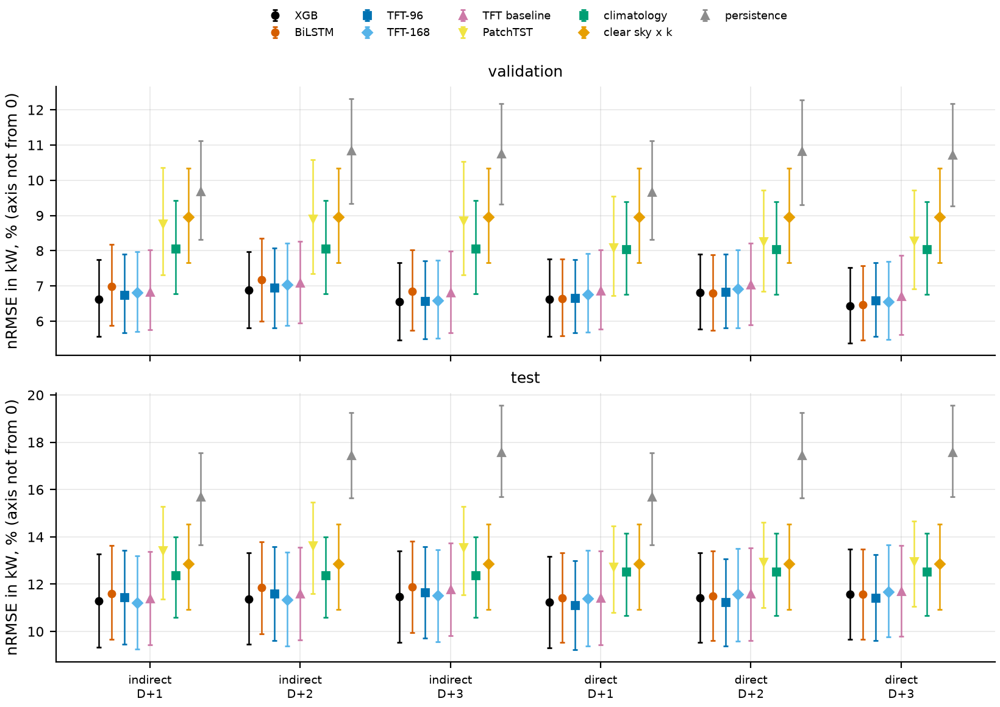

- **Question:** How large are the differences between the models compared with the uncertainty of one score, on validation and on test?
- **Shows:** One panel per split. For every route and horizon, one marker per model and reference: the mean over seeds of the nRMSE in kW (percent of the plant capacity); the bar is the 95 % circular block bootstrap interval (block of 24 hours), averaged over the model's seeds.
- **Takeaway:** On test the interval of a single score is about 1.93 pp on each side, and the six models differ by at most 2.30 pp in a cell; on validation the figures are 1.17 and 2.30 pp. The intervals of all six models overlap in 6 of 6 cells on test and in 6 of 6 on validation. These intervals are not paired, so overlap is not a test of a difference: the paired test of S10-04 separates PatchTST from XGB in every cell although the intervals overlap.
- **Led to:** S10-04 and S11-09 (the paired tests that use the same errors) and the statement of the results: the intervals are not paired, so they are wider than the paired test.
- **File:** `outputs/figures/stage_11/S11-01_benchmark_intervals.png`
- **Inputs:** `outputs/11_analyses/benchmark_ci_kw.csv`, `outputs/11_analyses/manifest.json`
- **Built at commit:** `a92756b+dirty`

### S11-02. Error against the horizon, validation and test

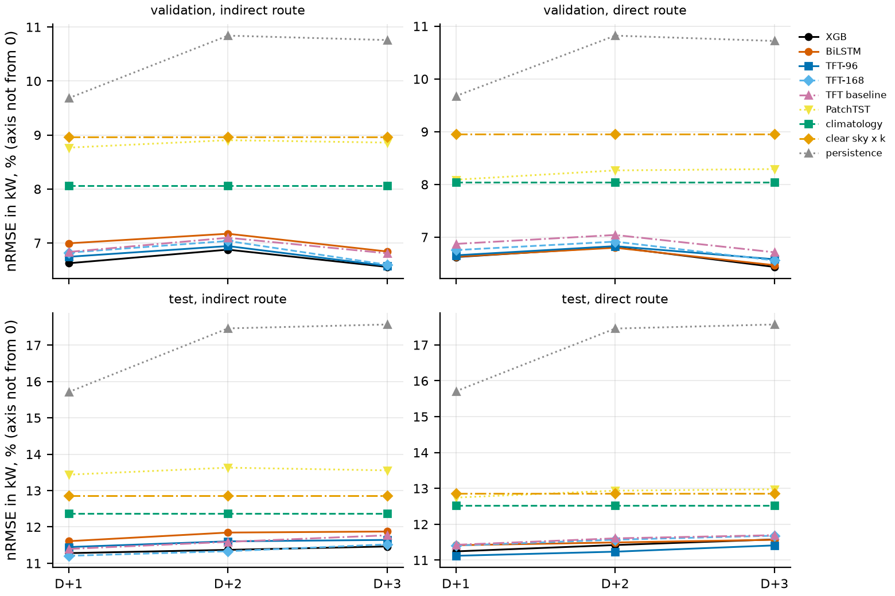

- **Question:** Does the error grow from D+1 to D+3, and is the answer the same on validation and on test?
- **Shows:** Four panels: validation and test, indirect and direct route. One line per model and reference: the mean over seeds of the nRMSE in kW at D+1, D+2 and D+3 (all daytime hours).
- **Takeaway:** On validation the error at D+3 is lower than at D+1 for 10 of the 12 pairs of a model and a route (change -0.22 to +0.20 pp); on test it is higher for 12 of 12 (change +0.12 to +0.38 pp). The sign of the horizon effect reverses between the two periods, and its size is at most 0.38 pp, so the order of the horizons is a property of the period and not of the horizon.
- **Led to:** The reading of the horizon in the report: the order of the horizons is a property of the period (R6b-07, R7-05), not of the models.
- **File:** `outputs/figures/stage_11/S11-02_horizon_robustness.png`
- **Inputs:** `outputs/11_analyses/horizon_robustness.csv`, `outputs/11_analyses/manifest.json`
- **Built at commit:** `a92756b+dirty`

### S11-03. Forecast against observed power on the test split

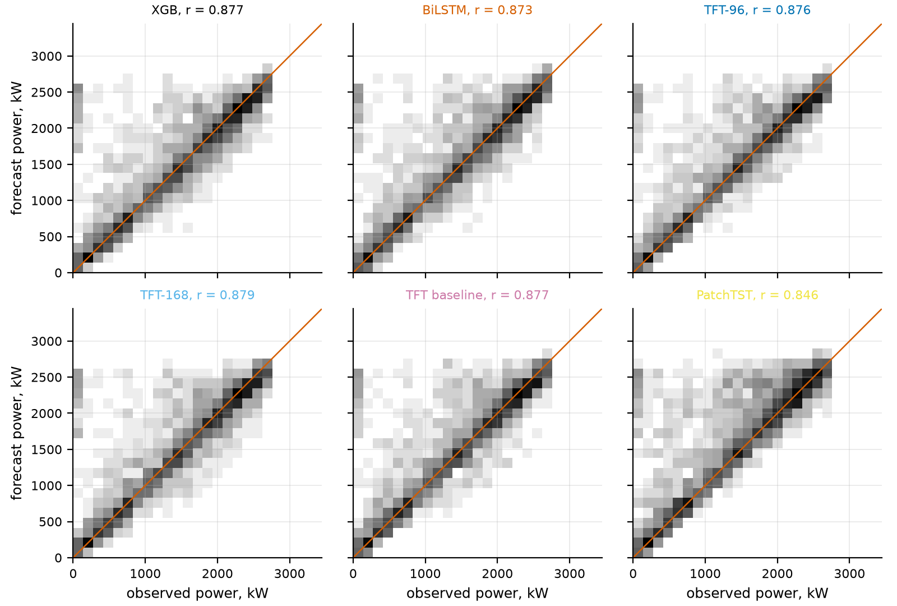

- **Question:** How close does each model come to the observed power, hour by hour, on the test split?
- **Shows:** One panel per model: the number of daytime hours (log scale) in a grid of observed power (horizontal) against the forecast (vertical), both in kW, D+1, indirect route (the forecast k times the clear-sky power), lowest seed. The diagonal is the perfect forecast.
- **Takeaway:** The correlation between forecast and observation on test is between 0.846 and 0.879 for the six models. In every panel a group of hours lies above the diagonal at observed values near zero: forecasts of high power while the plant delivered little. Some of these hours are operation-limited (D-22; S11-12).
- **Led to:** S11-11 and S11-12 (the bias, and where the hours with the large errors are).
- **File:** `outputs/figures/stage_11/S11-03_scatter_test.png`
- **Inputs:** `outputs/11_analyses/scatter_hist.csv`, `outputs/11_analyses/decomposition.csv`, `outputs/11_analyses/manifest.json`
- **Built at commit:** `a92756b+dirty`

### S11-04. Error by season, validation and test

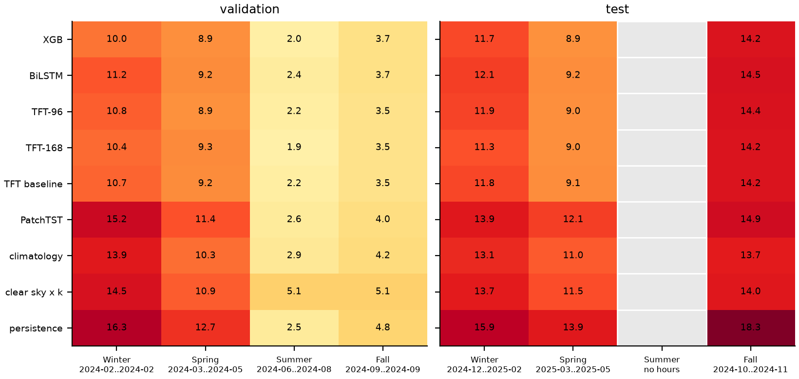

- **Question:** How does the error of each model depend on the season, and are the two periods comparable season by season?
- **Shows:** Two panels, validation and test: the nRMSE in kW (percent of the capacity) of every model and reference by season (local months), D+1, indirect route, mean over seeds. Grey: no hour of that season in the split. Each season is named with the months the split holds.
- **Takeaway:** The test split has no summer, and its autumn is 2024-10..2024-11 against 2024-09..2024-09 on validation, so a season is not the same weather in the two periods. XGB's error is highest in Winter on validation (10.05 per cent) and in Fall on test (14.19 per cent). From validation to test the error of XGB changes by +1.6 (Winter), -0.1 (Spring) and +10.5 (Fall) points, and that of climatology by -0.8, +0.7 and +9.5: the rise of the test period is concentrated in the autumn, where 10% of the test hours are operation-limited against 2% of the validation hours; Spring is almost unchanged.
- **Led to:** L-20: the by-season half; no comparison of a season across the two periods without naming the months (X104).
- **File:** `outputs/figures/stage_11/S11-04_seasonal_heatmap.png`
- **Inputs:** `outputs/11_analyses/seasonal_kw.csv`, `outputs/11_analyses/manifest.json`
- **Built at commit:** `a92756b+dirty`

### S11-05. Error by local hour and season on the test split

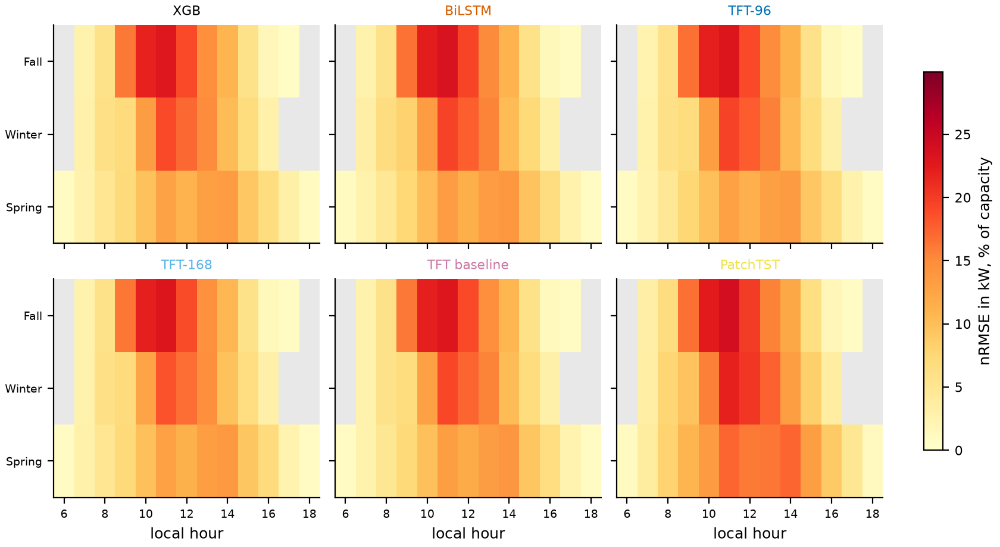

- **Question:** At which local hours of the day, in which season, does each model err most?
- **Shows:** One panel per model: the nRMSE in kW (percent of the capacity) by local hour (horizontal) and season (vertical), D+1, indirect route, test split, all daytime hours, mean over seeds, one colour scale for all panels. A cell with too few hours (the minimum is recorded in the manifest of the analyses) is left grey. The six models are shown together, not the best four (M47).
- **Takeaway:** The largest cell of each model is in the local hour(s) 11, and the largest cell of the figure is Fall at 11:00 (24.0 per cent of the capacity, PatchTST). Averaged over the seasons, the XGB error changes by 17.3 points between the hours of the day, and the six models differ by at most 3.1 points within an hour: the shape over the day is shared by the models. For XGB in the autumn at 11:00 the error is 22.9 per cent on all hours and 4.4 in normal operation; 18% of those hours are operation-limited (S11-17).
- **Led to:** S11-17 (the same figure in normal operation) and the report's section on the diurnal profile. Nothing was selected from this figure.
- **File:** `outputs/figures/stage_11/S11-05_hour_season.png`
- **Inputs:** `outputs/11_analyses/hour_season.csv`, `outputs/11_analyses/manifest.json`
- **Built at commit:** `a92756b+dirty`

### S11-06. Indirect route against direct route, validation and test

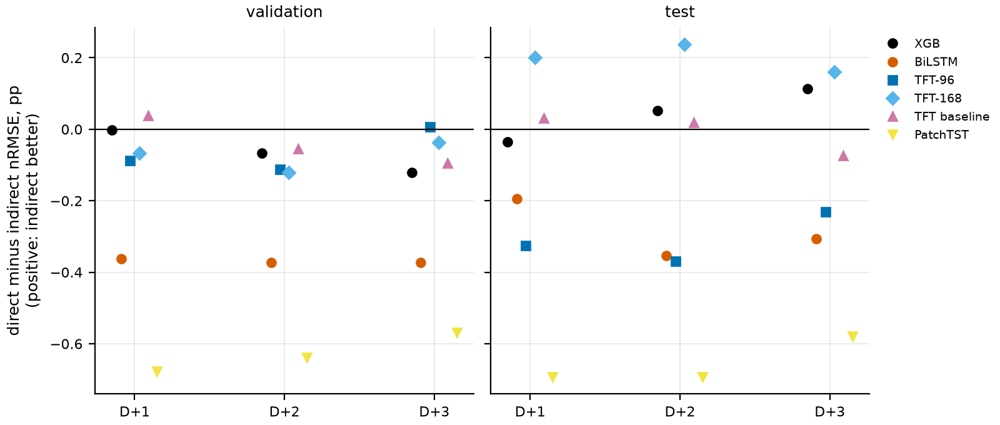

- **Question:** Is it better to forecast the clearness index and multiply by the clear-sky power, or to forecast the power directly?
- **Shows:** The nRMSE in kW of the direct route minus that of the indirect route (percentage points), for each model and horizon, mean over seeds, scored on the same hours against the actual AC (C-16). Positive: the indirect route is better. One panel per split.
- **Takeaway:** The direct route is better in 16 of the 18 pairs of a model and a horizon on validation and in 11 of 18 on test. The differences are between -0.69 and +0.24 pp, and the sign differs between the two periods for 7 of the 18 pairs: the direct route is nominally better on validation, and the evidence on test is mixed.
- **Led to:** The statement on the routes: a difference of this size is within the seed and period uncertainty (S11-01, S10-05).
- **File:** `outputs/figures/stage_11/S11-06_route_comparison.png`
- **Inputs:** `outputs/runs/20261114T083930Z_final/evaluate/val/route_comparison.csv`, `outputs/runs/20261114T083930Z_final/test/test/route_comparison.csv`
- **Built at commit:** `a92756b+dirty`

### S11-07. XGB: what the SHAP values attribute the forecast to

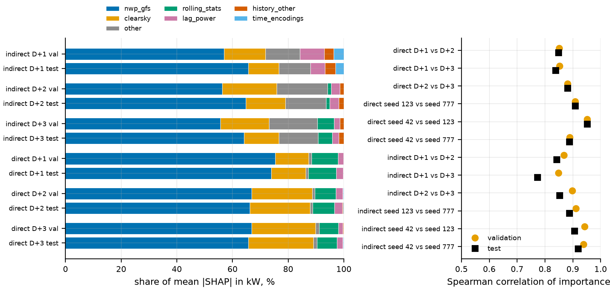

- **Question:** Which groups of features carry the XGB forecast, and is it the same on validation and on test?
- **Shows:** Left: the share of the mean absolute SHAP value (in kW) of each feature group, for each route and horizon, mean over the three seeds; validation (upper bar) and test (lower bar) of each cell. Right: the Spearman rank correlation of the feature importances between two horizons of the same route, and between two seeds.
- **Takeaway:** The group with the largest share is the same on validation and on test in 6 of the 6 cells (nwp_gfs). The share of the weather-forecast group (GFS) is between 56 and 75 per cent. The rank correlation between two horizons, or between two seeds, is at least 0.85 on validation and 0.77 on test.
- **Led to:** The report's section on explanations: the model relies on the forecast fields, not on same-hour power.
- **File:** `outputs/figures/stage_11/S11-07_shap_groups.png`
- **Inputs:** `outputs/runs/20261114T083930Z_final/explain/xgb/xgb_shap_groups.csv`, `outputs/runs/20261114T083930Z_final/test/shap_test/xgb_shap_groups_test.csv`, `outputs/runs/20261114T083930Z_final/explain/xgb/xgb_shap_rank_stability.csv`, `outputs/runs/20261114T083930Z_final/test/shap_test/xgb_shap_rank_stability_test.csv`
- **Built at commit:** `a92756b+dirty`

### S11-08. TFT: how the attention is spread over the encoder window

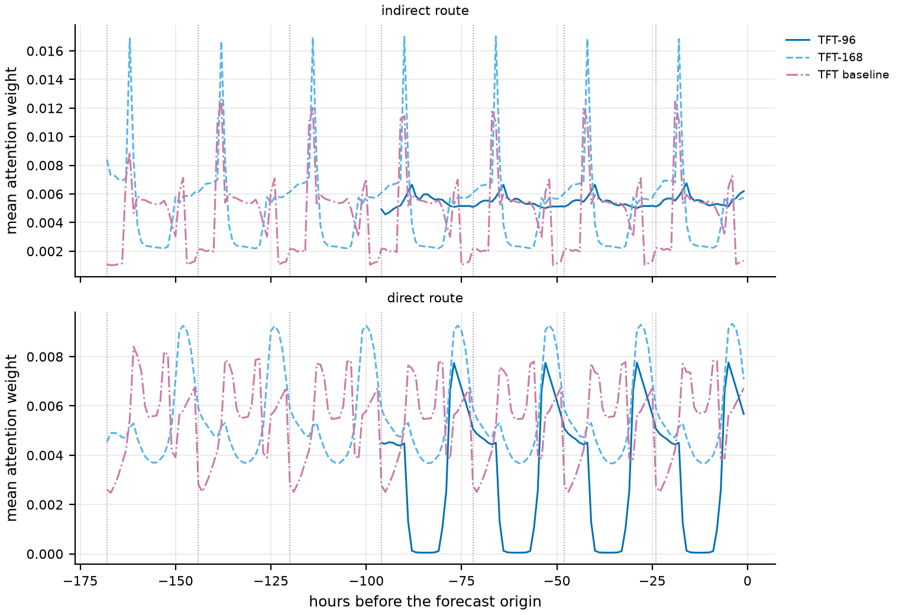

- **Question:** Over which past hours does each TFT look, and is there a pattern at 24-hour lags?
- **Shows:** The mean attention weight at each hour before the forecast origin (encoder position, negative hours), for the three TFT models and the two routes, validation hours, all blocks together. The dotted verticals are multiples of 24 hours.
- **Takeaway:** The mean attention over the encoder positions is almost entirely a daily cycle: the 24-hour pattern accounts for 76% to 100% of its variance in the six cases (76% for TFT-96 indirect), and the clock hour of the strongest attention differs between the cases (from 6 to 20). The attention on the clock hour of the forecast hour is 0.82 to 1.07 times what a uniform attention would give, and the weight on the oldest encoder position relative to uniform is between 0.49 and 1.37; only the TFT-168 indirect model is above one. The attention of a model is descriptive: it does not show that the model uses those hours.
- **Led to:** The report's section on the TFT attention (the submitted text described sharper peaks for the shorter window); no change of any model.
- **File:** `outputs/figures/stage_11/S11-08_tft_attention.png`
- **Inputs:** `outputs/runs/20261114T083930Z_final/explain/tft/tft_attention_lag.csv`, `outputs/runs/20261114T083930Z_final/explain/tft/tft_attention_summary.csv`
- **Built at commit:** `a92756b+dirty`

### S11-09. TFT encoder of 168 hours against 96 hours

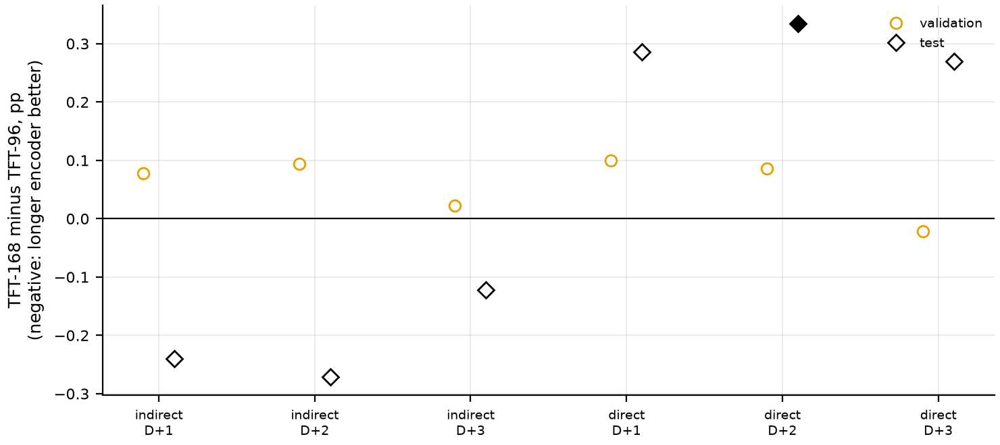

- **Question:** Does the longer encoder help, and is the answer the same on validation and on test?
- **Shows:** For each route and horizon, the nRMSE of the TFT with a 168-hour encoder minus that of the TFT with a 96-hour encoder, in kW (percentage points). Negative: the longer encoder is better. A filled marker is a significant paired Diebold-Mariano test (HLN, Bonferroni over the six cells of the split). Each model was tuned separately, one seed each.
- **Takeaway:** On validation the difference is between -0.02 and +0.10 pp, and no cell is significant. On test it is between -0.27 and +0.33 pp, with the sign negative for the indirect route in 3 of 3 horizons and positive for the direct route in 3 of 3; the number of significant cells is 1 of 12. A consistent advantage of the shorter window is not found: the sign depends on the route.
- **Led to:** The report's section on the encoder length; the submitted statement of a consistent advantage of the 96-hour window (M48) is not supported.
- **File:** `outputs/figures/stage_11/S11-09_encoder_length.png`
- **Inputs:** `outputs/11_analyses/encoder_length.csv`, `outputs/11_analyses/manifest.json`
- **Built at commit:** `a92756b+dirty`

### S11-10. TFT-96: how the search converged and what mattered

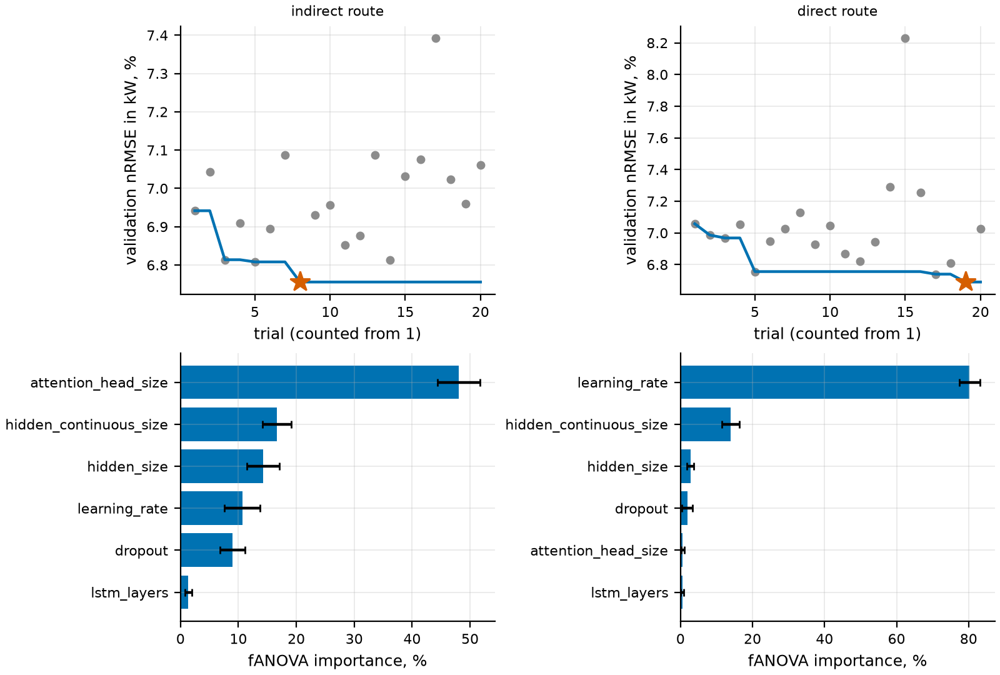

- **Question:** Did the 20 trials of TFT-96 converge, and which hyper-parameter explained the differences?
- **Shows:** Top: the validation nRMSE in kW of every trial (points) and the running best (line), for each route; the star is the winning trial. Bottom: the fANOVA importance of each hyper-parameter (mean and standard deviation over ten seeds of the importance model).
- **Takeaway:** The best trial is number 8 of 20 for the indirect route and number 19 for the direct route; a winner that late means that the direct search had not visibly converged. The most important hyper-parameter is attention_head_size for the indirect route (48 per cent) and learning_rate for the direct route (80 per cent). With 20 trials the importance model has few points; the values are descriptive.
- **Led to:** The report's section on the hyper-parameters of the TFT; the budget stays that of the submitted study (D-37).
- **File:** `outputs/figures/stage_11/S11-10_tft96_search.png`
- **Inputs:** `outputs/runs/20261114T083930Z_final/tft96/trials.csv`, `outputs/runs/20261114T083930Z_final/explain/hparam_importance.csv`
- **Built at commit:** `a92756b+dirty`

### S11-11. Bias² and variance of the error, and the bias in normal operation

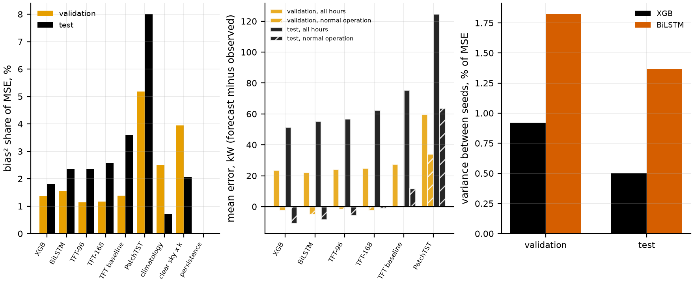

- **Question:** How much of the squared error is a systematic offset, and where does the offset come from?
- **Shows:** Left: the share of the mean squared error that is the squared mean error (bias²; the rest is the variance of the error), mean over the six route and horizon cells, validation and test, all daytime hours. Middle: the mean error in kW on all hours and on the hours of normal operation (no curtailment, stop or derate; D-22). Right: the share of the squared error of a seed that is the variance between the three seeds (XGB and BiLSTM).
- **Takeaway:** Bias² is below 1.6% of the squared error for the six models on validation and below 3.6% on test, except PatchTST (8.0% on test). Every model has a positive mean error on all hours, +52 to +125 kW on test; on the hours of normal operation it is -11 to +12 kW for XGB, BiLSTM and the three TFTs, so nearly all of their positive mean error is made on the 186 operation-limited hours; PatchTST keeps +64 kW in normal operation. The variance between seeds is at most 1.8% of the squared error.
- **Led to:** The statement of the bias of the neural forecasts (D-37) as a property of the operation-limited hours, and the report's section on the error decomposition.
- **File:** `outputs/figures/stage_11/S11-11_bias_variance.png`
- **Inputs:** `outputs/11_analyses/decomposition.csv`, `outputs/11_analyses/decomposition_seeds.csv`, `outputs/11_analyses/manifest.json`
- **Built at commit:** `a92756b+dirty`

### S11-12. XGB: the mean error by production quintile, two ways

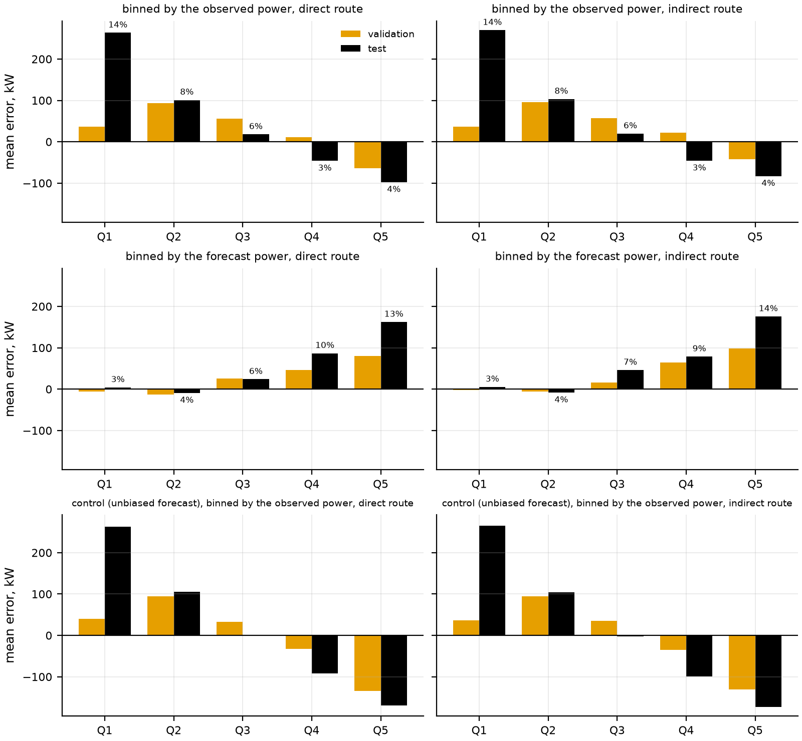

- **Question:** Is the XGB biased at low and high power, or does the pattern come from how the hours are binned?
- **Shows:** The mean error of the XGB (kW, forecast minus observed), seed 42, D+1, in five bins of equal validation count. Upper row: bins of the observed power (as in the submitted report). Lower row: bins of the forecast itself, which is known at issuance. Left: direct route, right: indirect route (in kW). Validation and test. The numbers above the bars are the share of operation-limited hours in the test bin. Third row, a control: the same XGB forecast made conditionally unbiased on validation by an isotonic regression, binned by the observed power.
- **Takeaway:** Binned by the observed power the lowest bin has a mean error of +263 kW and the highest -98 kW on test (direct route): a positive then negative pattern. Binned by the forecast it is +4 and +162 kW: the signs are the opposite at both ends. The control forecast, unbiased by construction on validation, gives +263 and -170 kW in the same observed bins on test, so binning by the outcome produces the first pattern without any conditional bias in the model. In the lowest observed bin 14% of the test hours are operation-limited against 2% on validation.
- **Led to:** The report's section on the production quintiles (M45): the reading of the submitted profile as a physical effect is not supported; the same table exists for every model.
- **File:** `outputs/figures/stage_11/S11-12_production_quintiles.png`
- **Inputs:** `outputs/11_analyses/quintiles.csv`, `outputs/11_analyses/quintile_control.csv`, `outputs/11_analyses/manifest.json`
- **Built at commit:** `a92756b+dirty`

### S11-13. XGB: feature-group ablation, validation and test

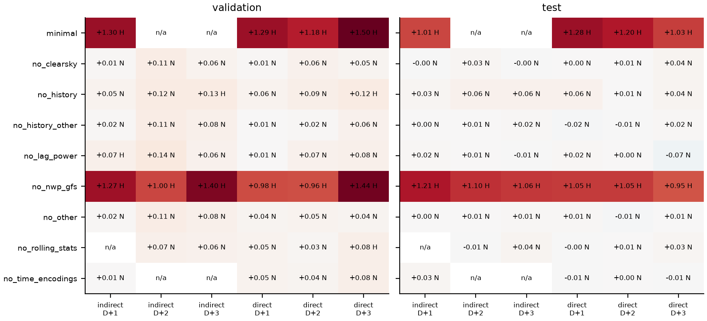

- **Question:** Which groups of features does the XGB need, and do the test results agree with validation?
- **Shows:** The change of the nRMSE in kW (percentage points) when a group of features is removed and the model is refitted, against the full model; mean over three seeds, validation and test. The letter is the verdict (H helpful, N neutral, U harmful) by the rule of the margin of two pooled seed standard deviations, at least 0.05 pp. n/a: the mode does not apply to that cell (the group is absent from the input of that cell, which the ablation record lists).
- **Takeaway:** Removing all but the minimal set raises the error by 1.18 to 1.50 pp on validation, and the GFS group by 0.96 to 1.44 pp; the other groups change it by at most 0.14 pp. The verdicts agree between validation and test in 45 of 49 cells.
- **Led to:** The report's section on the ablation: the weather-forecast group is the one that matters; the history groups change the error by about the size of the seed margin (M41, C-74).
- **File:** `outputs/figures/stage_11/S11-13_ablation_final.png`
- **Inputs:** `outputs/runs/20261114T083930Z_final/report/report_ablation.csv`, `outputs/runs/20261114T083930Z_final/report/report_ablation_test.csv`, `outputs/runs/20261114T083930Z_final/ablation/ablation_modes.csv`
- **Built at commit:** `a92756b+dirty`

### S11-14. PatchTST against XGB and against climatology

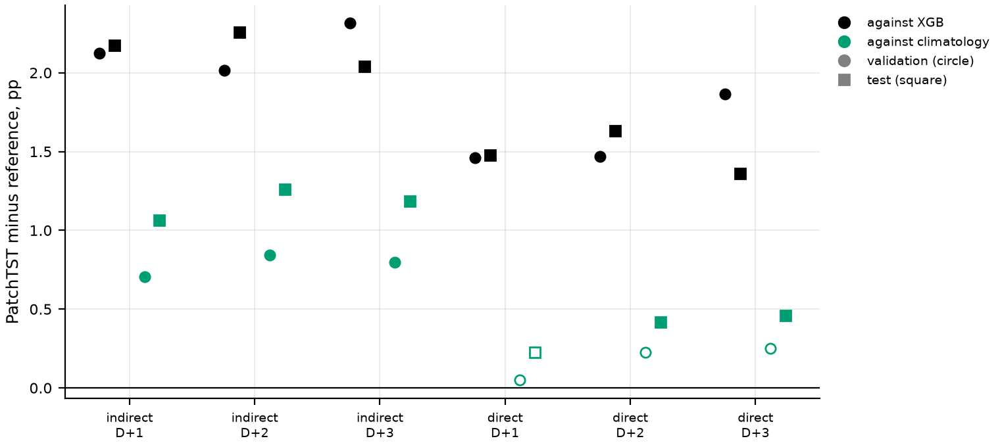

- **Question:** How far is the univariate PatchTST from the XGB with all inputs, and from a climatology?
- **Shows:** For each route and horizon, the nRMSE of PatchTST minus that of XGB (seed 42) and minus that of climatology, in kW (percentage points), validation and test. Positive: PatchTST is worse. A filled marker is a significant paired test (HLN, Bonferroni over the six cells of the split and reference).
- **Takeaway:** PatchTST is worse than XGB by 1.36 to 2.31 pp, significantly in 12 of 12 cells. Against climatology the gap is +0.05 to +1.26 pp, significant in 8 of 12 cells, all of them in the worse direction. A gap of this size does not support the reading of PatchTST as a lower bound within about one point of XGB.
- **Led to:** The report's section on PatchTST (M49): the submitted bound on the value of feature engineering is not stated.
- **File:** `outputs/figures/stage_11/S11-14_patchtst_gap.png`
- **Inputs:** `outputs/11_analyses/patchtst_gap.csv`, `outputs/11_analyses/manifest.json`
- **Built at commit:** `a92756b+dirty`

### S11-15. Our error and the literature, on the same normalisation

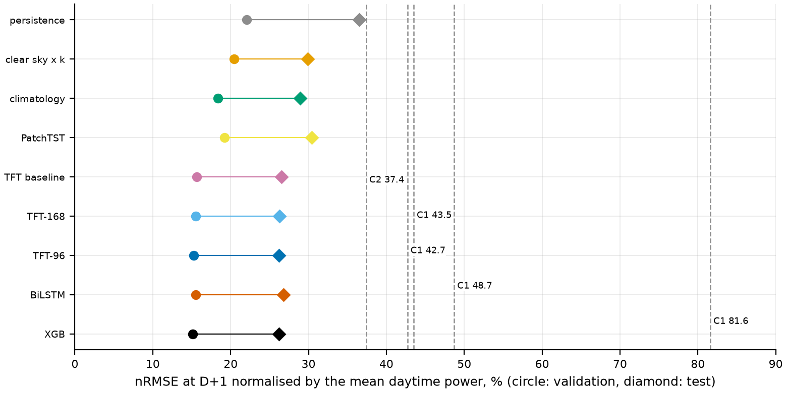

- **Question:** How do our errors compare with the day-ahead errors of the papers, once both are divided by the mean daytime power?
- **Shows:** The nRMSE at D+1 normalised by the mean observed daytime power (L-16), mean over seeds and over the two routes, for every model and reference on validation and test; the papers' numbers (the review's C1 and C2) as vertical lines. The differences of climate, NWP and resolution are listed in the panel.
- **Takeaway:** On this normalisation our six models are between 15 and 19 per cent on validation and between 26 and 30 per cent on test, against 37.4 to 48.7 per cent in the papers. The numbers are not comparable one to one: a hyper-arid site where most hours are clear, a coarser NWP, hourly instead of 15-minute data, one plant instead of a mean over seven, and an eight-month test period. No ranking against the papers is made.
- **Led to:** The report's literature paragraph (L-20, L-16): the papers' methods transfer, their numbers are not targets.
- **File:** `outputs/figures/stage_11/S11-15_literature_alignment.png`
- **Inputs:** `outputs/11_analyses/literature_alignment.csv`, `docs/literature_review.md`
- **Built at commit:** `a92756b+dirty`

### S11-16. The six models of the final run: inputs, budgets and time

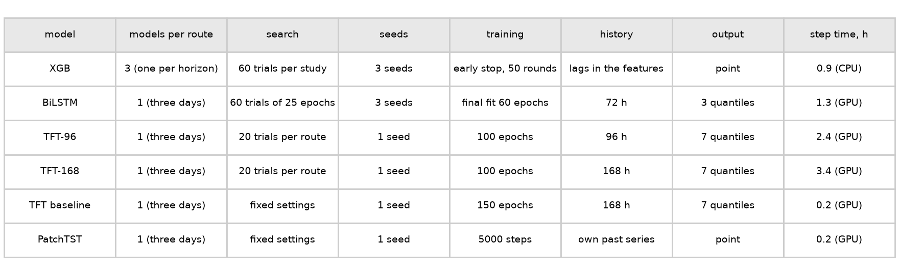

- **Question:** What does each model see, how was it tuned in the final run, and what did it cost?
- **Shows:** One row per model, read from the configurations and the step records of the final run: the number of trials per study, the seeds, the epochs or steps, the history window, the output and the time of the step (hours).
- **Takeaway:** The final run used the budgets of the submitted study: 60 trials and 3 seeds for XGB and BiLSTM, 20 trials per route for the two tuned TFTs, fixed settings for the TFT baseline and PatchTST. The five neural models took 7.6 hours of GPU time in total and XGB 0.9 hours of CPU time.
- **Led to:** The report's model table; the development cards (S09-25) keep the development budgets.
- **File:** `outputs/figures/stage_11/S11-16_model_cards_final.png`
- **Inputs:** `outputs/runs/20261114T083930Z_final/config.yaml`, `outputs/runs/20261114T083930Z_final/xgb/step.json`, `outputs/runs/20261114T083930Z_final/bilstm/step.json`, `outputs/runs/20261114T083930Z_final/tft96/step.json`, `outputs/runs/20261114T083930Z_final/tft168/step.json`, `outputs/runs/20261114T083930Z_final/tftbase/step.json`, `outputs/runs/20261114T083930Z_final/patchtst/step.json`, `outputs/runs/20261114T083930Z_final/xgb/xgb_config.json`, `outputs/runs/20261114T083930Z_final/bilstm/lstm_sota_config.json`, `outputs/runs/20261114T083930Z_final/tft96/tft_96_config.json`, `outputs/runs/20261114T083930Z_final/tft168/tft_168_config.json`, `outputs/runs/20261114T083930Z_final/tftbase/tft_config.json`, `outputs/runs/20261114T083930Z_final/patchtst/patchtst_config.json`
- **Built at commit:** `a92756b+dirty`

### S11-17. The same, in the hours of normal operation

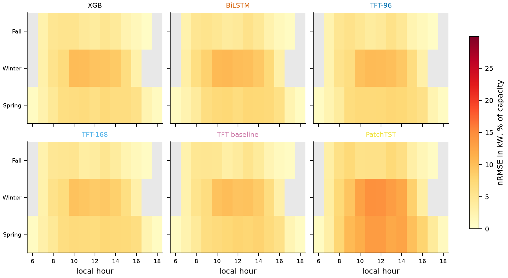

- **Question:** Does the pattern of S11-05 remain when the hours of curtailment, stops and derate are taken out?
- **Shows:** As S11-05, with only the hours of normal operation (no operation-limited flag, D-22), on the same colour scale.
- **Takeaway:** In normal operation the largest cell of each model is in the local hour(s) 10, 11, and the largest cell is Winter at 11:00 (14.6 per cent, PatchTST). For XGB in the autumn at 11:00 the error falls from 22.9 per cent on all hours to 4.4 in normal operation: the autumn peak of S11-05 is mostly the operation-limited hours.
- **Led to:** The report states both views (D-22); the diurnal profile is read in normal operation, and the limited hours are a separate topic.
- **File:** `outputs/figures/stage_11/S11-17_hour_season_normal.png`
- **Inputs:** `outputs/11_analyses/hour_season.csv`, `outputs/11_analyses/manifest.json`
- **Built at commit:** `a92756b+dirty`
