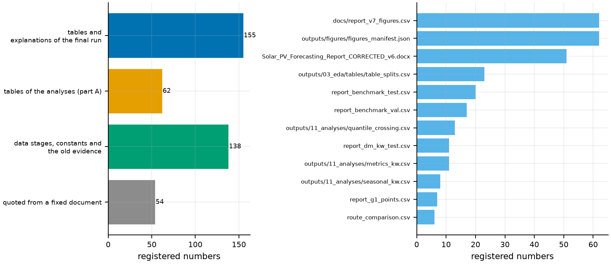
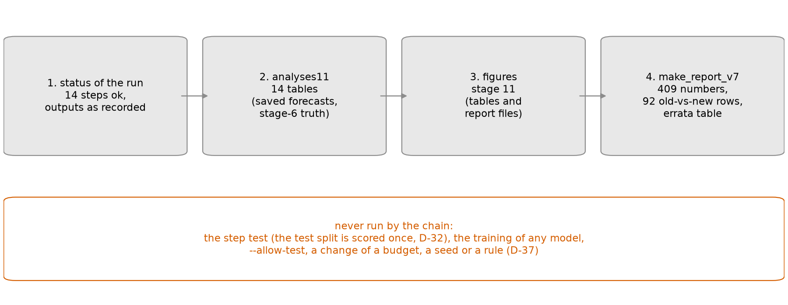
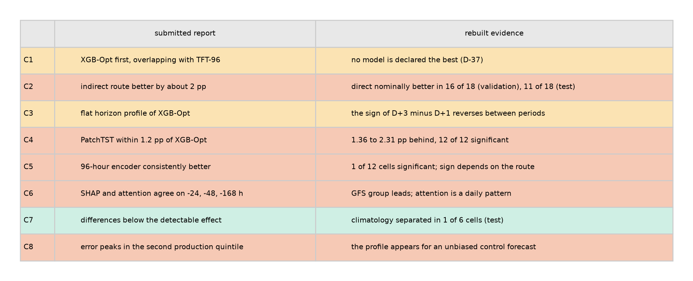
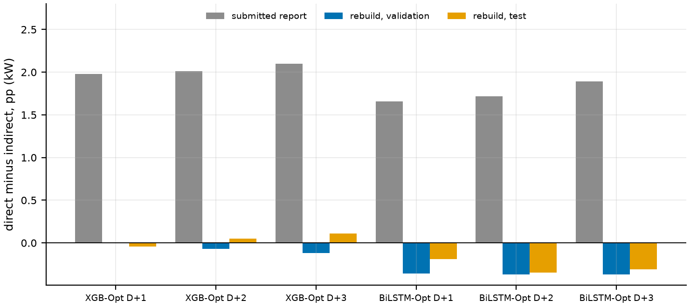

# Figure sheet: Stage 11, B: The report sections, the traceability and the old against new results

Generated by `python -m solarpv.figures` from `outputs/figures/figures_manifest.json`; do not edit by hand. One sheet per task (`docs/figures_plan.md`, rule 7): what the task did, what it found and what that led to, for writing the report. Every takeaway is formatted from the facts its builder computed.

Plan and self-review of the task: `docs/stage11_plan.md section 5`.

Figures: 4 (2 process, 2 correction).

## Process figures

### S11-18. Where every number of the report comes from

- **Question:** Does every number of the report have a source file and a script, and how are the numbers spread over the sources?
- **Shows:** Left: the registered numbers of the report by kind of source. Right: the twelve files that supply the most numbers. The registry is written by the script that writes the text, so a number cannot reach the report without a row.
- **Takeaway:** The 390 registered numbers of the report are read from 79 files: 155 from the tables and explanations of the final run, 49 from the tables of the analyses of part A, 137 from the data stages and constants, and 49 are quotations of the submitted report or of the project documents. Every row names the script that formats it; a test fails when a number of the text has no row.
- **Led to:** docs/traceability.csv and the table of old against new results (S-01, S-05, S-42 to S-44).
- **File:** `outputs/figures/stage_11/S11-18_number_sources.png`
- **Inputs:** `docs/traceability.csv`
- **Built at commit:** `1287c17`

### S11-19. The rebuild from the frozen predictions

- **Question:** What does the stage-11 rebuild read, what does it write, and what does it never run?
- **Shows:** The four steps of `scripts/make_tables_from_frozen.py` with what each reads and writes, and, below, what the chain never does. The counts are read from the files the steps wrote.
- **Takeaway:** The chain starts from the 14 steps of the final run that are `ok` and writes 13 tables of analyses, the figures of stage 11, 390 registered numbers and 92 rows of old against new results. It never runs the step `test` (the test split was scored once, 1 time in the access log), never trains a model and never changes a budget, a seed or a rule (D-37).
- **Led to:** S-45 (Q-30, option a): the counterpart of `--skip-train`; `--xgb-only`, a training run, is left for the end of the stage.
- **File:** `outputs/figures/stage_11/S11-19_rebuild_chain.png`
- **Inputs:** `outputs/runs/20261114T083930Z_final/run.json`, `outputs/11_analyses/manifest.json`, `docs/traceability.csv`, `docs/old_vs_new.csv`, `outputs/07_evaluation/test_access_log.csv`
- **Built at commit:** `1287c17`

## Correction figures (for docs/defense_notes.md only)

### C-11. The eight conclusions of the submitted report, one by one

- **Question:** Which conclusions of the submitted report does the rebuilt pipeline reproduce?
- **Shows:** One row per conclusion C1 to C8 of the submitted report, with the rebuilt evidence and a verdict. Green: reproduced; orange: replaced by a different statement; red: not supported.
- **Takeaway:** Of the eight conclusions, 1 is reproduced, 2 are replaced by a different statement and 5 are not supported. The route (C2) is nominally the other way in 16 of 18 pairs on validation and 11 of 18 on test; the encoder (C5) has 1 of 12 cells significant; PatchTST (C4) is 1.36 to 2.31 pp behind XGB in kW (the submitted report stated 1.2 pp, in the units of the target, F-06); the climatology margin (C7) is significant in 1 cell of 6.
- **Led to:** docs/defense_notes.md section 16; docs/report_v7.md section 14.
- **File:** `outputs/figures/correction/C-11_conclusions_ledger.png`
- **Inputs:** `outputs/11_analyses/patchtst_gap.csv`, `outputs/11_analyses/encoder_length.csv`, `outputs/11_analyses/horizon_robustness.csv`, `outputs/11_analyses/quintile_control.csv`, `outputs/runs/20261114T083930Z_final/evaluate/val/route_comparison.csv`, `outputs/runs/20261114T083930Z_final/test/test/route_comparison.csv`, `outputs/runs/20261114T083930Z_final/report/report_dm_kw_test.csv`, `outputs/runs/20261114T083930Z_final/report/report_benchmark_test.csv`, `outputs/runs/20261114T083930Z_final/report/report_benchmark_val.csv`, `outputs/runs/20261114T083930Z_final/explain/xgb/xgb_shap_groups.csv`, `outputs/runs/20261114T083930Z_final/explain/tft/tft_attention_summary.csv`, `docs/old_vs_new.csv`
- **Built at commit:** `c263a41`

### C-12. The route advantage: submitted report and rebuild

- **Question:** Is the indirect route better than the direct route by about two points, as the submitted report stated?
- **Shows:** For XGB-Opt and BiLSTM-Opt at each horizon: the nRMSE of the direct route minus that of the indirect route, in kW, as submitted (bars on the left of each group) and in the rebuild on validation and on test (seed mean). Positive: the indirect route is better.
- **Takeaway:** The submitted report found the indirect route better by 1.66 to 2.10 pp. In the rebuild the difference is -0.37 to -0.00 pp on validation and -0.35 to +0.11 pp on test, with the sign of 3 of the 6 bars changing between the two periods: the advantage is not reproduced, and neither route is declared better.
- **Led to:** docs/defense_notes.md section 16; docs/report_v7.md section 13.2 (C-16, C-34).
- **File:** `outputs/figures/correction/C-12_route_old_new.png`
- **Inputs:** `docs/old_vs_new.csv`
- **Built at commit:** `c263a41`
