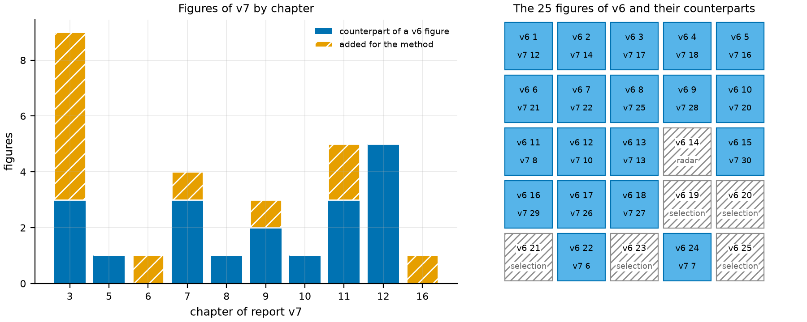

# Figure sheet: Stage 11, C: The final report v7 with its figures

Generated by `python -m solarpv.figures` from `outputs/figures/figures_manifest.json`; do not edit by hand. One sheet per task (`docs/figures_plan.md`, rule 7): what the task did, what it found and what that led to, for writing the report. Every takeaway is formatted from the facts its builder computed.

Plan and self-review of the task: `docs/stage11_plan.md section 6`.

Figures: 1 (1 process, 0 correction).

## Process figures

### S11-20. The figures of report v7 against those of the submitted report

- **Question:** Which figures does the final report hold, where, and which figure of the submitted report does each one replace?
- **Shows:** Left: the figures of the report by chapter, counterparts of a v6 figure (blue) and figures added to complete the account of the method (orange). Right: the 25 figures of v6, each with the number of its counterpart in v7, or hatched when it is not redrawn.
- **Takeaway:** The report has 31 figures in 10 chapters: 19 are the counterparts of v6 figures and 12 are added where they complete the account of the method or answer a sentence of v6 that had no figure (sections 3.2, 3.3, 3.4, 3.6, 3.9, 6.1, 7.6, 9.2, 11.3, 11.4, 16). Of the 25 figures of v6, 19 are redrawn from the final run and 6 are not: 5 drew the feature-selection protocol of v6, which was replaced (F-26, D-23), and 1 repeated the seasonal numbers as a radar (C-84).
- **Led to:** docs/report_v7.md (the figures chosen in part C) and docs/report_v7_README.md.
- **File:** `outputs/figures/stage_11/S11-20_report_figures.png`
- **Inputs:** `docs/report_v7_figures.csv`
- **Built at commit:** `ddee3ba+dirty`
