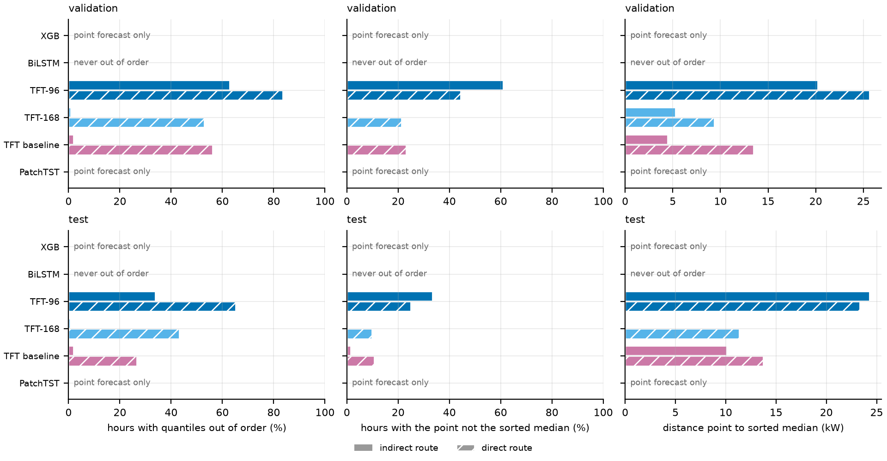

# Figure sheet: Stage 11, D: The quantile crossing in the report, with its sources

Generated by `python -m solarpv.figures` from `outputs/figures/figures_manifest.json`; do not edit by hand. One sheet per task (`docs/figures_plan.md`, rule 7): what the task did, what it found and what that led to, for writing the report. Every takeaway is formatted from the facts its builder computed.

Plan and self-review of the task: `docs/stage11_plan.md section 7`.

Figures: 1 (1 process, 0 correction).

## Process figures

### S11-21. The quantile outputs of the final run

- **Question:** How often are the quantiles of the final run out of order, on validation and on test, and what does sorting them cost the point forecast?
- **Shows:** Rows: validation and test. Left: the share of the scored hours whose quantiles are out of order, per model and route (indirect solid, direct hatched), the mean over the horizons and the seeds. Middle: the share of the hours on which the 0.5 quantile, the point forecast, is not the median of the sorted quantiles. Right: the mean distance between the two on those hours, in kW. XGB-Opt and PatchTST forecast a point only.
- **Takeaway:** The quantiles of the TFTs are out of order on 0.7 to 83.5 % of the hours of a model and route on validation and 0.7 to 65.2 % on test, most often for TFT-96 on the direct route; those of the BiLSTM-Opt never are. Sorting moves the median away from the point forecast on up to 61.0 % of the hours on validation and 33.3 % on test, by 19.2 and 20.7 kW on average on those hours, and it lowers the quantile loss in every cell of the TFTs, by at most 4.6 %.
- **Led to:** Section 6.5 of report v7: the point forecast stays the 0.5 head and is the only output scored, and the quantiles are sorted wherever they are read as a distribution (D-33).
- **File:** `outputs/figures/stage_11/S11-21_quantile_crossing_final.png`
- **Inputs:** `outputs/11_analyses/quantile_crossing.csv`, `outputs/11_analyses/manifest.json`
- **Built at commit:** `d6050fb`
