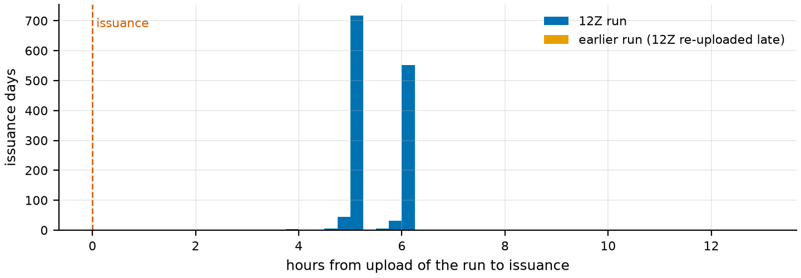
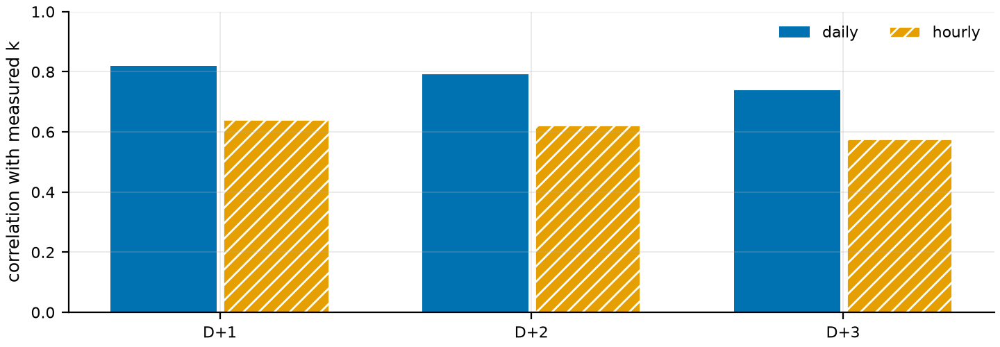
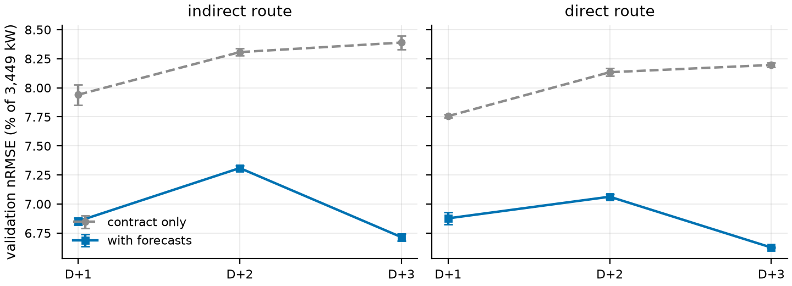

# Figure sheet: Stage 6b: Weather forecasts (GFS)

Generated by `python -m solarpv.figures` from `outputs/figures/figures_manifest.json`; do not edit by hand. One sheet per task (`docs/figures_plan.md`, rule 7): what the task did, what it found and what that led to, for writing the report. Every takeaway is formatted from the facts its builder computed.

Figures: 3 (3 process, 0 correction).

## Process figures

### S6b-01. Forecast runs public before the issuance time

- **Question:** Was every weather-forecast run really available at local midnight, when the forecast is issued?
- **Shows:** Histogram of the time between the upload of the last file of the run used for each day and the issuance time; runs that replaced a late 12Z run are counted separately.
- **Takeaway:** 1,369 issuance days; the run used was uploaded 1.1 to 12.0 hours before issuance (median 5.1 h). 2 days use the earlier 06Z run, because their 12Z files had been uploaded again after issuance.
- **Led to:** Only runs public before issuance enter the features (T-17); the check reads the upload time of every file, not the nominal run time.
- **File:** `outputs/figures/stage_6b/S6b-01_forecast_availability.png`
- **Inputs:** `data/processed/06b_gfs/gfs_features_D1.parquet`
- **Built at commit:** `123b2fb`

### S6b-02. Forecast agreement with the measured clear-sky index

- **Question:** How well does the forecast cloudiness track what the plant measured, at each horizon?
- **Shows:** Correlation between the forecast clear-sky index on the panel plane and the measured k, per hour and per day, at each horizon (train and validation days).
- **Takeaway:** Daily correlation 0.82 / 0.79 / 0.74 and hourly 0.64 / 0.62 / 0.58 at D+1 / D+2 / D+3 over 1,124 days: a real, imperfect forecast that weakens with lead time.
- **Led to:** The forecast variables became candidates for feature selection, after the value test of S6b-03.
- **File:** `outputs/figures/stage_6b/S6b-02_gfs_agreement.png`
- **Inputs:** `outputs/06b_gfs/horizon_skill.csv`
- **Built at commit:** `123b2fb`

### S6b-03. Value of the weather forecasts on validation

- **Question:** Do the forecast variables improve a fixed model enough to be kept?
- **Shows:** Validation nRMSE in kW of a fixed XGBoost with the contract features alone (dashed, circles) and with the forecast variables added (solid, squares); mean and SD over 3 seeds.
- **Takeaway:** Adding the forecasts lowers the error by 0.88 to 1.67 points of capacity at every horizon and in both routes, against a seed spread of at most 0.09.
- **Led to:** The forecasts were accepted (D-12) and entered feature selection as candidates.
- **File:** `outputs/figures/stage_6b/S6b-03_gfs_value.png`
- **Inputs:** `outputs/06b_gfs/value_check.csv`
- **Built at commit:** `123b2fb`
