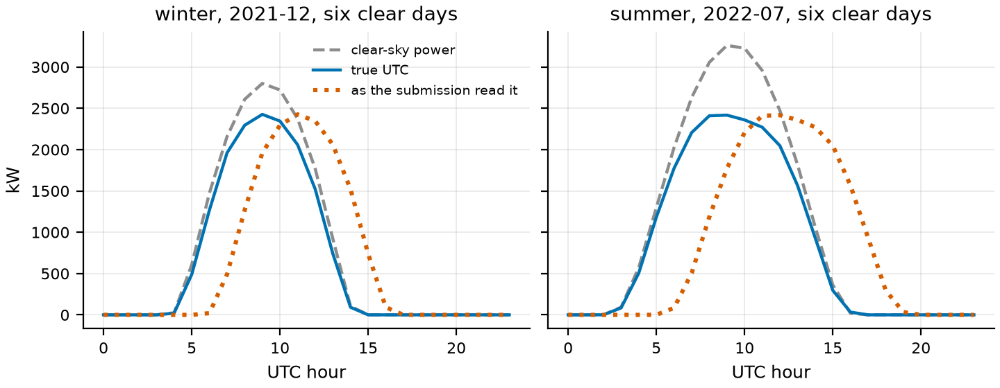
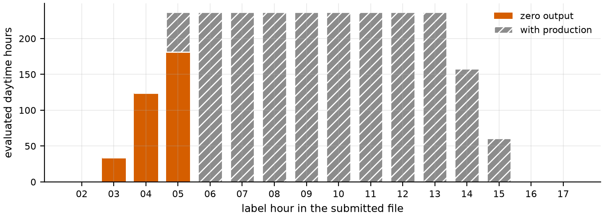
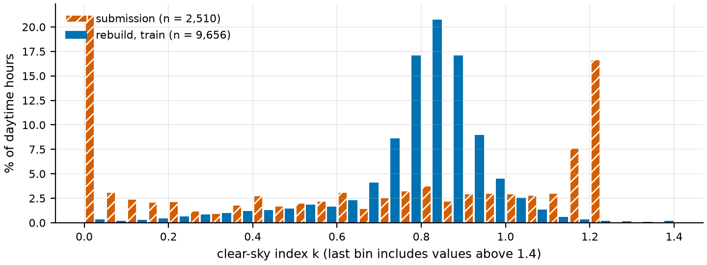
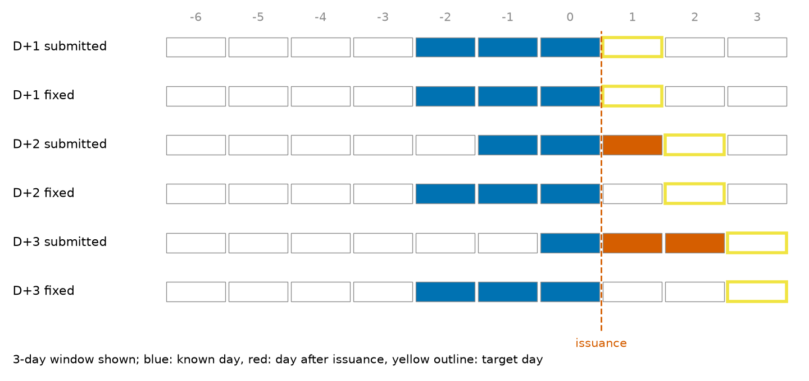
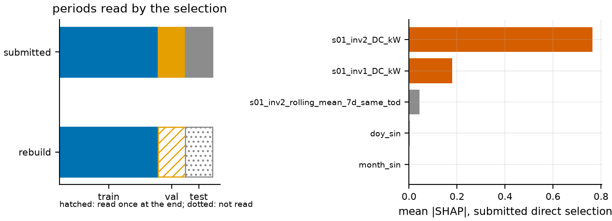
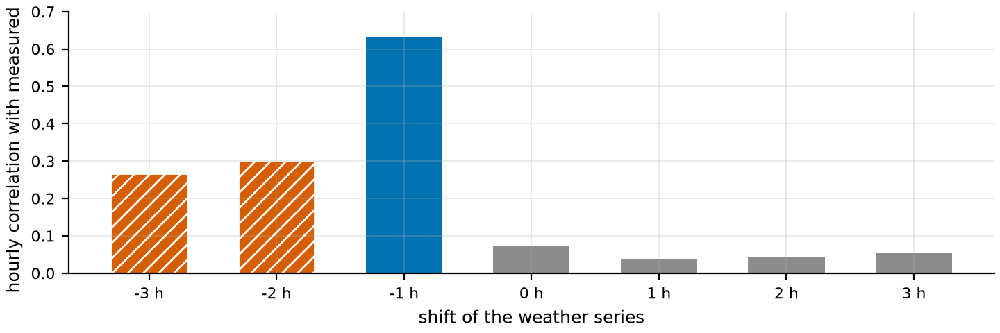

# Figure sheet: Corrections of the submitted project made with the figure book (OP-56)

Generated by `python -m solarpv.figures` from `outputs/figures/figures_manifest.json`; do not edit by hand. One sheet per task (`docs/figures_plan.md`, rule 7): what the task did, what it found and what that led to, for writing the report. Every takeaway is formatted from the facts its builder computed.

Figures: 6 (0 process, 6 correction).

## Correction figures (for docs/defense_notes.md only)

### C-01. Daily profile read as UTC and as local time

- **Question:** What does reading local time stamps as UTC do to the data?
- **Shows:** Mean hourly AC power of six clear train days per season against the clear-sky power, by true UTC hour (solid) and as the submitted pipeline placed it (dotted, local wall-clock hour read as UTC).
- **Takeaway:** Read as UTC, production appears 2 hours (winter) and 3 hours (summer) after the sun: the clear-day production centre sits 120 and 174 minutes after solar noon, against 1.9 and 2.6 minutes after the conversion.
- **Led to:** Every v6 result was computed on the shifted data (F-01); the rebuild converts the export to UTC at ingestion and checks the production centre against the sun every month (T-08).
- **File:** `outputs/figures/correction/C-01_time_shift_profile.png`
- **Inputs:** `data/processed/06_features/features_1H_D1.parquet`, `outputs/03_eda/tables/table_time_bug.csv`
- **Built at commit:** `a407f85+dirty`

### C-02. Zero-output daytime hours by label hour

- **Question:** Where do the 'inverter downtime' hours of the submitted report come from?
- **Shows:** Daytime hours of the submitted forecast file (direct target, D+1) per label hour, split into hours with production and hours with zero output.
- **Takeaway:** 339 of 2,510 evaluated daytime hours (13.5%) have zero output, and all of them carry the labels 03:00-06:00: local hours before sunrise that the shifted time base counted as daytime. None is a whole-day outage.
- **Led to:** The disclosure about inverter downtime is rewritten from the corrected data (C-13); real stops are now flagged from the inverter data (F1, F3).
- **File:** `outputs/figures/correction/C-02_false_downtime.png`
- **Inputs:** `submission_evidence/08_lstm_alignment/predictions_lstm_sota_aligned.csv`
- **Built at commit:** `a407f85+dirty`

### C-03. Clear-sky index of the submission and of the rebuild

- **Question:** What did the clipping of the target at 1.2 do?
- **Shows:** Share of daytime hours per k bin of 0.05: the submitted file's indirect truth (its evaluated test hours) and the rebuild's k (valid daytime train hours).
- **Takeaway:** In the submission 16.7% of daytime hours sit exactly at the 1.2 cap and 21.3% near zero; in the rebuild 0.61% exceed 1.2 and none is capped. The pile at the cap came mostly from the time shift: afternoon power divided by morning clear-sky power (F-06).
- **Led to:** k is now an hourly ratio of means against the panel-plane clear-sky power, never clipped, and converts back to kW exactly (F-06, T-11).
- **File:** `outputs/figures/correction/C-03_k_clipping.png`
- **Inputs:** `submission_evidence/08_lstm_alignment/predictions_lstm_sota_aligned.csv`, `data/processed/06_features/features_1H_D1.parquet`
- **Built at commit:** `a407f85+dirty`

### C-04. Same-hour windows per horizon, submitted and fixed

- **Question:** Did the multi-day averages use days that were not yet known at issuance?
- **Shows:** For each horizon and window length, the days averaged by the submitted code and by the fixed code; red cells are days after the issuance midnight.
- **Takeaway:** The submitted windows always started one day before the target day, so at D+2 they included 1 unknown day and at D+3 2 unknown days; the fixed windows end on the last day before issuance at every horizon.
- **Led to:** Horizon-aware windows (F-07), with a test that plants the submitted window and must fail (T-09, T-18).
- **File:** `outputs/figures/correction/C-04_rolling_windows.png`
- **Inputs:** drawn from the code
- **Built at commit:** `a407f85+dirty`

### C-05. Feature selection of the submission: periods and dominance

- **Question:** What did the submitted feature selection see?
- **Shows:** Left: the periods each selection read (submitted: all three; rebuild: train only, validation once at the end). Right: the five largest mean |SHAP| values of the submitted direct-route selection.
- **Takeaway:** The submitted selection ran on the whole period, test included. In its direct route the same-hour DC power of the two inverters took 95% of the listed importance, the first 17 times the third feature; they were removed only after the ranking.
- **Led to:** The rebuild selects on train only and admits features from an allow-list (F-26, F-27).
- **File:** `outputs/figures/correction/C-05_selection_leaks.png`
- **Inputs:** `00_data_audit/original_backup_2026-11-01/selection_shap_direct_top.csv`
- **Built at commit:** `a407f85+dirty`

### C-06. Submitted weather series: correlation by time shift

- **Question:** Was the submitted weather series a forecast, and was it aligned with the plant data?
- **Shows:** Hourly correlation of the submitted weather series with the measured clear-sky index for shifts of -3 to +3 hours.
- **Takeaway:** The series is the archive value of each target hour, not a forecast issued before midnight. It correlates 0.63 with the measured k after a 1-hour shift (end-of-hour labels), but only 0.30 and 0.27 at the 2- and 3-hour shifts that the time bug produced.
- **Led to:** The rebuild uses real forecast runs published before issuance and aligned in true UTC (F-28, D-12).
- **File:** `outputs/figures/correction/C-06_weather_alignment.png`
- **Inputs:** `00_data_audit/original_backup_2026-11-01/weather_lag_scan.csv`
- **Built at commit:** `a407f85+dirty`
