# Day-Ahead Solar Power Forecasting at One Section of a Utility-Scale PV Plant: A Comparative Study of Gradient Boosting, Recurrent and Transformer Architectures

Report v7, the rebuilt and corrected version of the submitted report v6. Author: Barak Yaakov, 2026.
Generated by `scripts/make_report_v7.py` from the frozen final run `20261114T083930Z_final` (tag `g1-frozen`).
The notes of the report (the correction note, the appendices and the availability of the code and the data) are in
`docs/report_v7_README.md`.

## Abstract

Day-ahead forecasts of photovoltaic power are needed to schedule a plant against the grid. This report compares six
models, XGBoost with monotone constraints (XGB-Opt), a bidirectional LSTM (BiLSTM-Opt), the Temporal Fusion
Transformer with a 96-hour and a 168-hour encoder (TFT-96, TFT-168), a TFT baseline with fixed settings and PatchTST,
for three horizons (D+1 to D+3) and two routes (the clear-sky index converted to power, and power directly), on a
section of two inverters of a utility-scale plant in the Southern Arava, Israel, with an AC capacity of
3,449 kW. The pipeline
runs from the one-minute SCADA export in true UTC to hourly features, uses only weather forecasts (GFS) that were public
before the issuance at local midnight, selects the features on the training period only, and scores every model and three
reference forecasts on the same daytime hours. The code was frozen and audited before the final training (gate G-1), and
the test period (2024-10..2025-05) was scored once.

On test, the nRMSE in kW, in percent of capacity, of the six models is
11.12 to 13.63 percent
(validation: 6.44 to 8.90),
against 12.37 to 12.52 for
climatology and 15.71 to 17.57
for persistence. XGB-Opt, BiLSTM-Opt and the three TFT models are close, and no model is declared the winner: in paired
Diebold-Mariano tests in kW on test the three TFT models are not separated from XGB-Opt in any cell. XGB-Opt is significantly
better than persistence and the clear-sky reference in every cell, and than climatology in
1
of 6 cells on test, where the observed difference is close to the minimum detectable effect of one section and one
test period. The error of every model and reference rises from validation to test; 66 percent of
the rise of XGB-Opt is in the
186
operation-limited hours (curtailment, stops, derate), which no input describes. The weather forecast is the input group
that matters most, in the ablation and in the attributions, and the two routes are equivalent within the uncertainty.

## Rules of reading

Every number of the test split is placed beside the validation number of the same view.
No model is declared the winner (D-37): four of the five neural models have one seed. The validation numbers are
tuning-split numbers (D-10). All
errors are nRMSE in kW, in percent of the plant capacity, over the daytime hours of the split with a measured output, the
same hours for every model. Every number of this report is registered in `docs/traceability.csv` with its source file and
the script that formats it, and the caption of every figure is the takeaway that its builder computed from the outputs.

## Reproduction and correction note (D-02)

This report rebuilds the submitted report (v6) from its evidence folder; it is not a one-to-one reproduction
(D-01). The rebuild corrects errors that changed the numbers: local time had been read as UTC (F-01), the
indirect target was clipped and its mean was a mean of ratios (F-06), rolling features saw unknown days at
D+2 and D+3 (F-07), the weather inputs were not forecasts available at issuance (F-28), and the feature
selection read the validation and test periods (F-26). Every correction has a row in `docs/errata.md` and a
test, and the table "Old vs new results" of the errata sets each submitted number beside the rebuilt one. The
scored hours changed from 2,580
in v6 to 2,575
in the rebuild, the same hours for every model, and the validation period was added as a second view (it had been
used for tuning).

## 1. Introduction

Solar photovoltaic generation is intermittent, weather-dependent and non-linear, and day-ahead scheduling commits a
plant to a production schedule before the weather of the delivery day is known. Physics gives the clear-sky output of a
plant; numerical weather prediction (NWP) gives the expected state of the atmosphere; machine learning learns the
relation between the two and the measured output. Attention-based models raise the question of how much of the skill
comes from the engineered inputs and how much from the history of the series itself.

This study compares six models on one plant section, from one pipeline, and makes the following contributions:

- **Issuance-time availability of every input.** Every input is checked against the issuance time at local midnight:
  measured lags end at the issuance, rolling windows and encoders do not reach past it, and the weather forecast is the
  GFS run that was public before it (sections 3.4 and 3.7).
- **Feature selection on the training period only**, with one look at validation (section 3.6).
- **A six-model benchmark on identical hours**, scored in kW against the measured AC power, with three reference
  forecasts, intervals, paired tests and the minimum detectable effect (chapters 6 to 8).
- **Two routes compared against the same truth.** The indirect route (the clear-sky index, converted to power) and the
  direct route (power) are both scored in kW against the measured AC power (chapter 10).
- **Interpretability and robustness.** SHAP attributions, TFT attention, encoder length, seeds, cross-validation, the
  error decomposition, production bins and a feature-group ablation (chapters 11 and 12).
- **Traceability.** Every number of the report is read from an output file and registered with its source, and the
  test period was scored once, on code frozen and audited before the final training (section 3.5, chapter 16).

Chapter 2 reviews related work. Chapter 3 describes the site, the data pipeline, the features, the feature selection, the
anti-leakage protocol and the split. Chapters 4 to 6 describe the methodology, the models and the evaluation. Chapters 7
to 12 present the results, chapter 13 discusses them and chapter 14 concludes.

## 2. Related Work

### 2.1 Statistical and Machine Learning Forecasters

Early machine-learning approaches to solar forecasting applied artificial neural networks to small, single-station
datasets [Mellit & Pavan, 2010]. Gradient-boosted trees, in particular XGBoost [Chen & Guestrin, 2016], introduced automatic handling of feature
interactions, built-in regularisation and monotone constraints, and are a dominant tabular method in solar forecasting
benchmarks [Nespoli et al., 2022].

### 2.2 Deep Learning Architectures

Recurrent networks, in particular Long Short-Term Memory networks [Hochreiter & Schmidhuber, 1997], are widely applied to multi-step solar
forecasting because they model sequential dependencies [Wang et al., 2019]. The bidirectional LSTM [Graves & Schmidhuber, 2005] processes the
sequence in both directions. The Temporal Fusion Transformer [Lim et al., 2021] combines gating, variable-selection networks and
multi-head attention to model static metadata, known future inputs and the dynamics of the target; its attention weights
describe which encoder positions it weights. PatchTST [Nie et al., 2023] divides the input series into patches that are treated as
tokens; its encoder-only, univariate design uses no exogenous variables and relies on the temporal structure of the target.

### 2.3 Two-Route Forecasting

Whether to forecast irradiance and convert it to power (the indirect route) or to forecast power directly (the direct
route) has received little systematic attention; studies that compare the routes do so on different training and test
sets [Antonanzas et al., 2016; Li et al., 2016]. This study scores both routes of the same models in kW against the same measured truth.

### 2.4 Evaluation Standards

Solar forecasting studies differ in the normalisation denominator, the daytime filter and whether the metrics cover all
hours or daytime hours only [Sweeney et al., 2020]. This study uses one daytime filter (sun elevation above
5 degrees at the middle of the hour),
normalises by the stated capacity, and reports block-bootstrap intervals [Efron & Tibshirani, 1993] and paired tests.

## 3. Study Site and Data

## 3.1 Plant description (S-01)

The plant that the data describe is a section of two inverters (inv1 and inv2) of a utility-scale park
of 40 MW in the Southern Arava, Negev, Israel; the park has 25 inverters in all (F-12, C-30).
The target is the AC power of these two inverters. That they form the whole metered section cannot be verified from the
data (A-07), and the rating of 3,449 kW
used to normalise every error is the sum of two ratings that is not verified against the inverter model (A-08); if the
rating were different, every nRMSE in percent of capacity would scale by the same factor and no ranking, test or skill
score would change. The climate is hyper-arid. Site coordinates are not published in this document (T-45).

| Parameter | Value |
|---|---|
| Location | Southern Arava, Negev, Israel (coordinates not published) |
| Section modelled | two inverters of the 25 of the park |
| AC capacity of the section | 3,449 kW |
| Panel plane | tilt 21, azimuth 185 degrees (measured on the corrected data, F-23) |
| Resolution | hourly, from minute data (1,971,360 rows) |
| Hourly rows | 32,856 |
| Train (hours, daytime hours with a measured output) | 21,195, 9,656 |
| Validation (hours, daytime hours with a measured output) | 5,832, 2,901 |
| Test (hours, daytime hours with a measured output) | 5,829, 2,575 |
| Operation-limited daytime hours (train, validation, test) | 379, 146, 186 (curtailment, stops, derate; D-22) |
| Test hours of the second data source (polled snapshots) | 1,071 (F-18) |

The data period is 2021-09-01 to 2025-05-31 in local dates (the split table, in UTC, starts on 2021-08-31 and ends on 2025-05-31). The daytime hour is
defined by the sun elevation at the middle of the hour (F-02).

## 3.2 Data processing

Figure 1 shows the pipeline. The one-minute export, written in local wall-clock time, is converted to true UTC
with the daylight-saving rule (F-01); the logger clocks are corrected per source and day against the solar geometry
(F-15); the minutes are averaged to hours; and an explicit cleaning policy removes impossible values and flags, without
erasing, the hours of curtailment, inverter stops and partial outages (D-22). The flagged hours stay in the primary score
and a second score leaves them out. Figure 2 shows them by month: they are rare in the first year of the data and
frequent from the second half of the data on, in the validation and test periods as well, which matters for the reading of the test results (section 7.6).

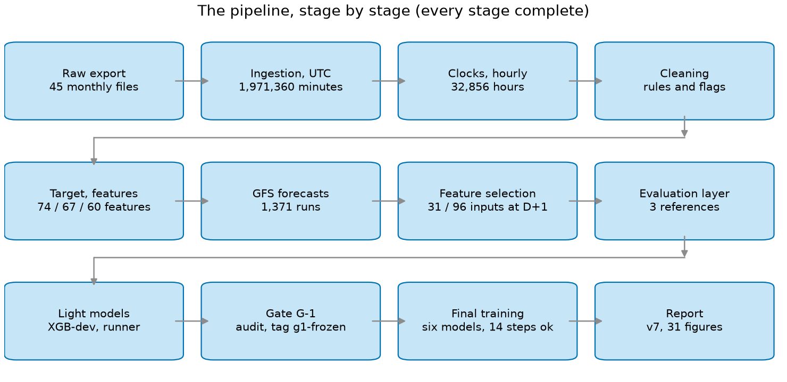

**Figure 1. The pipeline, stage by stage.** From 45 raw files to 1,971,360 UTC minutes, 32,856 hourly rows, 74 / 67 / 60 candidate features per horizon plus 1,371 weather-forecast runs, and 31 (indirect) and 96 (direct) model inputs at D+1. The final run completed 14 steps on the frozen code, and the report holds 31 figures. *(Figure book: `S01-01`.)*

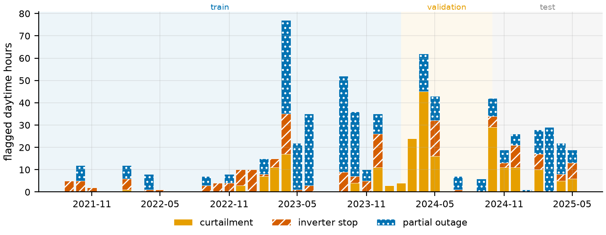

**Figure 2. Operationally limited daytime hours per month.** 379 flagged daytime hours in train, 146 in validation and 186 in test: 218 curtailment, 157 stops and 336 partial outages in total. *(Figure book: `S05-02`.)*

## 3.3 Target variables

The direct target is the hourly AC power in kW. The indirect target is the clear-sky index k, the measured power
divided by the clear-sky power of the panel plane (D-11), with no clipping, so that k and kW convert exactly into each
other (F-06). The mean daytime k on train is 0.788157.
Figure 3 shows the construction on a clear and on a cloudy day: dividing by the clear-sky power removes the daily
and seasonal shape and leaves the effect of the weather. A forecast of k is converted to kW with the clear-sky power of
the same hour, and both routes are scored in kW.

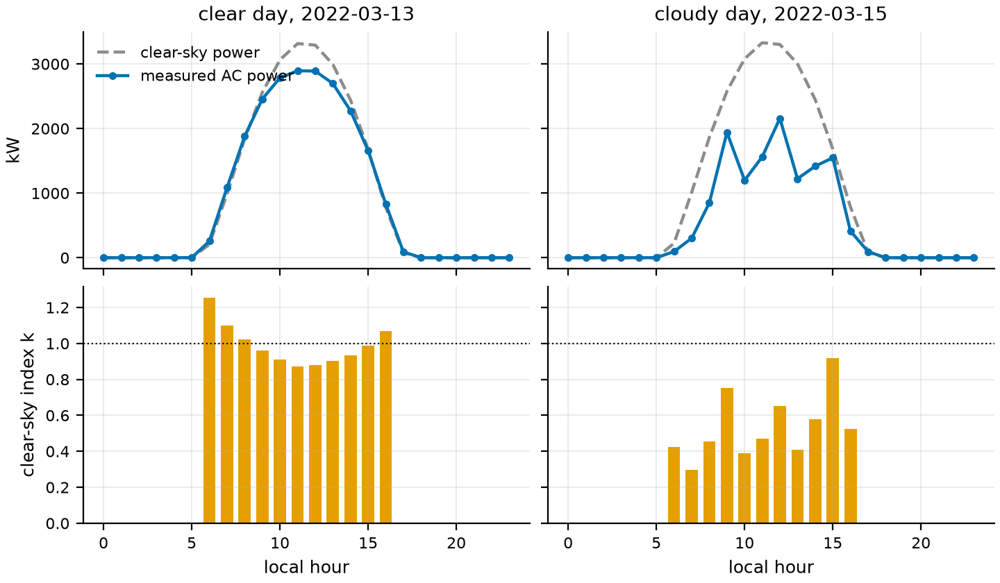

**Figure 3. From power to the clear-sky index on two days.** On the clear day (2022-03-13) the measured power follows the clear-sky curve: the daily k is 0.94, with hourly values from 0.87 to 1.25 (the highest at low sun). On the cloudy day (2022-03-15) the daily k is 0.54 and the hourly k drops to 0.30. Dividing by the clear-sky power removes the daily and seasonal shape and leaves the weather. *(Figure book: `S06-01`.)*

## 3.4 Feature engineering

The candidate features are calendar and solar-geometry encodings, the clear-sky power, lags and rolling statistics of
the measured power at the days that each horizon may use (section 3.9), and the weather forecast. The weather forecast is
the GFS run of the day before the issuance [NOAA NCEP, GFS], interpolated to the site and to the panel plane
(1,371 runs, D-12).
Figure 4 shows that every run used was public before the issuance: a run whose files were uploaded again after the
issuance is replaced by the earlier run of the same day (F-28).

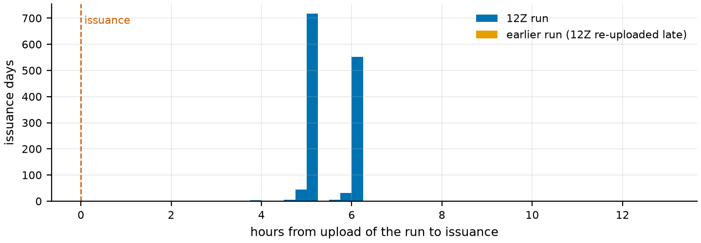

**Figure 4. Forecast runs public before the issuance time.** 1,369 issuance days; the run used was uploaded 1.1 to 12.0 hours before issuance (median 5.1 h). 2 days use the earlier 06Z run, because their 12Z files had been uploaded again after issuance. *(Figure book: `S6b-01`.)*

## 3.5 End-to-end milestones (S-05)

The comparison of the six models rests on earlier steps; each step has an artifact in the repository and
controls a risk of the forecasting setting. The numbers are read from the manifests of the steps.

| Step | Artifact | Risk controlled | Key number |
|---|---|---|---|
| Problem framing (D-16) | issuance at local midnight; D+1 to D+3; two targets | ambiguous forecast origin | three horizons, two routes |
| Ingestion (stage 2) | one-minute UTC series | local time read as UTC (F-01) | 1,971,360 rows |
| Logger clocks (stage 4) | clock offset per source and day | misalignment with solar geometry (F-15) | 32,856 hourly rows |
| Cleaning (stage 5) | explicit policy, flags not erasures | spikes, frozen values, curtailment (F-14, F-17) | 711 of 15,180 daytime hours flagged |
| Target and features (stage 6) | exact-inverse clear-sky index, horizon-aware lags | clipping, leaking rolling windows (F-06, F-07) | mean daytime k 0.788157 |
| Weather forecasts (stage 6b) | GFS runs public before issuance | inputs not known at issuance (F-28) | 1,371 runs |
| Feature selection (stage 7) | allow-list, train only, one validation look | selection on all periods (F-26) | 28 to 32 indirect, 82 to 96 direct inputs |
| Evaluation layer (stage 8) | six models, three references, paired tests | unequal rows, unpaired claims | HLN and Bonferroni, minimum detectable effect |
| Gate G-1 (stage 9) | audit, reproduction from raw data, external review, tag `g1-frozen` | changes after the test is seen | every review note answered (`docs/g1_review_log.md`) |
| Final run (stage 10) | budgets of v6, three seeds for XGB and BiLSTM | unequal tuning | 7.6 GPU hours |
| Test (stage 10, phase 2) | step `test`, run once | repeated looks at the test split | scored 1 time |

## 3.6 Feature selection

The features are selected on the training period only (D-23): an allow-list of candidates, a ranking by the
importance of a fixed XGBoost inside train, and a stability floor; validation is looked at once, after the sets are fixed.
The selected set of a route is kept only if it is not worse than the full candidate pool inside train, on date folds and
on an inner hold-out (Figure 5). The indirect route passes in every horizon and keeps its selected set; the direct
route does not pass, because its importance is concentrated in a few features, and it receives the full pool (F-29).
Figure 6 shows the resulting model inputs per route and horizon: the weather forecast is the largest group of the
indirect sets.

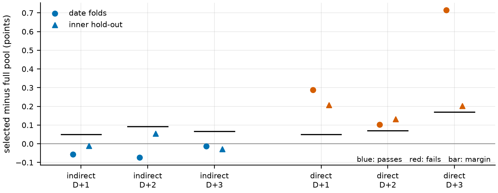

**Figure 5. Selected sets against the full candidate pool, inside train.** Indirect route: the selected set passes in 6 of 6 checks (difference -0.07 to +0.05 points). Direct route: it fails in 6 of 6 (the selected set is worse by 0.10 to 0.71 points), because its importance is concentrated in a few features and the stability floor kept too few. *(Figure book: `S07-01`.)*

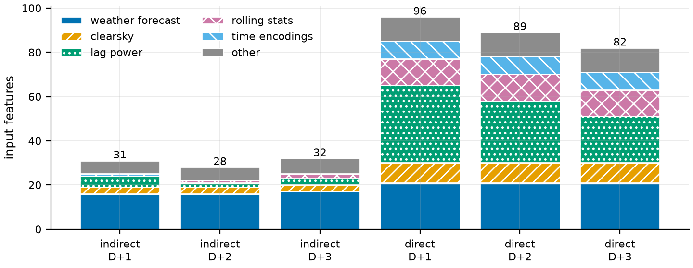

**Figure 6. Model inputs per route and horizon.** Indirect route: 31 / 28 / 32 inputs at D+1 / D+2 / D+3, of which 16 are weather-forecast variables at D+1. Direct route: 96 / 89 / 82 (the full pool, 21 forecast variables at D+1). *(Figure book: `S07-02`.)*

## 3.7 Anti-leakage protocol

A model may see only what is known at the issuance time T0, local midnight before the first forecast day. An
allow-list, not a block-list, decides what reaches a model, and the leakage tests run on every table and model input.
Figure 7 draws, for each horizon, the window of every input relative to T0: no measured input reads an hour that
ends after T0, and the forecast days are described only by deterministic inputs (calendar, clear sky, geometry) and the
GFS run. Before the final training the code was audited end to end, reproduced from the raw data, reviewed externally and
frozen with the tag `g1-frozen` (gate G-1); the test split was then scored once (section 3.5).

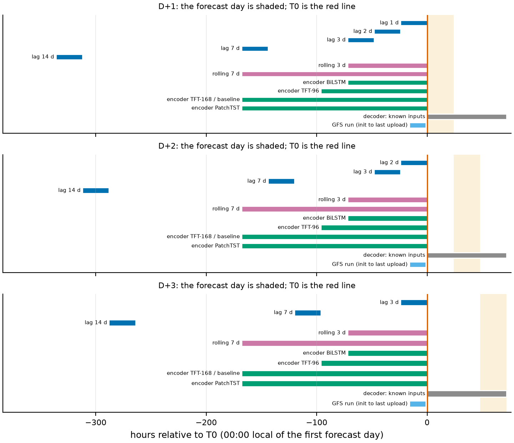

**Figure 7. When the information of each input is known.** No measured input reads an hour that ends after T0, at any horizon: the newest lag is 1, 2, 3 days at D+1, D+2 and D+3, and it ends exactly at T0, as do the rolling windows and the encoders. The GFS run starts 9–16 h before T0 and its last file arrives at least 1.1 h before T0 on every train row. Only deterministic inputs (calendar, clear sky, geometry) and that GFS run describe the forecast days. *(Figure book: `S09-35`.)*

## 3.8 Train / Validation / Test split

The split is chronological, without shuffling (Figure 8). Train is used to fit and select; validation to tune
and to decide; test is read once, in the final run, after the code was frozen (D-08).

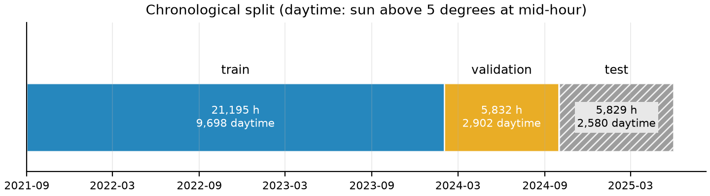

**Figure 8. Train, validation and test periods.** Chronological split without shuffling: train 21,195 hours (9,698 daytime), validation 5,832 (2,902 daytime), test 5,829 (2,580 daytime). Every selection and tuning step uses train and validation only. *(Figure book: `S01-02`.)*

## 3.9 Lag exclusion rules per horizon

A forecast issued at T0 for day D+h may use only measured days up to the day before the issuance. Figure 9
shows the lag days allowed for each horizon and the same-hour rolling windows, which always end on the last day before
the issuance, whatever the horizon (F-07).

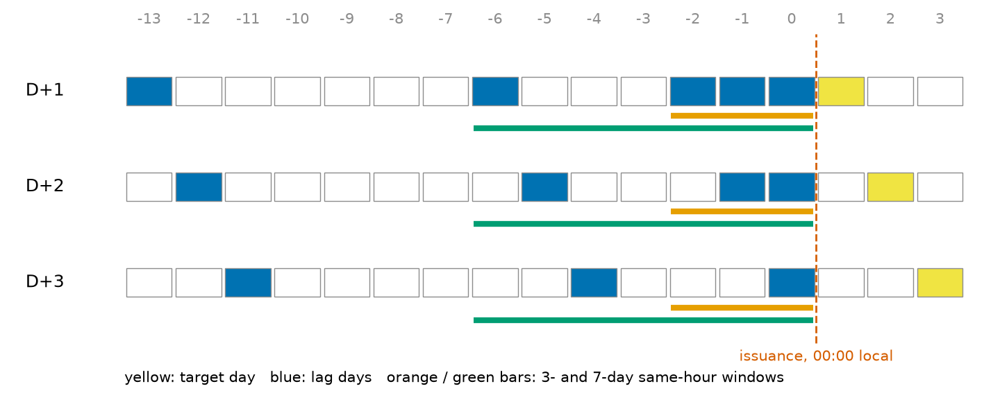

**Figure 9. Which past days each horizon may use.** Lags allowed, in days back from the target day: D+1: 1, 2, 3, 7, 14; D+2: 2, 3, 7, 14; D+3: 3, 7, 14. The same-hour windows always end on the last day before issuance (day 0), whatever the horizon. *(Figure book: `S06-04`.)*

## 4. Methodology

### 4.1 Hyperparameter optimisation

The tuned models are optimised with Optuna [Akiba et al., 2019] (TPE sampler). The objective of every study is the nRMSE in kW
over the daytime hours of validation (S-14). XGB-Opt and BiLSTM-Opt have
60 trials per study and
3 seeds; TFT-96 and TFT-168 have
20 trials per route and one seed; the TFT
baseline and PatchTST have fixed settings. The final run holds
28 studies. These are the
budgets of the submitted study; none was changed after the test split was read (D-37).

### 4.2 Statistical evaluation

Intervals are 95 percent percentile intervals from a
circular block bootstrap [Efron & Tibshirani, 1993] of the squared errors, with blocks of
24 consecutive daytime hours
and 1,000 replicates. Two models are compared with the
Diebold-Mariano test [Diebold & Mariano, 1995] on the squared errors in kW, with the small-sample correction of Harvey, Leybourne and
Newbold [Harvey et al., 1997], a Newey-West variance [Newey & West, 1987] with a bandwidth of
24 hours, and a
Bonferroni correction over the 6 cells (target x horizon) of a split and comparison. Each observed difference is set
beside the minimum detectable effect of the paired test at
80 percent power.

## 5. Model Architectures

Figure 10 compares the six models: their inputs, budgets and training time in the final run.

- **XGB-Opt** [Chen & Guestrin, 2016]: gradient-boosted trees on the selected tabular inputs, with a monotone constraint on the
  clear-sky input (D-15); one model per target and horizon; on the CPU.
- **BiLSTM-Opt** [Graves & Schmidhuber, 2005]: a bidirectional encoder-decoder over the hourly sequence with a quantile loss
  [Koenker & Bassett, 1978]; one forecast origin per local day (D-25).
- **TFT-96 and TFT-168** [Lim et al., 2021]: the Temporal Fusion Transformer with an encoder of 96 or 168 hours and the known
  future inputs of the decoder (D-26), tuned per route.
- **TFT baseline**: the same architecture with fixed settings.
- **PatchTST** [Nie et al., 2023]: a patch-based, univariate transformer that sees only the past of the target.

The five neural models took 7.6 hours of GPU time in
the final run.

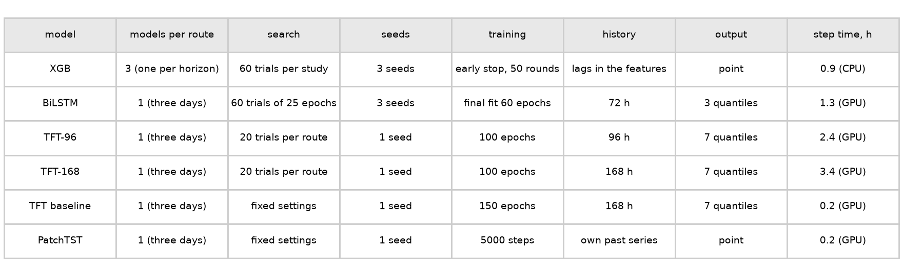

**Figure 10. The six models of the final run: inputs, budgets and time.** The final run used the budgets of the submitted study: 60 trials and 3 seeds for XGB and BiLSTM, 20 trials per route for the two tuned TFTs, fixed settings for the TFT baseline and PatchTST. The five neural models took 7.6 hours of GPU time in total and XGB 0.9 hours of CPU time. *(Figure book: `S11-16`.)*

## 6. Evaluation Framework

### 6.1 Primary metric

The primary metric is the nRMSE in kW, the root mean squared error of the forecast power in percent of the AC capacity,
over the daytime hours of the split with a measured output. An hour is a daytime hour when the sun is above the threshold
at the middle of the hour (Figure 11); every model and reference is scored on exactly these hours. The indirect route
is converted to kW before it is scored.

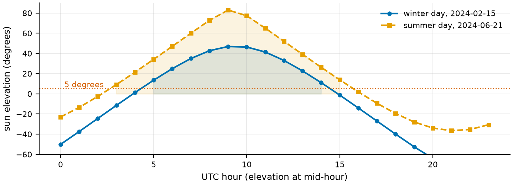

**Figure 11. Which hours are scored.** An hour is scored when the sun is above 5 degrees at its middle: 10 hours on 2024-02-15 and 13 on 2024-06-21. Validation has 2,901 scored hours with a measured truth; every model and reference is scored on exactly these hours. *(Figure book: `S08-01`.)*

### 6.2 Secondary metrics

The MAE, the R², the skill score against persistence and the nRMSE normalised by the mean daytime power (for comparison
with studies that normalise that way) are reported in the tables of the run. A second view of every metric leaves out the
operation-limited hours (the hours of normal operation).

### 6.3 Reference forecasts

Three references are scored on the same hours: persistence (the same hour of the last measured day, safe for daylight
saving time), climatology (the mean of the same calendar hour on train), and the clear-sky power times the mean daytime k.

### 6.4 Confidence intervals and significance

Intervals and paired tests follow section 4.2. Overlapping marginal intervals do not imply that a paired test is not
significant [Schenker & Gentleman, 2001], so the comparisons of models rest on the paired test.

### 6.5 Quantile outputs

The BiLSTM-Opt forecasts 3 quantiles of the power and the TFTs
7; the point forecast of each model is its
0.5 quantile, as in v6, and only the point
forecast is scored in this report (D-33). The quantile heads of the TFT are separate outputs of one layer, and nothing in
the training keeps them in order. On the scored hours, averaged over the horizons, the quantiles of the TFTs are out of
order on 0.7 to
83.5 percent of the hours on
validation and on 0.7 to
65.2 percent on test, depending on
the model and route, most often for TFT-96 on the direct route; the quantiles of the BiLSTM-Opt are never out of order.

Wherever the quantiles are read as a distribution, they are first sorted per hour: the monotone rearrangement
[Chernozhukov et al., 2010]. The quantile loss [Koenker & Bassett, 1978] of an hour never rises when its quantiles are sorted, because the
part of the loss that depends on their order is smallest when they rise with their levels; on this run sorting lowers
the mean quantile loss in kW by at most 4.6 percent (TFT-96,
direct route, validation). The point forecast is not sorted, so no score or test of this report changes. The cost is
that on some hours the point forecast is not the median of the sorted distribution: on up to
61.0
percent of the hours of a model and route on validation and
33.3 percent
on test, by 19.2
kW on average on validation and 20.7
kW on test, and by at most 102.2 kW
(2.96 percent
of the capacity). Training that keeps the quantiles in order is future work (section 14).

## 7. Main Results

### 7.1 Benchmark overview

Figure 12 shows the benchmark in kW with 95 percent intervals, for all six models and the three references, on
validation and on test. On test the error of the six models is
11.12 to 13.63 percent and on validation
6.44 to 8.90 percent. The width of a test
interval is 3.61 to 4.10
points, and the intervals of XGB-Opt, BiLSTM-Opt and the three TFT models overlap in every cell.

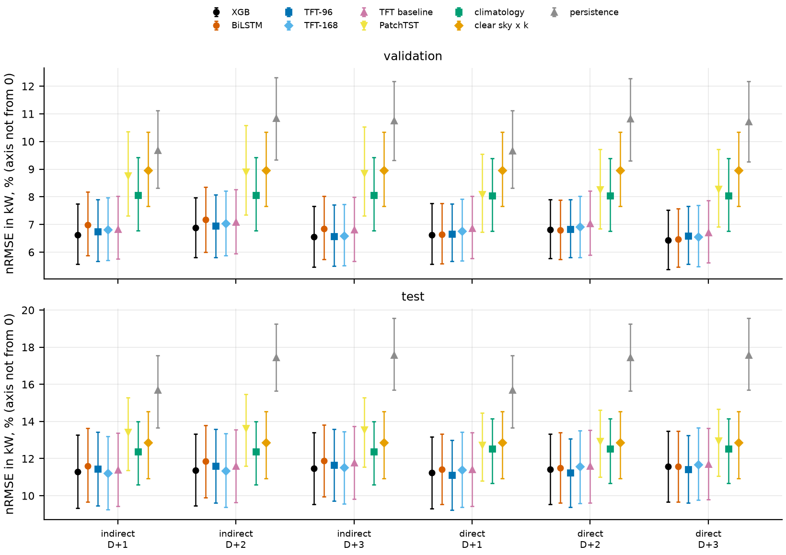

**Figure 12. The benchmark in kW with 95 % intervals.** On test the interval of a single score is about 1.93 pp on each side, and the six models differ by at most 2.30 pp in a cell; on validation the figures are 1.17 and 2.30 pp. The intervals of all six models overlap in 6 of 6 cells on test and in 6 of 6 on validation. These intervals are not paired, so overlap is not a test of a difference: the paired test of S10-04 separates PatchTST from XGB in every cell although the intervals overlap. *(Figure book: `S11-01`.)*

### 7.2 Indirect target results

At D+1 of the indirect route the seed-mean nRMSE on test is
11.28 for XGB-Opt,
11.61 for BiLSTM-Opt,
11.45 for TFT-96,
11.21 for TFT-168,
11.39 for the TFT baseline and
13.44 for PatchTST; on validation the same numbers are
6.63,
6.99,
6.74,
6.82,
6.83 and
8.77. The references are
12.37 (climatology) and
15.71 (persistence) on test, and
8.06 and
9.68 on validation.

### 7.3 Direct target results

At D+1 of the direct route the seed-mean nRMSE on test is
11.24 for XGB-Opt,
11.41 for BiLSTM-Opt,
11.12 for TFT-96,
11.41 for TFT-168,
11.43 for the TFT baseline and
12.74 for PatchTST (validation:
6.62,
6.63,
6.66,
6.76,
6.87 and
8.09). On test, XGB-Opt has the lowest seed-mean error of
the six models in 1 of 6 cells and on validation in
5 of 6; the order of the five leading models is not a
result (chapter 8). Figure 13 shows the forecast against the observed power on the test split.

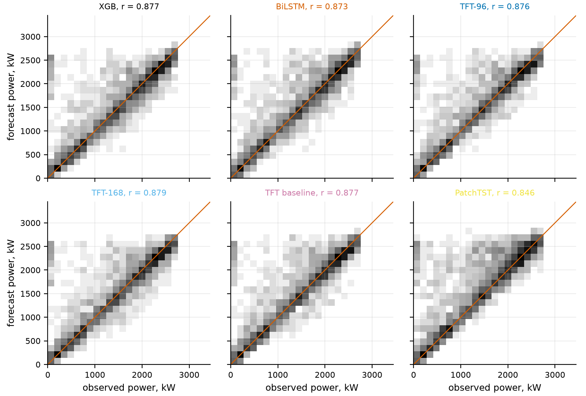

**Figure 13. Forecast against observed power on the test split.** The correlation between forecast and observation on test is between 0.846 and 0.879 for the six models. In every panel a group of hours lies above the diagonal at observed values near zero: forecasts of high power while the plant delivered little. Some of these hours are operation-limited (D-22; S11-12). *(Figure book: `S11-03`.)*

### 7.4 Common-mask evaluation

Every model and reference is scored on the same
2,575 daytime hours of
the test split; no model drops an hour, so the common-mask scores equal the primary scores (S-25).

### 7.5 Horizon robustness

Figure 14 shows the error against the horizon. The change from D+1 to D+3 is at most
0.38 points
for the six models and two routes. It is negative in
10
of 12 pairs on
validation and positive in
12
of 12
on test: the three horizons are close (the weather forecast covers all three days, and the history groups add little,
section 12.5), and their order is a property of the period (R6b-07, R7-05), not of a model.

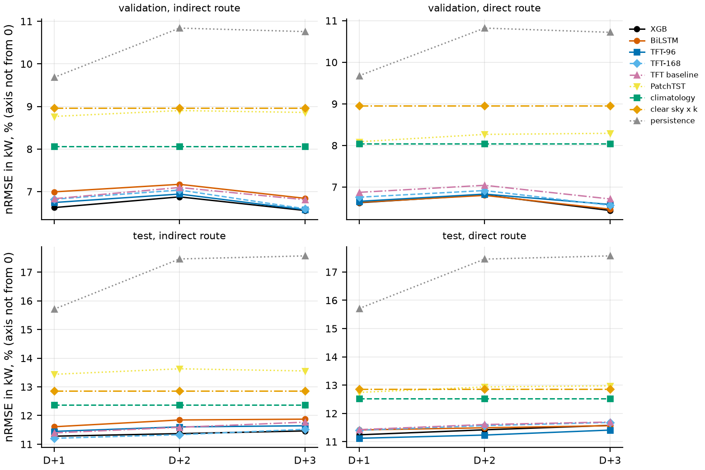

**Figure 14. Error against the horizon, validation and test.** On validation the error at D+3 is lower than at D+1 for 10 of the 12 pairs of a model and a route (change -0.22 to +0.20 pp); on test it is higher for 12 of 12 (change +0.12 to +0.38 pp). The sign of the horizon effect reverses between the two periods, and its size is at most 0.38 pp, so the order of the horizons is a property of the period and not of the horizon. *(Figure book: `S11-02`.)*

### 7.6 From validation to test

Every model and reference has a larger error on test than on validation, by about
4.8 points on
average over the six models and the three references. Figure 15 separates the rise: for XGB-Opt the mean nRMSE goes
from 6.65 to 11.39
on all daytime hours and from 4.93 to
6.55 in the hours of normal operation; for
climatology from 8.05 to
12.45 and from
6.76 to
8.95. The
186
operation-limited hours of the test split account for
66 percent of the rise of
XGB-Opt, and for 18 to 68
percent across the models and references; the rest is a change of the period that every model and reference shares. The comparisons of models are paired on the same hours.

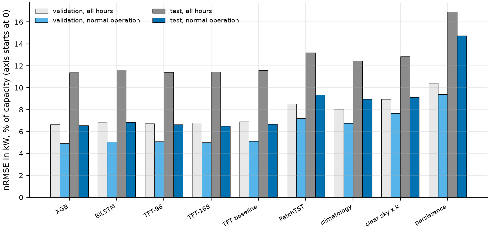

**Figure 15. From validation to test: where the extra error is.** Every model and reference rises from validation to test: XGB 6.65 to 11.39 on all hours, climatology 8.05 to 12.45. On the hours of normal operation the rise is smaller (XGB 4.93 to 6.55, climatology 6.76 to 8.95): the 186 operation-limited hours of the test split account for 18% to 68% of the rise, and the rest is a shift of the period that every model and reference shares. *(Figure book: `S10-03`.)*

## 8. Statistical Significance Analysis

### 8.1 Diebold-Mariano results

Figure 16 shows the paired tests in kW of every model and reference against XGB-Opt on test. XGB-Opt is significantly
better than clear sky x k and persistence in all 6 cells on test and validation, and than PatchTST in every cell. It is
significantly better than the BiLSTM in
3 of 6
cells on test, and than the three TFT models in
0,
0 and
0 of 6
cells (TFT-96, TFT-168 and the TFT baseline). The leading models are not separated, and no model is declared the
winner (D-37).

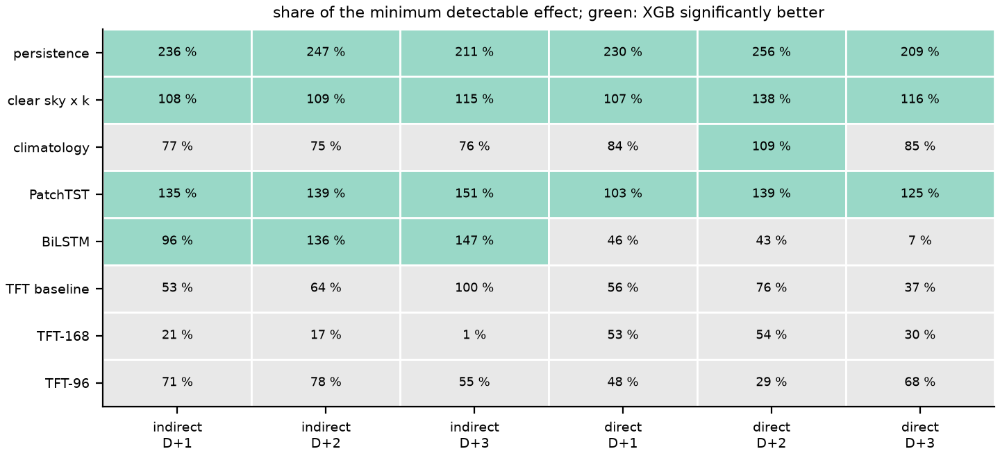

**Figure 16. Every model and reference against XGB: Diebold-Mariano in kW on test.** XGB is significantly better than persistence in 6 of 6 cells, than clear sky x k in 6, than PatchTST in 6 and than climatology in 1; the climatology effect is 75 to 109 per cent of the minimum detectable effect, so the test has too little power to separate them. BiLSTM is significantly worse than XGB in 3 cells; the three TFTs in 0. XGB is significantly worse than no model (0). *(Figure book: `S10-04`.)*

### 8.2 Statistical power analysis

Against climatology XGB-Opt is significant in
1
of 6 cells on test and in
6
of 6 on validation. On test the
observed difference is 75 to 109
percent of the minimum detectable effect: with one section of a plant,
2,575 test hours and
autocorrelated errors, the test cannot separate differences of this size. The report therefore states the margin over
climatology as the observed difference and its share of the minimum detectable effect, and not as a significant result.

## 9. Seasonal and Temporal Analysis

### 9.1 Seasonal performance

Figure 17 shows the error by season on validation and on test. The test period (October to May) has no summer, and a
season is not the same months in the two periods: the autumn of the test split is 2024-10..2024-11 and the
autumn of the validation split is 2024-09..2024-09. For XGB-Opt (indirect, D+1) the error in the autumn is
3.7 percent
on validation and 14.2
percent on test; for climatology it is
4.2
and 13.7
percent. In the autumn
10 percent of the test
hours are operation-limited against
2 percent of the
validation hours. In spring the two periods are close
(8.9 and
8.9 percent).

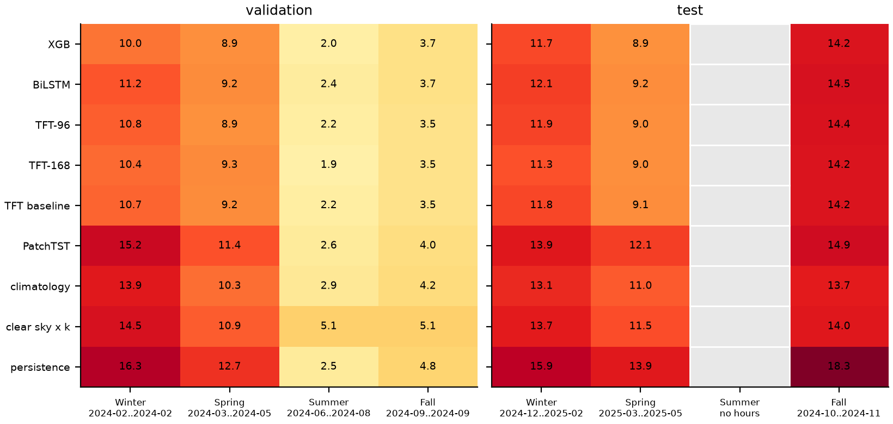

**Figure 17. Error by season, validation and test.** The test split has no summer, and its autumn is 2024-10..2024-11 against 2024-09..2024-09 on validation, so a season is not the same weather in the two periods. XGB's error is highest in Winter on validation (10.05 per cent) and in Fall on test (14.19 per cent). From validation to test the error of XGB changes by +1.6 (Winter), -0.1 (Spring) and +10.5 (Fall) points, and that of climatology by -0.8, +0.7 and +9.5: the rise of the test period is concentrated in the autumn, where 10% of the test hours are operation-limited against 2% of the validation hours; Spring is almost unchanged. *(Figure book: `S11-04`.)*

### 9.2 Hourly error by season

Figure 18 shows the error by local hour and season on the test split for all six models and the references, with
cells of fewer than twenty hours masked. Figure 19 shows the same in the hours of normal operation: the peak of the
autumn hours falls to the level of the other cells, so it is made mostly by the operation-limited hours.

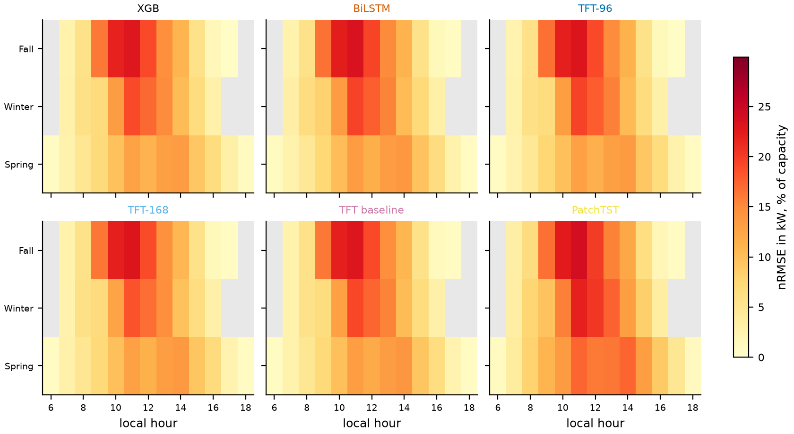

**Figure 18. Error by local hour and season on the test split.** The largest cell of each model is in the local hour(s) 11, and the largest cell of the figure is Fall at 11:00 (24.0 per cent of the capacity, PatchTST). Averaged over the seasons, the XGB error changes by 17.3 points between the hours of the day, and the six models differ by at most 3.1 points within an hour: the shape over the day is shared by the models. For XGB in the autumn at 11:00 the error is 22.9 per cent on all hours and 4.4 in normal operation; 18% of those hours are operation-limited (S11-17). *(Figure book: `S11-05`.)*

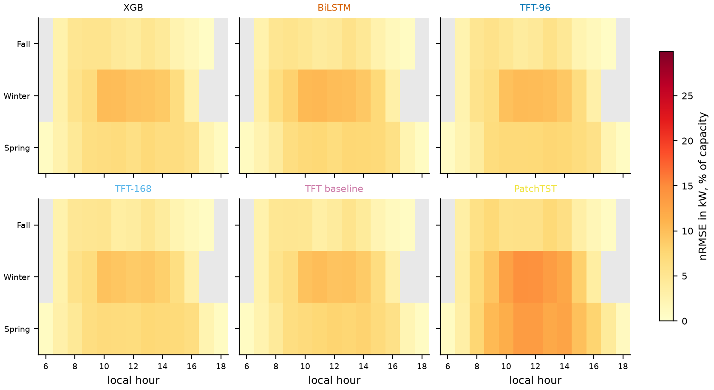

**Figure 19. The same, in the hours of normal operation.** In normal operation the largest cell of each model is in the local hour(s) 10, 11, and the largest cell is Winter at 11:00 (14.6 per cent, PatchTST). For XGB in the autumn at 11:00 the error falls from 22.9 per cent on all hours to 4.4 in normal operation: the autumn peak of S11-05 is mostly the operation-limited hours. *(Figure book: `S11-17`.)*

## 10. Forecast Route Analysis

Both routes are scored in kW against the measured AC power on the same hours (Figure 20). The direct route has the
lower error in 16
of 18 pairs of a model and a horizon on
validation and in 11 of
18 on test. The differences range
from -0.69 to
+0.24 points (direct minus
indirect), and the sign differs between the two periods for
7 of the
18 pairs. The two routes are equivalent within the
seed and period uncertainty, and the choice between them can follow operational convenience.

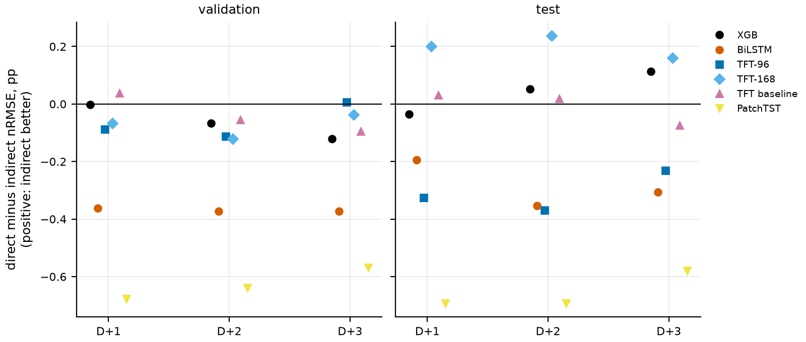

**Figure 20. Indirect route against direct route, validation and test.** The direct route is better in 16 of the 18 pairs of a model and a horizon on validation and in 11 of 18 on test. The differences are between -0.69 and +0.24 pp, and the sign differs between the two periods for 7 of the 18 pairs: the direct route is nominally better on validation, and the evidence on test is mixed. *(Figure book: `S11-06`.)*

## 11. Interpretability Analysis

### 11.1 XGBoost SHAP: feature-group importance

Figure 21 shows what the SHAP values [Lundberg & Lee, 2017] of XGB-Opt, computed exactly for the trees with
TreeSHAP [Lundberg et al., 2020], attribute the forecast to, on validation and on test. The
weather-forecast group holds
56 to 75
percent of the mean absolute SHAP value on validation and
64 to 74
percent on test, and it is the largest group in every cell on both splits. The rank correlation of the feature importances
between two horizons or two seeds is at least
0.85 on validation and
0.77 on test (mean over
seeds): the attribution is stable.

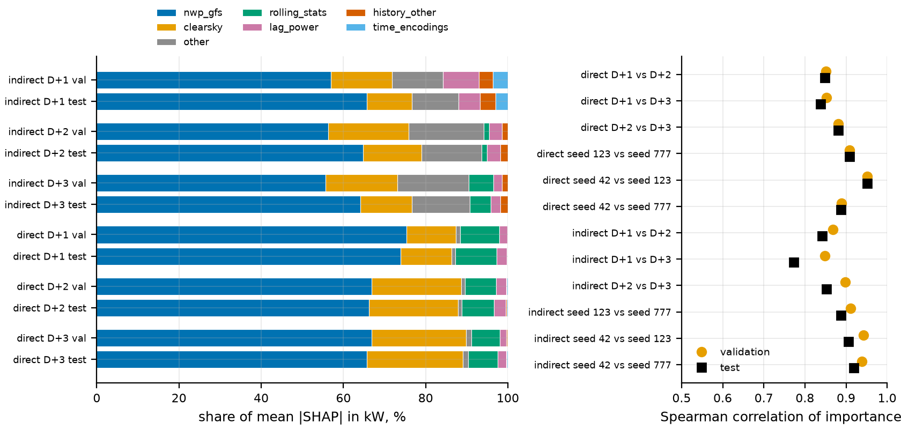

**Figure 21. XGB: what the SHAP values attribute the forecast to.** The group with the largest share is the same on validation and on test in 6 of the 6 cells (nwp_gfs). The share of the weather-forecast group (GFS) is between 56 and 75 per cent. The rank correlation between two horizons, or between two seeds, is at least 0.85 on validation and 0.77 on test. *(Figure book: `S11-07`.)*

### 11.2 TFT temporal attention

Figure 22 shows how the attention of the three TFT models is spread over the encoder window. Attention is a
description of the model and not evidence of use. In the six cases of target and model, the weight on the clock hour of
the forecast hour is 0.82 to 1.07
times a uniform attention, and the weight on the oldest encoder position is
0.49 to 1.37
times uniform: the attention follows the daily cycle.

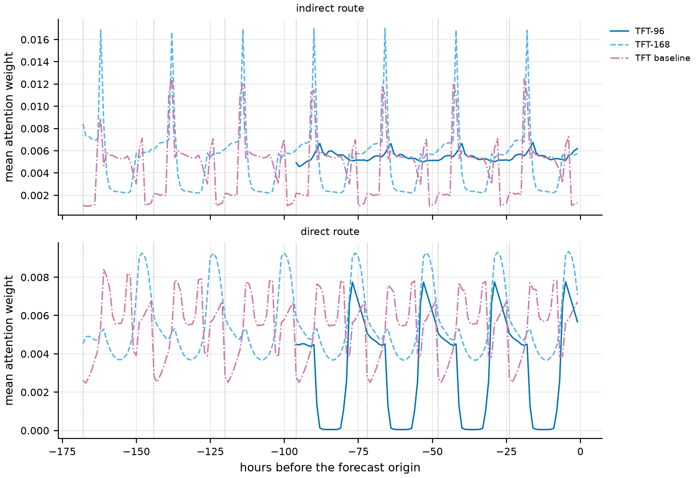

**Figure 22. TFT: how the attention is spread over the encoder window.** The mean attention over the encoder positions is almost entirely a daily cycle: the 24-hour pattern accounts for 76% to 100% of its variance in the six cases (76% for TFT-96 indirect), and the clock hour of the strongest attention differs between the cases (from 6 to 20). The attention on the clock hour of the forecast hour is 0.82 to 1.07 times what a uniform attention would give, and the weight on the oldest encoder position relative to uniform is between 0.49 and 1.37; only the TFT-168 indirect model is above one. The attention of a model is descriptive: it does not show that the model uses those hours. *(Figure book: `S11-08`.)*

### 11.3 TFT encoder length

Figure 23 compares the encoder of 168 hours with that of 96 hours in a paired test per cell. The TFT-168 minus TFT-96
difference lies between -0.02
and +0.10
pp on validation, with no significant cell, and between
-0.27 and
+0.33 pp on
test, with 1
of 12 cells significant. No consistent
difference between the two encoder lengths is found; each model was tuned separately with one seed.

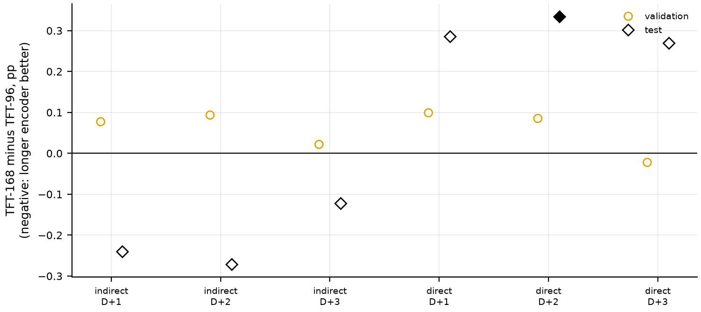

**Figure 23. TFT encoder of 168 hours against 96 hours.** On validation the difference is between -0.02 and +0.10 pp, and no cell is significant. On test it is between -0.27 and +0.33 pp, with the sign negative for the indirect route in 3 of 3 horizons and positive for the direct route in 3 of 3; the number of significant cells is 1 of 12. A consistent advantage of the shorter window is not found: the sign depends on the route. *(Figure book: `S11-09`.)*

### 11.4 PatchTST: the autoregressive structure

PatchTST sees only the past of the target (Figure 24). It is worse than XGB-Opt by
1.36 to 2.31 pp, significantly in
12 of
12 cells (validation and test, two routes,
three horizons), and worse than climatology by
0.05 to 1.26
pp, significantly in 8
of 12. The history of the series
carries the daily and seasonal cycle that climatology already holds; the information of the forecast day comes from the
weather forecast, which PatchTST does not see.

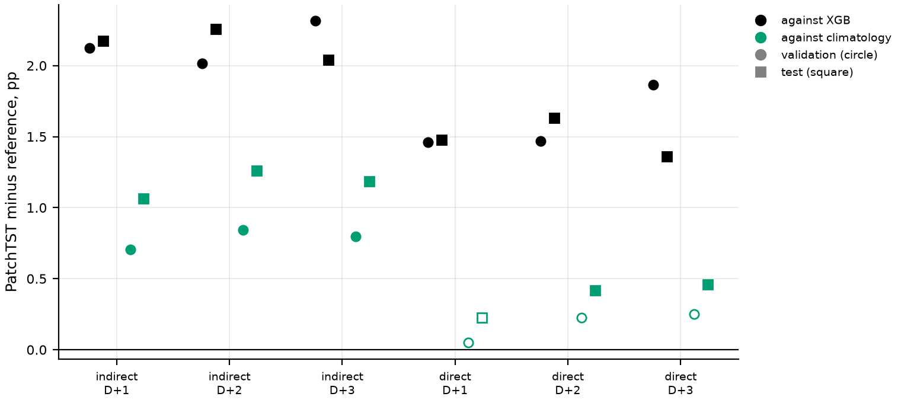

**Figure 24. PatchTST against XGB and against climatology.** PatchTST is worse than XGB by 1.36 to 2.31 pp, significantly in 12 of 12 cells. Against climatology the gap is +0.05 to +1.26 pp, significant in 8 of 12 cells, all of them in the worse direction. A gap of this size does not support the reading of PatchTST as a lower bound within about one point of XGB. *(Figure book: `S11-14`.)*

### 11.5 Optuna convergence and hyperparameter importance (TFT-96)

Figure 25 shows how the search of TFT-96 converged and which hyperparameters mattered. The selected hidden sizes are
32 (indirect) and
64 (direct) for TFT-96 and
32 and
32 for TFT-168.

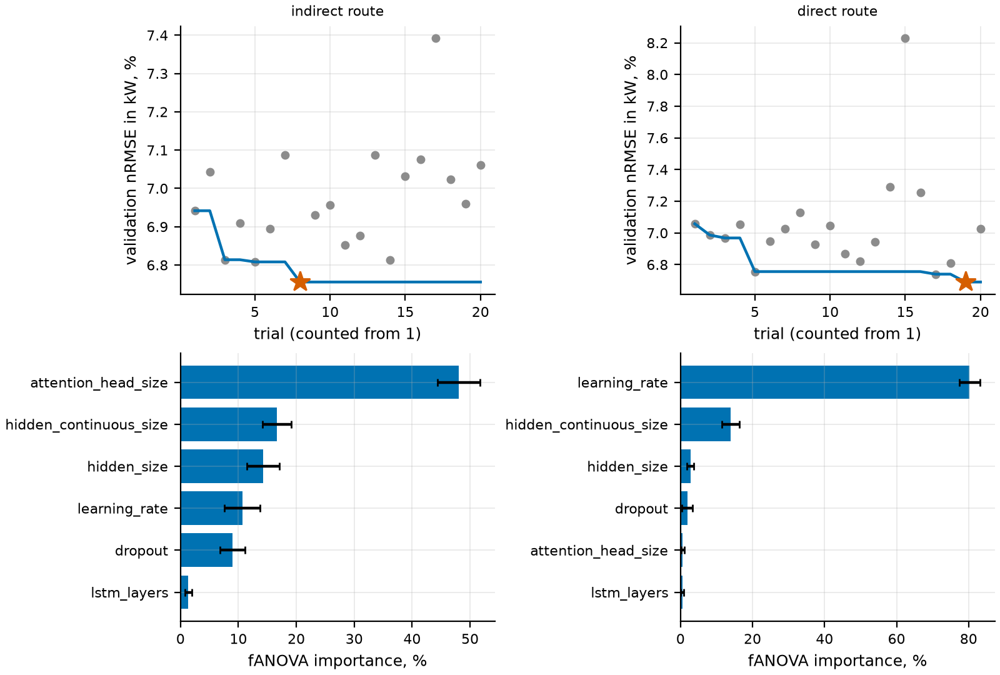

**Figure 25. TFT-96: how the search converged and what mattered.** The best trial is number 8 of 20 for the indirect route and number 19 for the direct route; a winner that late means that the direct search had not visibly converged. The most important hyper-parameter is attention_head_size for the indirect route (48 per cent) and learning_rate for the direct route (80 per cent). With 20 trials the importance model has few points; the values are descriptive. *(Figure book: `S11-10`.)*

## 12. Robustness and Stability Analysis

### 12.1 Seed variability

Each seed of XGB-Opt and BiLSTM-Opt is scored by the evaluation layer on the same hours (Figure 26). The largest
standard deviation over the three seeds is
0.079 points for XGB-Opt and
0.074 points for BiLSTM-Opt. The
TFT models and PatchTST have one seed each.

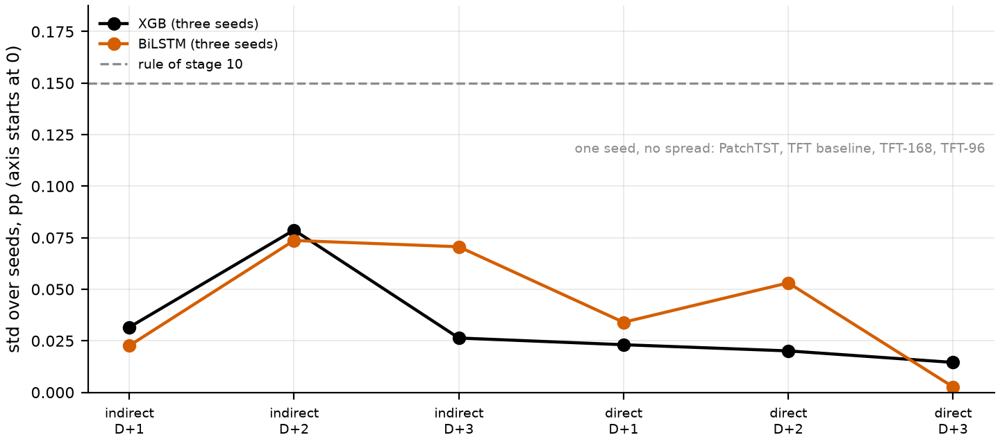

**Figure 26. Seed spread in kW against the rule of stage 10.** The largest spread is 0.079 pp for XGB and 0.074 pp for BiLSTM, against the rule of 0.15 pp; 0 of 12 cells are above it. PatchTST, TFT baseline, TFT-168, TFT-96 have one seed each, so their spread is unknown; the differences among models of a similar level (S10-02) are read with that caveat. *(Figure book: `S10-05`.)*

### 12.2 Cross-validation (five-fold expanding window)

Figure 27 compares the five-fold expanding-window cross-validation of XGB-Opt on train with validation and test. The
test error is above the cross-validation mean in every fit, by
3.5 to 4.0
points, and validation lies below it, by
0.6 to 1.7
points; the folds themselves differ by a mean standard deviation of
2.4 points. The difference between
the periods is shared by the references (section 7.6).

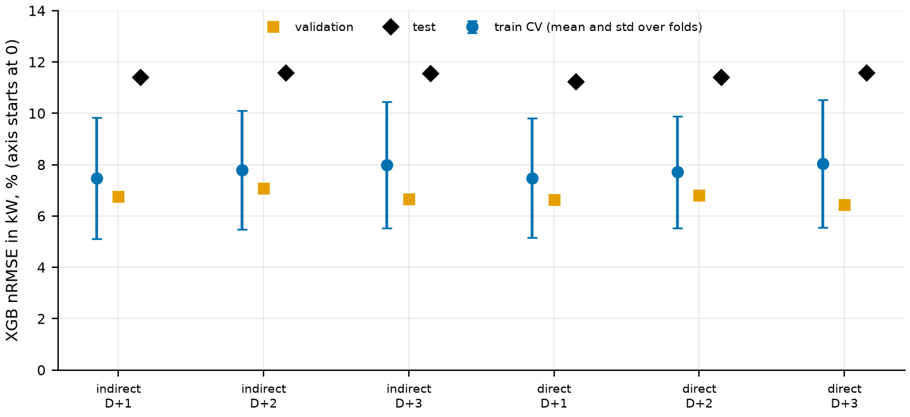

**Figure 27. XGB: the five-fold CV on train, validation and test.** The test error is 3.5 to 4.0 pp above the train CV in every one of the 18 fits, and validation lies 0.6 to 1.7 pp below it. The mean spread between folds is 2.4 pp, so the folds themselves differ by a large part of the gap; the references rise from validation to test as well (S10-03). *(Figure book: `S10-06`.)*

### 12.3 Error decomposition

Figure 28 splits the squared error into the squared mean error and the variance of the error (MSE = ME² + Var(e)).
Every model has a positive mean error on all daytime hours of the test split:
+52 to +125 kW across
the six models. On the hours of normal operation it is
-11 to +12
kW for XGB-Opt, BiLSTM-Opt and the three TFT models, and
+64 kW
for PatchTST (F-30): the positive bias is made in the
186
operation-limited hours (curtailment, stops, derate; D-22), which neither the weather nor the history describes. Bias
squared is at most
1.6
percent of the squared error on validation and
3.6
percent on test (mean over the cells) for the five models other than PatchTST, and the variance between the three seeds is at most
1.8
percent of the squared error: the error is almost entirely variance.

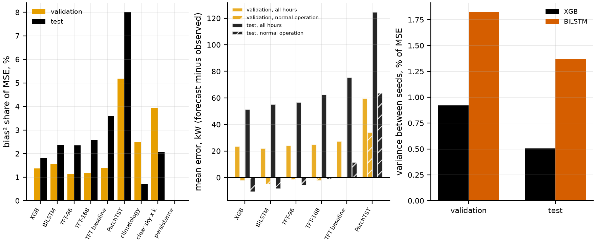

**Figure 28. Bias² and variance of the error, and the bias in normal operation.** Bias² is below 1.6% of the squared error for the six models on validation and below 3.6% on test, except PatchTST (8.0% on test). Every model has a positive mean error on all hours, +52 to +125 kW on test; on the hours of normal operation it is -11 to +12 kW for XGB, BiLSTM and the three TFTs, so nearly all of their positive mean error is made on the 186 operation-limited hours; PatchTST keeps +64 kW in normal operation. The variance between seeds is at most 1.8% of the squared error. *(Figure book: `S11-11`.)*

### 12.4 Production bins (XGB-Opt, direct, D+1)

Figure 29 shows the mean error of XGB-Opt by production quintile, binned in two ways, with edges fixed on validation.
Binned by the observed power, the mean error is
+263
kW in the lowest bin and
-98
kW in the highest; binned by the forecast, which is known at issuance, it is
+4
and +162
kW. A control forecast made unbiased on validation gives
+263
and -170
kW in the observed bins. Binning by the outcome puts positive errors in the low bins and negative errors in the high bins
for any forecast that regresses to the mean, so the profile of the observed bins is made by the binning and is not stated
as a property of the plant or of the model (M45).

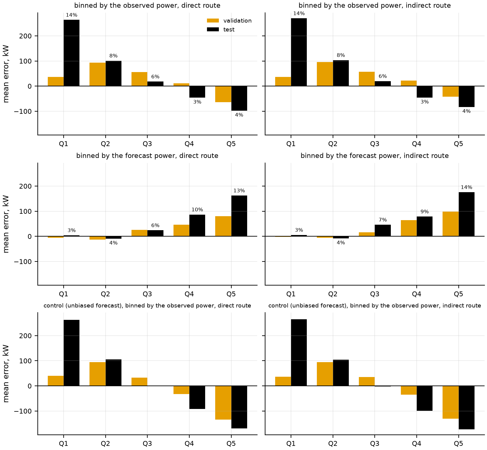

**Figure 29. XGB: the mean error by production quintile, two ways.** Binned by the observed power the lowest bin has a mean error of +263 kW and the highest -98 kW on test (direct route): a positive then negative pattern. Binned by the forecast it is +4 and +162 kW: the signs are the opposite at both ends. The control forecast, unbiased by construction on validation, gives +263 and -170 kW in the same observed bins on test, so binning by the outcome produces the first pattern without any conditional bias in the model. In the lowest observed bin 14% of the test hours are operation-limited against 2% on validation. *(Figure book: `S11-12`.)*

### 12.5 Feature-group ablation

Figure 30 shows the ablation of XGB-Opt: each feature group is removed and the model refitted with three seeds.
Removing the weather-forecast (GFS) group raises the error by
0.96 to 1.44
pp on validation and by
0.95 to 1.21
pp on test. The largest change of any other group on validation is
0.14
pp, close to the seed margin (M41).

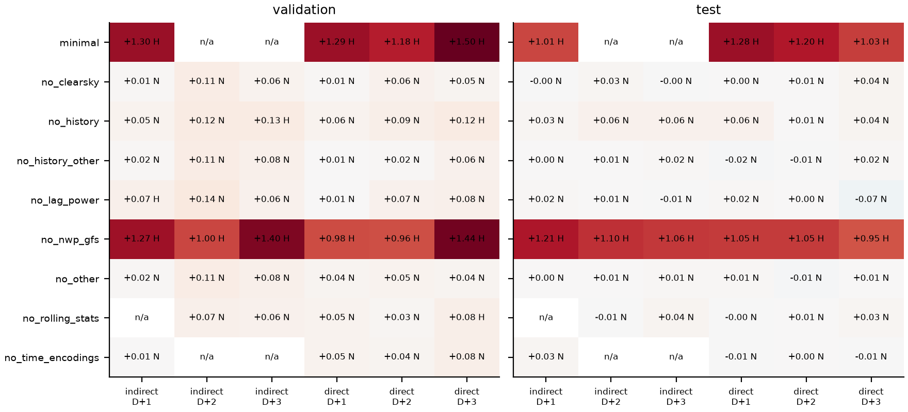

**Figure 30. XGB: feature-group ablation, validation and test.** Removing all but the minimal set raises the error by 1.18 to 1.50 pp on validation, and the GFS group by 0.96 to 1.44 pp; the other groups change it by at most 0.14 pp. The verdicts agree between validation and test in 45 of 49 cells. *(Figure book: `S11-13`.)*

## 13. Discussion (S-42)

### 13.1 The value of feature engineering

The ablation (section 12.5), the SHAP attributions (section 11.1) and PatchTST (section 11.4) agree: the value of the
engineered inputs sits mainly in the issued weather forecast. Without it XGB-Opt loses about a point; PatchTST, which sees
only the history, does not reach climatology. The history groups add little once the forecast is present. The comparison
with PatchTST is not a bound on the value of feature engineering: the models differ in design as well as in inputs, and
PatchTST has one seed.

### 13.2 The route decision

The two routes are equivalent within the uncertainty (chapter 10). The indirect route has a target whose daily and
seasonal shape is removed, and the direct route lets the model learn that shape from the clear-sky input; with the issued
weather forecast as the main input both reach the same error. The choice can follow operational convenience.

### 13.3 Architecture insights

XGB-Opt, BiLSTM-Opt and the three TFT models are close (chapters 7 and 8), and the order among them changes between the
periods. A tree model on the selected tabular inputs reaches the level of the sequence models at a fraction of their
training time (section 5). The encoder length of the TFT does not matter at this site (section 11.3), and the attention
follows the daily cycle (section 11.2).

### 13.4 Statistical power

The differences between the leading models are below the minimum detectable effect of one section and one test period,
and so is the margin of XGB-Opt over climatology on test (section 8.2). Results of this kind should be reported with
intervals and with the effect as a share of the minimum detectable effect; pooling sites would give the paired tests the
power that one section does not have.

### 13.5 Seasonal generalisability

The test period has no summer, so the results describe autumn, winter and spring. The rise of the error in the autumn of
the test period is a property of the period and of its operation-limited hours, and the references rise by a similar
amount (section 9.1).

### 13.6 Modelling coordinates

All clear-sky and solar-position calculations use the coordinates of the solar field itself (D-05). They are kept in a
private configuration and are not published in this document (T-45); the daytime mask is the same under either location
(F-02).

## 14. Conclusions (S-43)

This study compares six models at three horizons and two routes on one section of a plant, from an end-to-end pipeline
with issuance-time inputs, selection on train only, identical scored hours, a frozen code base and one look at the test
period.

C1. Ranking. No model is declared the best (D-37). XGB-Opt, BiLSTM-Opt and the three TFT models lie within the
intervals of each other; PatchTST is clearly behind (sections 7.1 to 7.3, chapter 8).

C2. Route. The indirect and the direct route are equivalent within the seed and period uncertainty (chapter 10).

C3. Horizon. The three horizons are close, and their order is a property of the period, not of a model (section 7.5).

C4. Autoregression. A model that sees only the history of the target does not reach climatology; the information of the
forecast day comes from the weather forecast (section 11.4).

C5. Encoder length. No consistent difference is found between the 96-hour and the 168-hour encoders of the TFT
(section 11.3).

C6. Interpretability. The weather-forecast group dominates the XGB attributions, stably across horizons and seeds; the TFT
attention follows the daily cycle and is read as a description (sections 11.1 and 11.2).

C7. Statistical power. Differences between the leading models, and the margin of XGB-Opt over climatology on test, are
close to or below the minimum detectable effect (section 8.2).

C8. Production regimes. The mean error by production bin depends on how the hours are binned; binned by the outcome it
shows a profile that a control forecast shares, so the profile is made by the binning and is not stated as a property of
the plant or of the model (section 12.4). The positive mean error of the models is made in the operation-limited hours
(section 12.3).

### Practical recommendations

- Report both views of the error, all daytime hours and hours of normal operation, because the operation-limited
  hours carry most of the rise from validation to test.
- Compare models with a paired test in kW and report the effect as a share of the minimum detectable effect.
- Use the weather forecast issued before the forecast time: it is the group that matters most in the ablation
  and in the attributions.
- Either route can be used; the choice can follow operational convenience.

### Future work

- A forecast product of higher resolution than the one used (GFS), and quarter-hour data.
- Probabilistic forecasts: the quantile outputs of the neural models are stored (D-33); their coverage is not
  analysed here.
- Several sites, to give the paired tests the power that one section does not have.
- Dust events: the project holds no aerosol record; an aerosol product would allow an analysis of dust days (Q-29).
- Training that prevents crossing quantiles of the TFT (D-33), and a longer search for the TFT models (D-37).

## 15. Academic Disclosures (S-44)

D1. Operation-limited hours. The hours of curtailment, stops and derate are flagged and not erased (D-22):
186 of the
2,580 daytime hours of the
test split and 146 of
2,902 of the validation split.
They are in the primary score and a second score leaves them out. The models do not predict them, and they account for
most of the positive mean error (section 12.3).

D2. Search spaces. 22 of the
28 studies of the final run have a best
value on the edge of the search space; the search spaces are those of the submitted study and were not widened after the
test split was read (D-37).

D3. Internal and evaluation metrics. The tuning objective of every study is the nRMSE in kW over the daytime hours of
validation (S-14); the BiLSTM stops early on its quantile loss. The final fit of the BiLSTM is worse than its best trial
by 0.16 to 0.25 points,
and the best step of PatchTST is
4,100 to
4,900 of a budget of
5,000 steps.
13 of
1,080 XGB trials stopped at their cap. None of the
budgets, seeds or rules was changed after the test split was read (D-37).

D4. Direction of the paired test. A positive difference in the tables of `dm_tests_kw.csv` means that the model in
the first column has the larger squared error than XGB-Opt. The tests use the HLN correction and Bonferroni over the
6 cells of a split and comparison, with a Newey-West bandwidth of
24 hours.

D5. Seeds. XGB-Opt and BiLSTM-Opt have three seeds, each scored by the evaluation layer on the same hours; the TFT
models and PatchTST have one seed each, so no seed interval exists for them (section 12.1).

D6. One section of one plant. The data are two inverters of a park (A-07), the rating is not verified (A-08), the
test period has no summer, and 1,071
of its 2,580 daytime hours
come from a second data source whose hourly means rest on four snapshots (F-18). The validation numbers are tuning-split
numbers (D-10).

## 16. Data and Code Availability

The raw SCADA data are commercially sensitive and are not released; the site coordinates are kept in a private
configuration (T-45). The code, the configurations, the split definitions and the frozen final run are in the repository
at the tag `g1-frozen`. Two scripts rebuild the results: `scripts/reproduce_paper_results.py` runs the pipeline from the
raw data, and `scripts/make_tables_from_frozen.py` rebuilds
the tables, the figures and this report from the frozen forecasts without training and without scoring the test split
again (Figure 31). At gate G-1 the reproduction from the raw data gave the same forecasts as the reference runs for
every model, and every file that differed had a documented reason (X99).

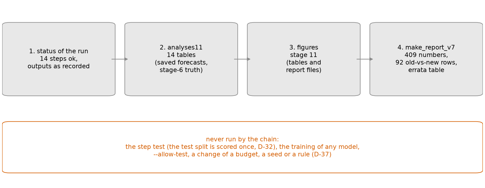

**Figure 31. The rebuild from the frozen predictions.** The chain starts from the 14 steps of the final run that are `ok` and writes 14 tables of analyses, the figures of stage 11, 409 registered numbers and 92 rows of old against new results. It never runs the step `test` (the test split was scored once, 1 time in the access log), never trains a model and never changes a budget, a seed or a rule (D-37). *(Figure book: `S11-19`.)*

## 17. References

- Akiba, T., Sano, S., Yanase, T., Ohta, T., & Koyama, M. (2019). Optuna: A next-generation hyperparameter optimization framework. KDD 2019.
- Antonanzas, J., Osorio, N., Escobar, R., Urraca, R., Martinez-de-Pison, F. J., & Antonanzas-Torres, F. (2016). Review of photovoltaic power forecasting. Solar Energy, 136, 78–111.
- Chen, T., & Guestrin, C. (2016). XGBoost: A scalable tree boosting system. KDD 2016.
- Chernozhukov, V., Fernández-Val, I., & Galichon, A. (2010). Quantile and probability curves without crossing. Econometrica, 78(3), 1093–1125.
- Diebold, F. X., & Mariano, R. S. (1995). Comparing predictive accuracy. Journal of Business & Economic Statistics, 13(3), 253–263.
- Efron, B., & Tibshirani, R. J. (1993). An Introduction to the Bootstrap. Chapman & Hall.
- Graves, A., & Schmidhuber, J. (2005). Framewise phoneme classification with bidirectional LSTM and other neural network architectures. Neural Networks, 18(5–6), 602–610.
- Harvey, D., Leybourne, S., & Newbold, P. (1997). Testing the equality of prediction mean squared errors. International Journal of Forecasting, 13(2), 281–291.
- Hochreiter, S., & Schmidhuber, J. (1997). Long short-term memory. Neural Computation, 9(8), 1735–1780.
- Koenker, R., & Bassett, G. (1978). Regression quantiles. Econometrica, 46(1), 33–50.
- Li, J., Ward, J. K., Tong, J., Collins, L., & Platt, G. (2016). Machine learning for solar irradiance forecasting of photovoltaic system. Renewable Energy, 90, 542–553.
- Lim, B., Arık, S. Ö., Loeff, N., & Pfister, T. (2021). Temporal fusion transformers for interpretable multi-horizon time series forecasting. International Journal of Forecasting, 37(4), 1748–1764.
- Lundberg, S. M., & Lee, S.-I. (2017). A unified approach to interpreting model predictions. Advances in Neural Information Processing Systems 30 (NIPS 2017), 4765–4774.
- Lundberg, S. M., Erion, G., Chen, H., DeGrave, A., Prutkin, J. M., Nair, B., Katz, R., Himmelfarb, J., Bansal, N., & Lee, S.-I. (2020). From local explanations to global understanding with explainable AI for trees. Nature Machine Intelligence, 2(1), 56–67.
- Mellit, A., & Pavan, A. M. (2010). A 24-h forecast of solar irradiance using artificial neural network. Renewable Energy, 35(11), 2603–2616.
- Nespoli, A., Niccolai, A., Ogliari, E., Perego, G., Collino, E., & Ronzio, D. (2022). Machine learning techniques for solar irradiance and power forecasting. Energies, 15(21), 8129.
- Newey, W. K., & West, K. D. (1987). A simple, positive semi-definite, heteroskedasticity and autocorrelation consistent covariance matrix. Econometrica, 55(3), 703–708.
- Nie, Y., Nguyen, N. H., Sinthong, P., & Kalagnanam, J. (2023). A time series is worth 64 words: Long-term forecasting with transformers. ICLR 2023.
- NOAA National Centers for Environmental Prediction (NCEP). NOAA Global Forecast System (GFS), 1.0° global forecast grids. NOAA Open Data Dissemination, Registry of Open Data on AWS, bucket noaa-gfs-bdp-pds. https://registry.opendata.aws/noaa-gfs-bdp-pds/
- Schenker, N., & Gentleman, J. F. (2001). On judging the significance of differences by examining the overlap between confidence intervals. The American Statistician, 55(3), 182–186.
- Sweeney, C., Bessa, R. J., Browell, J., & Pinson, P. (2020). The future of forecasting for renewable energy. Wiley Interdisciplinary Reviews: Energy and Environment, 9(2), e365.
- Wang, H., Yi, H., Peng, J., Wang, G., Liu, Y., Jiang, H., & Liu, W. (2019). Deterministic and probabilistic forecasting of photovoltaic power based on deep convolutional neural network. Energy Conversion and Management, 195, 1150–1163.

## Appendices

- **A. Errata** (`docs/errata.md`): every correction of the submitted project, its regression test and the table
  "Old vs new results".
- **B. Traceability** (`docs/traceability.csv`): every number of this report with its source file and script.
- **C. Data processing record** (`docs/data_processing_record.md`): every operation on the data, why, how, with what
  parameters and result.
- **D. Figure book** (`outputs/figures/gallery.html`, `docs/figure_sheets/`): every figure of the project, and the map of
  the figures of this report to those of the submitted report (`docs/report_v7_figures.csv`).
